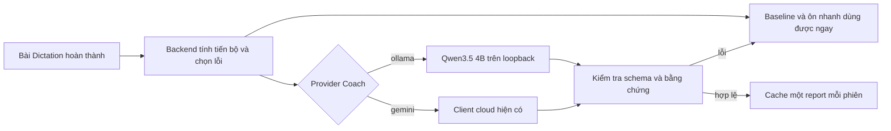

# Coach local: triển khai và kiểm chứng

Ngày triển khai: 18/10/2026. Bản này dùng Qwen3.5 4B trên máy HP, không triển khai Ollama lên VPS.

## Hành vi sản phẩm

Sau khi hoàn thành Dictation, màn hình hiển thị độ đúng lần nhập đầu một lần, nhận xét tiến bộ ngay bên dưới, tối đa một câu chú ý và hai lựa chọn: học bài tiếp hoặc ôn nhanh. Ôn nhanh chọn tối đa ba câu khác nhau có audio; số trên nút là số câu thực tế. Không bắt buộc ôn để học tiếp. Đáp án mục tiêu được che trước khi trả lời.

“Xem chi tiết” giữ kết quả sau khi sửa, trợ giúp, các lỗi đã ghi nhận, audio, xuất báo cáo và Error Bank. Kho lỗi và ôn cách quãng hiện có tiếp tục sử dụng. Danh sách ôn nhanh được chốt từ báo cáo đầu tiên; AI trả muộn không thay câu đang luyện hoặc đổi điểm gốc. Một câu ôn được đi tiếp khi nhập đúng hoặc chọn xem đáp án; “hoàn tất lượt ôn” được ghi khi đi hết các câu đã chọn. Đây là hành vi ôn lại, không phải bằng chứng năng lực ở ngữ cảnh mới.

Tiến bộ dùng tối đa năm bài mới, độc lập, cùng CEFR, hoàn thành trước bài đang xem; cần ít nhất hai bài. Chênh lệch được làm tròn một chữ số, ngưỡng tăng/giảm là ±3 điểm phần trăm. Dữ liệu trả về có số hiện tại, trung bình, chênh lệch, số bài so sánh, cấp độ và lý do không so sánh. Bài học chung và luyện lại được phân biệt. Report cũ vẫn đọc được, giữ nguyên câu tiến bộ đã lưu; không tái sinh lịch sử khi đổi model.

## Chạy trên HP

Cài Ollama và tải `qwen3.5:4b`. Đặt các biến sau trong `.env` (file được Git bỏ qua):

```dotenv
DICTALAB_COACH_ENABLED=true
DICTALAB_COACH_PROVIDER=ollama
DICTALAB_COACH_LOCAL_BASE_URL=http://127.0.0.1:11434
DICTALAB_COACH_LOCAL_MODEL=qwen3.5:4b
DICTALAB_COACH_LOCAL_TIMEOUT_SECONDS=60
```

```powershell
ollama list
pwsh -File scripts/run-local.ps1 -WithCoach
```

Script kiểm tra model đã được tải. Ollama cần đang chạy. Nếu thêm `-WithMessaging`, Coach dùng hàng đợi hiện có; trường hợp còn lại gọi trực tiếp sau khi giao diện đã nhận baseline. Frontend chờ tối đa 105 giây cho POST, polling chỉ đọc tối đa 180 giây. HTTP local mặc định 60 giây, cho phép 1–90 giây; lease worker hiện có là 180 giây. Model lỗi, sai JSON, quá hạn hoặc quá tải đều giữ baseline, không tự gửi bằng chứng sang cloud.

Provider mặc định trong mã và `.env.example` vẫn là `gemini`. Chỉ `.env` của máy HP được bật Ollama. `GEMINI_URL` và `GEMINI_MODEL` của Listening/Conversation không đổi. Quay lại cloud bằng `DICTALAB_COACH_PROVIDER=gemini`, cung cấp khóa theo cấu hình hiện có rồi khởi động lại app. Report đã cache không đổi theo provider.

## Hợp đồng và vận hành



Local chỉ nhận CEFR và tối đa 12 ứng viên ưu tiên, không nhận email, cookie, tên người học hoặc toàn bộ lịch sử. Đầu ra `{focus, reviewIds}` độc lập với Report của frontend. ID phải có thật, đúng nhóm và không trùng. Nhận xét một câu tiếng Việt, tối đa 120 ký tự; không cắt câu cho vừa UI. `focus=null` hợp lệ. Sai hợp đồng thì giữ baseline.

Với âm cuối, âm yếu, từ chưa biết, chính tả, tên riêng và nhận diện từ chưa rõ nguyên nhân, backend dùng diễn giải cố định bám dữ liệu. Điều này tránh coi lần nhập sai là bằng chứng model đã nghe hoặc phân tích âm thanh. Các câu khác vẫn cần xem xét nội dung: validation không chứng minh mọi nhận xét đúng ngữ nghĩa.

Report mới có metadata `generation`: provider, model, prompt version và schema/validator version. Các thông tin này phục vụ truy vết, không hiển thị trên màn hình mặc định. Prompt nằm trong `CoachLocalClient`; validator nằm trong `CoachAnalysis.interpretLocal`.

Client dùng Java HttpClient và JSON sẵn có, chỉ cho base URL loopback, không theo redirect. Một request local đồng thời, context 8.192 token, output tối đa 240 token, không thinking. Request tối đa 32 KB, response tối đa 16 KB; deadline bao gồm toàn bộ body, hủy future và giải phóng slot khi lỗi. ProviderGuard tái sử dụng metrics/circuit breaker hiện có với tên `coach-local`. Không ghi transcript/đáp án/response thô vào log ứng dụng.

Local dùng các scope `LOCAL_GLOBAL`, `LOCAL_USER:<id>` trong bảng ngân sách hiện có: đếm lượt nhưng dự trữ 0 micro-USD. Vẫn áp dụng giới hạn lượt, quyền Premium và công tắc dừng AI; không tiêu ngân sách cloud. Đây là giới hạn tài nguyên, không phải khẳng định inference miễn phí.

## Kiểm thử và đánh giá

```powershell
mvn '-Dtest=CoachAnalysisTest,CoachServiceIntegrationTest,CoachLocalClientTest,CoachLocalServiceIntegrationTest,CoachLocalQueueIntegrationTest,AiUsageBudgetIntegrationTest,AiBackgroundJobsIntegrationTest,GeminiClientTest' test
node --test src/test/js/*.cjs
pwsh -File scripts/test-postgres.ps1 -MavenArgs @('-Dtest=CoachAnalysisTest,CoachServiceIntegrationTest,CoachLocalServiceIntegrationTest,CoachLocalQueueIntegrationTest,AiUsageBudgetIntegrationTest,AiBackgroundJobsIntegrationTest','test')
```

Test client dùng HTTP server giả cho response lỗi/quá lớn, model thiếu, body đứng, concurrency và phục hồi slot. Test service kiểm tra quyền, cache JSON cũ, không gọi khi không có lỗi, không chuyển cloud khi local lỗi và không đổi điểm. JavaScript kiểm tra năm trạng thái tiến bộ, dữ liệu cũ, XSS, không lộ đáp án trước khi ôn, stale responses và giữ nguyên bài ôn khi AI trả muộn.

Đánh giá Qwen thật là bước opt-in, không chạy trong unit test/CI thông thường:

```powershell
mvn '-Dtest=CoachLocalEvaluationTest' '-Dcoach.evaluate=true' test
```

24 tình huống tổng hợp cố định nằm trong `CoachLocalEvaluationTest`, trong đó bốn case được gắn nhãn holdout. Bao gồm lỗi trống, từ quen, từ chưa biết, dạng từ, số, tên riêng, chính tả và injection trong đáp án/transcript. File `target/coach-local-evaluation.json` chứa đầu vào tổng hợp, đầu ra thô, baseline, nội dung thực sự được chọn để hiển thị và thời gian từng case. Không dùng dữ liệu học thật. Thời gian mẫu đầu là “first request”, không mặc nhiên là cold start; chỉ coi là cold nếu xác nhận model chưa nạp trước khi chạy.

Vòng prompt V1 có 24/24 JSON hợp lệ nhưng 24/24 focus rỗng: đạt cấu trúc mà không có ích. V2 tạo nhận xét; kiểm tra thủ công phát hiện cách nói vượt bằng chứng ở một số nhóm, nên validator V2 giữ diễn giải cố định cho các nhóm đó. Lỗi có ID giả trong case không có lỗi bị loại; ứng dụng cũng không gọi model cho phiên không có ứng viên. Báo cáo đánh giá và số đo cuối được ghi trong phần bàn giao của nhiệm vụ. Các case holdout đã được chạy trong quá trình kiểm chứng, cần một tập mới cho đánh giá độc lập tiếp theo.

Không dùng tỷ lệ JSON hợp lệ thay thế đánh giá chất lượng sư phạm; không coi tập nhỏ này là benchmark production hoặc cam kết tăng retention.

### Bằng chứng lần chạy cuối

Môi trường quan sát lúc bàn giao: HP EliteBook 865 G9, Ryzen 7 PRO 6850HS, 31,3 GiB RAM, chạy CPU; Ollama báo phiên bản 0.40.6. Model `qwen3.5:4b`, ID rút gọn `d8b0f5e9760c`, prompt `COACH_FOCUS_V2`, schema/validator `FOCUS_V2`.

- 22/24 đầu ra qua kiểm chứng đầy đủ; 2/24 dùng baseline. Một case injection đổi tên nhóm, một case không lỗi bịa ID: cả hai bị loại. Dịch vụ thực tế không gọi model khi không có ứng viên.
- Median 23 request sau request đầu: 9,29 giây; p95 mẫu: 12,00 giây. Request đầu 8,72 giây khi model có thể đã nạp; không báo đây là cold start.
- Ghi token đầu vào/đầu ra từng case từ Ollama. Kiểm tra tay cả 24 đầu ra và câu được hiển thị; các nhóm thiếu bằng chứng nguyên nhân dùng diễn giải cố định như mô tả ở trên.
- 148 ca Java hồi quy: không lỗi, 6 ca điều kiện bỏ qua. Lượt PostgreSQL 18.4: 37 ca, không lỗi, 1 ca điều kiện bỏ qua. Bộ client/analysis và evaluation cuối: 12 ca đạt. JavaScript: 308/308 đạt. Build JAR thành công; UTF-8 đã kiểm tra.
- Luồng thật trên app QA riêng: tạo người học tổng hợp, hoàn thành bài qua API/chức năng bình thường, nhận report `source=AI` từ Qwen3.5, kiểm tra cache và giữ nguyên điểm. Kiểm tra chuyển Error Bank về lịch sử; ảnh desktop và mobile 320 px không tràn ngang. Axe kiểm tra phần mặc định: 0 vi phạm, 0 mục chưa xác định. Nội dung chi tiết kế thừa còn các mục kiểm tra thủ công về ARIA/gradient; không tuyên bố toàn ứng dụng đạt WCAG.

Đầu vào, đầu ra và thời gian từng case: [evaluation-synthetic.json](coach-local-ai-assets/evaluation-synthetic.json). Ảnh [desktop](coach-local-ai-assets/desktop-synthetic.png) và [mobile](coach-local-ai-assets/mobile-320-synthetic.png) dùng người học QA, cố ý mở đáp án để tạo lỗi; điểm 0% trên ảnh là dữ liệu tổng hợp, không phải tài khoản thật.

## Đo hành vi và migration

V41 chỉ tạo bảng `coach_usage_events` và index mới, không sửa điểm, transcript hoặc report cũ. Migration Coach được đánh số V41 vì production đã áp dụng V39 payment operations và V40 payment ledger guards. Đã có kiểm tra trên H2 và PostgreSQL 18.4. Khi đưa lên môi trường khác, vẫn cần quy trình backup/deploy hiện có; FK mới có thể chờ lock của bảng phiên, không cam kết DDL không khóa production. Bản ứng dụng cũ bỏ qua bảng mới được; rollback app không cần xóa bảng.

Bốn sự kiện: `coach_result_viewed`, `coach_details_opened`, `coach_quick_review_started`, `coach_quick_review_completed`. Backend kiểm tra chủ sở hữu và buổi đã hoàn thành; khóa theo session + event + run chống trùng reload/polling. View/details chỉ có một bản ghi mỗi session; mỗi lượt ôn có UUID riêng, completion phải có start tương ứng. Tối đa 82 sự kiện mỗi session. Không lưu câu trả lời trong analytics; đây là telemetry không đáng tin từ client, không cấp điểm hoặc xác nhận tiến bộ.

Để đo cùng cohort: chọn tập session có `coach_result_viewed` trong khoảng thời gian cần xem, rồi đếm session khác nhau có start và complete tương ứng. Tỷ lệ bắt đầu = session có start / session được xem; hoàn thành = session có complete / session có start. Không dùng tổng số lần bấm thay cho số session.
