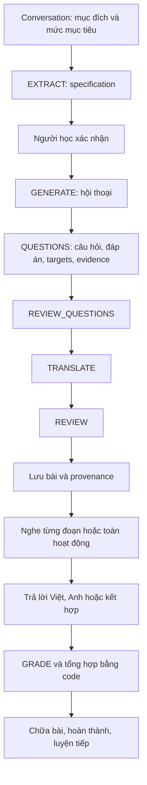

# Conversation AI hiện hành

## Bản đang chỉnh sửa

Một nguồn prompt: `services/ai-generation/app/scenario-prompts.json`.
V4.13, hash `b1f627bce2367904664a68ca2460e5ffd96868e1eb7fa93b244762673d6d3087`.
Không thay nội dung hoặc hash prompt trong đợt dọn dự án này.

`scenario_prompts.py` nạp bản hiện hành. `scenario-prompt-history.json.gz` giữ giá trị đã biên dịch của
28 bản cũ, được kiểm tra SHA-256 khi đọc. Kho này chỉ phục vụ tương thích bài đã lưu, pin cũ và benchmark;
không phải 28 bộ prompt đang cùng được phát triển. Tests đối chiếu hash prompt/schema trước và sau khi gộp.
Không xóa kho lịch sử hoặc sửa hash bài cũ để làm chúng khớp prompt mới.

## Luồng thực tế

- Frontend chính: `static/js/conversation.js`, sử dụng Scenario API khi chương trình được mở.
- Catalog, mục tiêu và profile: `ScenarioController`, `ScenarioProgramRegistry`, `ScenarioPersonalization`.
- Draft/session/audio/answer/state transitions: `ScenarioEngine`, `ScenarioOperations`, `ScenarioData`.
- Admission/version/approval: `ScenarioRelease`. Profile TOEIC/IELTS dùng scale riêng; giao tiếp dùng CEFR.
- AI API/worker: `services/ai-generation/app`; job ledger giữ idempotency và kết quả chưa rõ.
- Hợp đồng API: [Scenario engine](scenario-engine-openapi.yaml), [foundation](scenario-foundation-openapi.yaml).

V4.13 sinh bài qua năm bước, không gọi `AUDIT_MEANINGS` hoặc `AUDIT_QUESTIONS`.
EXTRACT trước đó là một lượt riêng; GRADE chạy khi người học trả lời.
Luồng không sửa cần 6 lượt cho EXTRACT + sinh bài, giảm 2 so với V4.12. Envelope sinh bài tối đa 9 lượt;
đây là số lời gọi logic, không phải số HTTP attempts hoặc hóa đơn.

## Hợp đồng cần giữ

- Ba activity; cấu trúc, ID, references, bằng chứng và provenance được validation bằng code.
- Hội thoại giữ dữ kiện/vai đã xác nhận và phân biệt đề xuất, đồng ý, giả định, điều chưa chắc chắn.
- Câu hỏi/đáp án/targets cùng phạm vi; thông tin có sẵn trong câu hỏi không thành yêu cầu chấm.
- Câu hỏi nhiều ý hợp lệ. Đúng địa điểm nhưng sai giờ trong câu hỏi hỏi cả hai → `PARTIAL`.
- Hỏi nơi nào thì chấm địa điểm; không yêu cầu lý do ngoài câu hỏi. Cho phép trả lời Việt/Anh/kết hợp.
- Review ngữ nghĩa là advisory theo chính sách đã chọn: lưu cờ và kết quả, có sửa giới hạn;
  không biến việc JSON hợp lệ hoặc `qualityPassed` thành chứng nhận nội dung đúng.
- Lỗi cấu trúc/bằng chứng không được xóa chỉ để bài dễ đạt. Không loại bài riêng vì giới hạn từ.
- Không replay công việc paid có kết quả UNKNOWN. Model fallback giữ nguyên policy hiện có.
- TTS, phân vai, continuous activity playback, tracing và quyền sở hữu dữ liệu giữ nguyên.

## Tương thích

`ConversationService` và prompt Java còn cần cho các phiên legacy đã lưu và luồng tiếp tục của chúng.
Không dùng chúng làm pipeline đánh giá mới. Java V8 trong Evaluation Studio đã nghỉ tạo/chạy mới;
phiên bản và kết quả cũ vẫn đọc, so sánh và xuất được. Không xóa bảng legacy hoặc sửa nội dung lesson.

Production defaults và approval gates không được chuyển sang V4.13 bởi đợt cleanup này.
Local preview chỉ mở qua cấu hình đã xác minh, xem [chạy local](local-development.md).

## Đánh giá chất lượng

[AI Evaluation Studio](ai-evaluation-studio.md) chỉ mở pipeline/prompt hiện hành cho lần chạy mới.
[Lịch sử và quyết định benchmark](project-history.md) ghi vì sao giữ V4.13 thay vì kích hoạt candidate V4.14.
Tests code đạt không đồng nghĩa chất lượng ngữ nghĩa AI đã tăng. Giữ nguyên raw output trước khi thử sửa prompt tiếp.
