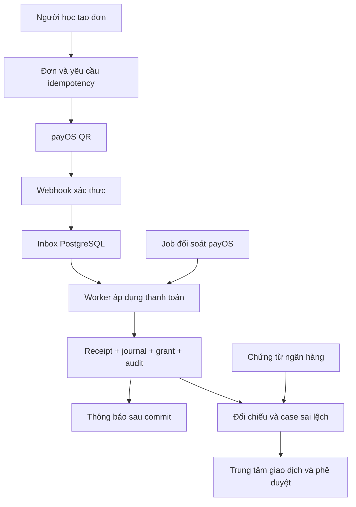

# Plan — DictaLab Payment Operations

Ngày lập: 17/10/2026 · Trạng thái: kế hoạch để bắt đầu code · Ngôn ngữ: Java 17, Spring Boot 4.1.1, PostgreSQL.

Phát triển thanh toán Premium thành một phân hệ có nghiệp vụ thu tiền, đối soát, sổ giao dịch, hoàn tiền, kiểm soát quyền và bằng chứng kiểm thử. Mục tiêu portfolio là giải thích và chứng minh được tính đúng đắn khi có lỗi, giao dịch đồng thời và sự can thiệp của người vận hành.

“Đủ tiêu chí fintech” trong tài liệu này nghĩa là hoàn thành ma trận nghiệm thu dưới đây trong phạm vi người bán dịch vụ số. Không có một checklist duy nhất bao phủ mọi ngân hàng, sản phẩm fintech và nghĩa vụ pháp lý. Hoàn thành kế hoạch không đồng nghĩa được chứng nhận PCI DSS, ISO 27001, tuân thủ toàn bộ pháp luật, hoặc đủ điều kiện vận hành ví/ngân hàng.

## Scope

- In: thu QR qua payOS; quyền Premium; đối soát tự động và đối chiếu chứng từ ngân hàng; sổ phụ giao dịch ghi kép; quản trị giao dịch; hoàn tiền có phê duyệt; kiểm toán; báo cáo; vận hành và demo lỗi.
- Out: giữ tiền hộ khách, ví và chuyển tiền giữa người dùng, tín dụng, lãi suất, FX, thẻ/PAN/CVV, định kỳ tự trừ tiền, tự xây eKYC hoặc hệ thống AML. Khi mở rộng sang các nghiệp vụ này phải lập phạm vi và đánh giá pháp lý riêng.
- Giữ modular monolith và các dependency hiện có. PostgreSQL là nguồn dữ liệu tài chính chính; Redis không quyết định số dư hoặc việc một khoản tiền đã được ghi nhận.
- Đây là yêu cầu tạo kế hoạch. File không tự cho phép thực hiện hoàn tiền thật, mở quyền chi hộ, thay điều khoản khách hàng hay triển khai toàn bộ roadmap.

## Action items

- [ ] P0 — Chốt hợp đồng nghiệp vụ, trạng thái và các điều kiện bất biến; tạo bộ dữ liệu demo.
- [ ] P1 — Bổ sung nhật ký sự kiện, inbox bền vững, idempotency và test giao dịch đồng thời.
- [ ] P2 — Xây Trung tâm giao dịch với quyền đọc, tìm kiếm và dòng thời gian.
- [ ] P3 — Xây đối soát tự động, hàng đợi sai lệch và nhập chứng từ ngân hàng có kiểm soát.
- [ ] P4 — Xây sổ phụ ghi kép, dữ liệu quyền lợi theo từng lần mua và báo cáo kiểm chứng được.
- [ ] P5 — Xây quy trình hoàn tiền, tách người lập/người duyệt và xác nhận kết quả thực tế.
- [ ] P6 — Hoàn thiện kiểm soát bảo mật, vận hành, khôi phục và kiểm thử lỗi.
- [ ] P7 — Đóng gói bằng chứng portfolio; triển khai từng phần sau khi đạt cổng nghiệm thu.

## 1. Hiện trạng và điểm xuất phát

Đã đọc mã nguồn và tài liệu trong workspace ngày 17/10/2026; lượt lập kế hoạch này không kiểm tra lại production hoặc chạy lại test. Giao dịch thật và đợt triển khai trước là bằng chứng lịch sử, không thay thế nghiệm thu các phần mới.

| Đã có trong mã | Nơi tái sử dụng |
|---|---|
| Tạo đơn, giữ giá/số ngày tại thời điểm mua, tra cứu, xử lý webhook, cộng hạn trong transaction | `src/main/java/com/dictalab/service/BillingService.java` |
| HTTP timeout, giới hạn body, HMAC, so sánh chữ ký, kiểm tra dữ liệu payOS | `src/main/java/com/dictalab/service/PayOsClient.java` |
| Quyền Premium, hạn mức ngày và khóa theo người dùng | `src/main/java/com/dictalab/service/PremiumAccessService.java` |
| API người học và webhook giới hạn 64 KiB | `src/main/java/com/dictalab/web/BillingController.java` |
| Bảng đơn, hạn Premium, usage; tài khoản bị xóa thì đơn được tách chủ sở hữu | `src/main/resources/db/migration/V38__premium_payos.sql` |
| Test webhook trùng/đồng thời, giá từ server, ownership, CSRF, kết quả tạo đơn chưa rõ | `src/test/java/com/dictalab/web/BillingIntegrationTest.java`, `src/test/java/com/dictalab/service/PayOsClientTest.java` |
| UI thanh toán và cấu hình | `src/main/resources/static/js/billing.js`, `docs/payos-premium.md` |
| CI unit, PostgreSQL, reliability; triển khai có backup/rollback | `.github/workflows/deploy.yml`, `scripts/linux/release.py` |

Khoảng trống cần giải quyết, không coi kiểm tra hiện tại là đủ:

- Chưa có inbox bền vững, đối soát lịch chạy, sổ phụ, hồ sơ hoàn tiền và quyền vận hành tài chính riêng.
- `check()` trả ngay nếu đơn đã PAID; đối soát nền phải có đường lấy chứng cứ provider mới, không dùng nguyên hành vi cache này.
- Một `payment_reference` trên đơn không đủ biểu diễn nhiều khoản chuyển hoặc khoản đến sau khi đơn đã PAID. Cần lưu receipt riêng trước khi quyết định cấp quyền.
- Webhook không khớp đơn hiện được bỏ qua để phục vụ mẫu xác minh. Phải phân biệt mẫu xác minh và giao dịch thật chưa tìm được đơn; giữ giao dịch chưa khớp trong hàng chờ xử lý.
- `view()` hiện có thể hiển thị EXPIRED cho mọi đơn chưa PAID quá thời hạn, kể cả CANCELLED. P0/P1 phải định nghĩa lại ưu tiên trạng thái và để test bảo vệ.
- `EmailOutbox` hiện gắn với token tài khoản. Chỉ tái sử dụng mẫu lease/retry; không đưa thông báo giao dịch vào luồng token bằng cách giả token hoặc bỏ kiểm tra token.

## 2. Ma trận nghiệp vụ và bằng chứng bắt buộc

| ID | Tiêu chí | Kết quả phải chứng minh | Giai đoạn |
|---|---|---|---|
| F01 | Số tiền chính xác | VND nguyên, kiểm tra miền giá trị/overflow; tổng và lọc cùng quy tắc | P0, P4 |
| F02 | Đơn hàng rõ ràng | Giá, kỳ hạn, phiên bản chính sách được snapshot; trạng thái chuyển hợp lệ | P0, P1 |
| F03 | Ghi nhận một lần | Một receipt/bút toán/quyền lợi cho cùng sự kiện, kể cả 100 yêu cầu đồng thời | P1, P6 |
| F04 | Không mất sự kiện đã nhận | Webhook hợp lệ đã ACK phải có bản ghi durable; khởi động lại vẫn xử lý được | P1, P6 |
| F05 | Truy vết đầy đủ | Từ đơn tìm được receipt, event, bút toán, quyền lợi, hoàn tiền và người thao tác | P1–P5 |
| F06 | Đối soát độc lập | Phát hiện mất webhook, thiếu quyền lợi, sai số tiền, trùng và chưa khớp | P3 |
| F07 | Bảo toàn sổ phụ | Mỗi journal cân Nợ/Có; sửa sai bằng đảo/bù; không sửa lịch sử đã ghi sổ | P4 |
| F08 | Hoàn tiền đúng | Tổng đã hoàn + đang giữ chỗ không vượt tiền đủ điều kiện; kết quả chưa rõ không chi lại | P5 |
| F09 | Tách nhiệm vụ | Người lập không tự duyệt; ADMIN nội dung không mặc nhiên có quyền chi | P2, P5 |
| F10 | Chống giả mạo | Chữ ký, ownership, CSRF, phân quyền từng API, chống đổi dữ liệu sau phê duyệt | P1, P5, P6 |
| F11 | Quyền riêng tư | Che dữ liệu, kiểm soát xem/xuất, retention và xóa/tách PII có bằng chứng | P2, P6 |
| F12 | Vận hành phục hồi | Cảnh báo, retry có giới hạn, lease, replay có kiểm soát, restore và đối soát lại | P3, P6 |
| F13 | Báo cáo đúng bản chất | Phân biệt tiền nhận, tiền hoàn, doanh thu và tiền đã đối chiếu ngân hàng | P4 |
| F14 | Khiếu nại | Hồ sơ gắn đơn, bằng chứng, người xử lý, hạn xử lý, quyết định và lịch sử | P5 |
| F15 | Kiểm soát thay đổi | Migration tương thích, backfill chạy lại an toàn, feature flag và rollback đã tập dượt | P1–P7 |
| F16 | Bằng chứng ứng tuyển | Demo tái lập, test report, threat model, ADR và diễn giải giới hạn | P7 |

Mỗi ID phải có đường dẫn test/bằng chứng, người kiểm tra, ngày kiểm tra và trạng thái `TODO / IMPLEMENTED / VERIFIED / BLOCKED / NOT_APPLICABLE`. `NOT_APPLICABLE` cần lý do. Không dùng phần trăm “đạt fintech” thay cho từng bằng chứng.

## 3. Hợp đồng nghiệp vụ mặc định

### 3.1. Tiền, thời gian và quyền lợi

- Chỉ VND ở phiên bản này. Dùng `long`/`BIGINT` cho tiền và tổng, không dùng float/double. Validate số nguyên từ JSON trước khi chuyển kiểu; công thức tỷ lệ dùng BigDecimal/rational với quy tắc làm tròn rõ ràng.
- Server quyết định sản phẩm, giá và số ngày. Lưu `product_code`, `price_version`, `policy_version`, `currency`, `amount_vnd`, `duration_days` trên đơn.
- Giữ 49.000đ/30 ngày làm cấu hình ban đầu. Một lần mua đủ điều kiện cấp một grant; thời hạn mới = `max(thời điểm cấp quyền, hạn hiện tại) + số ngày`.
- UTC cho thời điểm lưu; `Asia/Ho_Chi_Minh` cho ngày nghiệp vụ và báo cáo. Phân biệt thời điểm giao dịch ngân hàng, nhận webhook, ghi sổ và cấp quyền.
- Khi đối soát muộn, cấp đủ số ngày từ lúc phục hồi hoặc từ hạn còn lại; không tự tính lùi khiến người học mất ngày chưa dùng được.
- Thay đổi giá/chính sách áp dụng cho đơn mới. Quyền ADMIN sử dụng sản phẩm không tạo doanh thu và không trở thành quyền duyệt hoàn tiền.

### 3.2. Tách các loại trạng thái

| Đối tượng | Trạng thái đề xuất | Quy tắc |
|---|---|---|
| Đơn | CREATING, PENDING, PAID, CANCELLED, EXPIRED | Hủy/hết hạn không chứng minh không có tiền đến muộn; PAID không bị callback cũ hạ trạng thái |
| Xử lý sự kiện | RECEIVED, PROCESSING, PROCESSED, RETRY, QUARANTINED | Retry không làm mất chứng cứ; hết lượt phải có case vận hành |
| Tình trạng số tiền | UNPAID, PARTIAL, EXACT, OVERPAID, UNMATCHED | Tính từ receipt xác thực, tách khỏi trạng thái link do provider trả |
| Đối soát | OPEN, INVESTIGATING, RESOLVED, ACCEPTED_EXCEPTION | Đóng case cần lý do và chứng cứ; ngoại lệ chấp nhận vẫn hiện trên báo cáo |
| Hoàn tiền | REQUESTED, APPROVED, REJECTED, EXECUTING, UNKNOWN, SUCCEEDED, FAILED, CANCELLED | APPROVED không đồng nghĩa đã trả tiền; UNKNOWN phải đối soát trước khi thử lại |

Chuyển trạng thái phải có bảng allowed transitions và lý do. Hai worker cạnh tranh phải dùng khóa hoặc compare-and-set/version; không chỉ kiểm tra trạng thái ở frontend.

### 3.3. Các bất biến

1. Không cấp Premium từ query redirect, ảnh chuyển khoản, thông báo trình duyệt hoặc thao tác sửa PAID thủ công.
2. Không xác nhận tiền từ webhook sai chữ ký. HMAC hợp lệ vẫn phải khớp kênh, mã đơn/link, tiền tệ và quy tắc số tiền.
3. Một receipt chỉ được phân bổ một lần; khóa duy nhất có phạm vi provider + kênh + mã tham chiếu đã xác minh.
4. Một đơn chỉ có một grant mua hàng. Các điều chỉnh/hoàn quyền lợi là sự kiện riêng có lý do.
5. Đơn, receipt, journal, grant và audit cần thiết phải commit nguyên tử khi áp dụng một kết quả thanh toán.
6. Mạng phân tán có thể giao lại nhiều lần. Mục tiêu là xử lý idempotent tạo một hiệu lực nghiệp vụ, không tuyên bố mạng “exactly once”.
7. `debit_total = credit_total` trong từng journal và từng currency; journal đã POSTED không được UPDATE/DELETE bởi tài khoản ứng dụng.
8. `refund_succeeded + refund_reserved <= refundable_verified_amount`, kiểm tra trong transaction có khóa.
9. Receipt đến sau đơn PAID vẫn được ghi nhận/đối soát; không cộng thêm Premium hoặc bỏ qua khoản chuyển dư.
10. Xóa tài khoản không tái tạo tài khoản qua webhook; giữ liên kết tài chính theo chính sách lưu trữ tối thiểu và tách dữ liệu định danh.

### 3.4. Ngoại lệ và chính sách đề xuất

- Thiếu tiền: lưu receipt và mở case, chưa cấp Premium. Chỉ cộng nhiều receipt khi semantics giao dịch payOS đã được xác minh bằng fixture và contract test.
- Thừa tiền: giữ toàn bộ receipt, mở case; người vận hành có thể phân bổ đúng giá cho đơn và phần dư vào khoản phải trả khách theo quy trình duyệt. Không tự mất phần dư hoặc tự biến thành doanh thu.
- Sai link/currency/kênh, mã tham chiếu trùng với nội dung khác: cách ly; không cấp quyền.
- Tiền đến sau hủy/hết hạn: kiểm tra chứng cứ mới. Nếu đủ điều kiện và chưa hoàn thì cấp đúng một grant; nếu mâu thuẫn thì mở case.
- Không có đơn: lưu sự kiện xác thực chưa khớp. Chỉ loại mẫu xác minh đã nhận diện chắc chắn theo hợp đồng provider.
- Không biết kết quả create: tra cứu cùng order code. Không phát lại create hoặc sinh đơn thay thế trước khi kết luận được kết quả cũ.
- Không tự áp chính sách hoàn tiền mới cho khách đang sử dụng. Mặc định phát triển full refund và partial refund có nhập số tiền/lý do, cùng bảng xem trước ảnh hưởng quyền lợi; công bố chính sách cần chủ sản phẩm duyệt.

## 4. Kiến trúc và mô hình dữ liệu

### 4.1. Luồng xử lý



- Webhook: validate kích thước/cấu trúc/chữ ký, ghi inbox rồi mới ACK. Worker xử lý độc lập; lỗi DB không được trả ACK thành công.
- Không giữ database lock trong khi gọi payOS, gửi email hoặc đọc file ngoài. Claim có lease; khi ghi kết quả phải kiểm tra token/version và trạng thái hiện tại.
- Dùng worker PostgreSQL có batch nhỏ trước. Có thể dùng RabbitMQ sẵn có để đánh thức worker; tính đúng đắn không phụ thuộc thông báo đánh thức.
- Chỉ tạo abstraction cần cho real provider và fake provider phục vụ test. Không tách microservice hoặc viết framework payment chung.

### 4.2. Bảng mới/đổi theo giai đoạn

Tên dưới đây là định hướng schema, chỉ tạo khi đến giai đoạn sử dụng.

| Dữ liệu | Nội dung và ràng buộc chính |
|---|---|
| `payment_orders` mở rộng | Snapshot sản phẩm/chính sách/currency, version, trạng thái đối soát; giữ API cũ tương thích |
| `payment_events` | Append-only: event ID, nguồn, correlation, order/link, thời gian, loại, hash, dữ liệu tối thiểu; kiểm soát dữ liệu nhạy cảm |
| `payment_inbox` | Khóa dedupe, tham chiếu event, trạng thái worker, attempts, next_attempt, lease, lỗi đã lọc; trạng thái xử lý được cập nhật |
| `payment_receipts` | Một khoản tiền thực tế: provider/channel/reference duy nhất, amount, currency, thời điểm và nguồn chứng cứ; không gộp mất chi tiết |
| `payment_allocations` | Phân bổ receipt vào đơn hoặc khoản phải trả; tổng phân bổ không vượt receipt, kiểm tra trong transaction |
| `payment_idempotency` | actor + operation + key duy nhất, request hash, trạng thái, resource ID; cùng key khác body trả 409 |
| `premium_grants` | Một grant/đơn; số giây hoặc ngày được cấp, mốc bắt đầu/kết thúc, điều chỉnh gắn refund; `premium_accounts` là projection phục vụ đọc |
| `reconciliation_runs`, `reconciliation_cases` | Cửa sổ quét, checkpoint, counts/totals, sai lệch, owner, deadline, evidence và quyết định |
| `statement_imports`, `statement_lines` | File hash, nguồn/định dạng, ngày nghiệp vụ, dòng tiền chuẩn hóa, trạng thái khớp; import lặp không nhân đôi |
| `ledger_accounts`, `ledger_journals`, `ledger_entries` | Sổ phụ VND, event key duy nhất, bút toán Nợ/Có, effective/recorded time, reversal link; journal không cân không POST được |
| `refund_requests`, `refund_attempts` | Tiền giữ chỗ, người lập/duyệt, version, hash nội dung duyệt, bằng chứng chi, kết quả chưa rõ và mã tham chiếu |
| Quyền tài chính và audit | Quyền riêng từng thao tác; audit actor/action/resource/reason/correlation; ghi lại xem dữ liệu nhạy cảm và xuất báo cáo |
| Outbox thông báo giao dịch | Ghi cùng transaction nghiệp vụ; retry sau commit, không chi tiền/cấp quyền qua gửi email |

Idempotency request dùng key ngẫu nhiên đủ entropy; thời gian lưu tối thiểu đề xuất 7 ngày, còn khóa duy nhất của receipt/journal/grant tồn tại theo dữ liệu tài chính. Không lưu response chứa PII hoặc secret vô thời hạn. Order code gửi provider phải nằm trong miền số nguyên an toàn theo hợp đồng API/JavaScript.

### 4.3. Sổ phụ ghi kép có phạm vi rõ ràng

Đây là sổ phụ phục vụ vận hành và portfolio. Chart of accounts, thuế và ghi nhận doanh thu pháp định cần người có chuyên môn xác nhận trước khi dùng làm sổ kế toán chính thức.

Ví dụ mô hình nội bộ, mỗi dòng dưới đây là một journal cân bằng:

| Sự kiện | Nợ | Có |
|---|---|---|
| Xác nhận khoản thu 49.000đ, chưa đối chiếu sao kê | Tiền thu chờ đối chiếu 49.000 | Nghĩa vụ cung cấp Premium 49.000 |
| Khớp chứng từ ngân hàng | Tiền ngân hàng thuộc phạm vi DictaLab 49.000 | Tiền thu chờ đối chiếu 49.000 |
| Ghi nhận phần dịch vụ đã cung cấp | Nghĩa vụ cung cấp Premium X | Doanh thu dịch vụ X |
| Duyệt hoàn phần chưa cung cấp | Nghĩa vụ cung cấp Premium X | Phải trả hoàn tiền X |
| Xác nhận đã chuyển hoàn | Phải trả hoàn tiền X | Tiền ngân hàng thuộc phạm vi DictaLab X |

- Tên “chờ đối chiếu” là trạng thái bằng chứng nội bộ, không ngụ ý payOS đang giữ tiền rồi settlement cho cửa hàng.
- Hoàn phần đã ghi nhận doanh thu cần bút toán giảm doanh thu theo chính sách được duyệt; phí ngân hàng ghi riêng, không tự trừ vào tiền khách được hoàn.
- Khoản thu chưa biết chủ/đơn ghi đối ứng vào nghĩa vụ chưa phân bổ; không ghi doanh thu.
- Phân bổ doanh thu demo theo thời gian dịch vụ; dùng tính lũy kế và phần chênh lệch đã ghi để tránh sai số 49.000/30. Tổng khi hết kỳ phải đúng 49.000đ.
- Daily close tạo snapshot, cutoff, phiên bản và tổng kiểm tra; sự kiện đến muộn sinh điều chỉnh có ngày ghi nhận và ngày hiệu lực. Không viết đè báo cáo đã khóa.
- Tài khoản ngân hàng đang dùng chung cá nhân: báo cáo chỉ phản ánh tập giao dịch DictaLab đã nhận diện, không gọi là toàn bộ số dư ngân hàng. Khuyến nghị tài khoản riêng khi vận hành rộng hơn.

## 5. Phân quyền, bảo mật và dữ liệu

### 5.1. Quyền vận hành

| Quyền | Được làm | Giới hạn |
|---|---|---|
| `PAYMENT_VIEW` | Danh sách, chi tiết đã che dữ liệu | Không sửa trạng thái tài chính |
| `PAYMENT_RECONCILE` | Yêu cầu đối soát, xử lý case theo hành động cho phép | Không sửa trực tiếp số tiền/PAID |
| `REFUND_REQUEST` | Lập hồ sơ, nhập lý do và bằng chứng | Không tự duyệt hồ sơ mình lập |
| `REFUND_APPROVE` | Duyệt/từ chối trong hạn mức | Phải khác người lập, cần xác thực tăng cường |
| `REFUND_EXECUTE` | Thực hiện lệnh đã duyệt hoặc ghi bằng chứng chi thủ công | Không đổi số tiền/người nhận sau duyệt |
| `PAYMENT_AUDIT` | Audit và xuất báo cáo được cấp quyền | Chỉ đọc, export có nhật ký |

Áp quyền ở service/API và kiểm tra truy cập từng đối tượng. Route `/api/admin/**` hiện yêu cầu ADMIN: thiết kế tích hợp quyền tài chính rõ ràng, không mở rộng toàn bộ admin cho một nhân viên tài chính. USER chỉ xem đơn/yêu cầu của mình.

- Maker/checker phải là hai người thực sự khi vận hành thật; hai tài khoản do một người giữ chỉ là mô phỏng demo. Nếu chưa có checker độc lập thì giữ thực thi chi tự động tắt.
- Xác thực tăng cường cho duyệt/chi: chọn TOTP hoặc WebAuthn sau khi khảo sát auth hiện có, dùng thư viện được duy trì. Challenge ngắn hạn, dùng một lần, gắn hash số tiền, người nhận, refund ID và version; sửa nội dung làm mất hiệu lực phê duyệt.
- Giữ TLS, CSRF cho API dùng cookie, kiểm tra session/revocation, rate limit và ownership. Chỉ webhook chuyên biệt được miễn CSRF, vẫn phải kiểm tra chữ ký.
- Không ghi key, token, payload chứa PII hoặc full tài khoản vào application log. Lưu evidence nhạy cảm ở vùng riêng có mã hóa/quyền truy cập và thời hạn.
- Phân tách quyền DB migration và runtime; runtime không có quyền sửa/xóa ledger đã POSTED. Audit append-only không chống được mọi DBA: dùng digest định kỳ lưu ngoài DB để phát hiện can thiệp, không quảng cáo “bất biến tuyệt đối”.
- Export CSV có giới hạn, chống formula injection, ghi actor/filter/count; không công khai file trong static directory. Upload chứng từ giới hạn loại/kích thước, lưu ngoài web root, bảo vệ tải xuống và xử lý mã độc theo môi trường.
- Lập bảng retention cho receipt, ledger, audit, raw evidence, idempotency, báo cáo và backup. Chưa chọn số năm pháp định khi chưa xác định nghĩa vụ cụ thể; PII có thể tách và xóa theo chính sách trong khi giữ liên kết nghiệp vụ tối thiểu.

Chọn OWASP ASVS 5.0.0 làm baseline kiểm chứng bảo mật, mục tiêu các yêu cầu Level 2 áp dụng và kiểm soát bổ sung theo threat model; phải ghi version/ID cụ thể khi triển khai. Đây là mục tiêu kiểm thử, chưa phải tuyên bố đã đạt. [ASVS](https://owasp.org/projects/asvs)

Các yêu cầu xác thực giao dịch cần ràng buộc dữ liệu quan trọng, được thực thi phía server và tránh tái sử dụng sự chấp thuận. [OWASP Transaction Authorization](https://cheatsheetseries.owasp.org/cheatsheets/Transaction_Authorization_Cheat_Sheet.html)

## 6. Kế hoạch code theo giai đoạn

### P0 — Hợp đồng nghiệp vụ và nền kiểm thử

- [ ] Viết ADR ngắn cho trạng thái, amount semantics, thời điểm cấp quyền, idempotency, late payment và phạm vi sổ phụ; bổ sung vào tài liệu triển khai khi bắt đầu code.
- [ ] Tạo fake payOS chạy local với chữ ký test riêng, các fixture PENDING/PAID/CANCELLED/partial/overpaid/null/array; không dùng dữ liệu hay key production.
- [ ] Khảo sát quyền, job lease, metrics, audit và email để tái sử dụng đúng; đưa các khoảng trống tại mục 1 thành regression test.
- [ ] Chọn lock order nhất quán cho user/order/refund/ledger; viết test interleaving với xóa tài khoản và mua tiếp.
- [ ] Tách `Clock` có thể điều khiển trong test cho hết hạn và ranh giới ngày; không thay đổi thời gian máy.

Nghiệm thu: test tái hiện lỗi đã phát hiện; hợp đồng dữ liệu và bảng chuyển trạng thái đủ để code P1, không cần gọi tiền thật.

### P1 — Inbox, sự kiện và áp dụng thanh toán một lần

- [ ] Thêm migration mới kế tiếp tại thời điểm code; tuyệt đối không sửa V38 đã phát hành. Thêm event/inbox/receipt/idempotency và index đúng truy vấn.
- [ ] Đổi webhook thành xác thực → lưu durable → ACK. Lưu riêng delivery attempt và business event để retry không che mất lần nhận.
- [ ] Refactor nhánh áp dụng tiền trong `BillingService` thành một đường dùng chung cho webhook và đối soát; kiểm tra receipt trước cả khi đơn đã PAID.
- [ ] Thêm worker claim/lease/retry có jitter, backoff và giới hạn; worker chết thì lease hết hạn cho phép phục hồi. Payload lỗi nghiệp vụ vào quarantine.
- [ ] Áp idempotency cho create và lệnh thay đổi tài chính; cùng key/cùng body trả cùng resource, khác body trả 409, trạng thái đang xử lý trả mã nhất quán có thể tra cứu.
- [ ] Bổ sung API response DTO và mã lỗi ổn định cho các phần mới; không refactor toàn dự án chỉ để đổi Map.

File chính: `BillingService`, `PayOsClient`, `BillingController`, `BillingProperties`, migration mới, các test thanh toán. Có thể thêm `PaymentInboxWorker`/`PaymentEventService` khi có trách nhiệm riêng thực tế.

Nghiệm thu: 100 lần nhận trùng và lookup đồng thời tạo đúng một grant; restart sau ACK không mất sự kiện; kết quả tạo đơn chưa rõ không phát lại create; sai chữ ký không ghi tiền.

### P2 — Trung tâm giao dịch

- [ ] Thêm quyền tài chính và controller API riêng; test USER, admin nội dung, operator, auditor và quyền bị thu hồi.
- [ ] Danh sách phân trang phía server, sort ổn định, lọc mã đơn/trạng thái/ngày/số tiền; mặc định che thông tin người trả.
- [ ] Trang chi tiết thể hiện giá snapshot, nguồn tiền, trạng thái link, trạng thái xử lý, entitlement, timeline, case và evidence theo quyền.
- [ ] Thêm nút “Yêu cầu đối soát” tạo job có audit/idempotency; không đặt nút “Đánh dấu đã thanh toán”.
- [ ] Phân biệt payment receipt với hóa đơn thuế trong nhãn và nội dung; lịch sử người học chỉ hiển thị thông tin họ cần.

File UI: `src/main/resources/static/admin.html`, `js/admin-ui.js`, `css/admin.css`, `js/billing.js`; tách `admin-payments.js` nếu khối chức năng đủ lớn, giữ phong cách UI hiện có.

Nghiệm thu: truy vết được một đơn đầu-cuối; kiểm tra keyboard/mobile/error/empty/loading; URL đoán được không vượt ownership; danh sách không tải mọi dòng về browser.

### P3 — Đối soát tự động và hàng đợi sai lệch

- [ ] Quét đơn cần xử lý theo `next_check_at`, batch tối đa 20 và concurrency khởi điểm 1; cấu hình theo quota thực tế provider, xử lý 429/Retry-After.
- [ ] Lịch đề xuất: đơn chưa rõ sau 1 phút, retry backoff tối đa 15 phút; sau 24 giờ chuyển ưu tiên kiểm tra thấp và case có người phụ trách. Case chưa giải quyết không bị bỏ quên sau một cửa sổ cố định.
- [ ] Kiểm tra lại đơn PAID theo job riêng; đối chiếu provider ↔ receipt/ledger ↔ grant. Chỉ so khớp provider với status nội bộ là chưa đủ.
- [ ] Tự phục hồi trường hợp chắc chắn: provider xác thực đủ tiền, đúng đơn, chưa grant. Các trường hợp lệch tiền, mâu thuẫn, chưa tìm được đơn cần case.
- [ ] Ghi run/checkpoint/result; hai instance không xử lý một lease; kết quả API cũ không ghi đè trạng thái mới.
- [ ] Nhập sao kê CSV chuẩn hóa bằng preview → validate → xác nhận; lưu checksum, mapping version và thống kê. Demo dùng file giả. File thật cần nguồn/định dạng được chủ tài khoản cung cấp.
- [ ] Match bằng mã tham chiếu đáng tin và số tiền/ngày; chỉ dựa amount/time thì đề xuất ứng viên, không tự xác nhận. Giao dịch cá nhân nằm ngoài tập DictaLab.
- [ ] Hiện rõ giới hạn: tra cứu các order code đã biết không phát hiện được mọi khoản chuyển ngoài đơn. Muốn bao phủ ngân hàng cần feed/statement độc lập đã xác minh quyền truy cập.

Nghiệm thu: mất webhook tự phục hồi trong mục tiêu 5 phút khi provider/DB bình thường; import cùng file hoặc file chồng ngày không nhân đôi; sai lệch có chủ xử lý và bằng chứng đóng case.

### P4 — Sổ phụ và quyền lợi theo lần mua

- [ ] Thêm journal/entry và constraint/trigger hoặc posting function để DB từ chối journal không cân; test bằng SQL trực tiếp ngoài service.
- [ ] Ghi receipt → journal → grant trong transaction áp dụng; outbox thông báo chỉ được thêm khi commit thành công.
- [ ] Tạo grant theo từng order và adjustment theo refund; kiểm tra ảnh hưởng mua nối tiếp, hoàn đơn cũ, hết hạn, account deletion.
- [ ] Định nghĩa hoàn phần quyền lợi bằng số giây của grant được chọn. Preview và commit dưới cùng version/khóa; không trừ một số ngày khỏi `premium_until` mà bỏ qua các grant khác.
- [ ] Backfill PAID lịch sử với khóa riêng; không phát lại thông báo hoặc cộng hạn. Chụp hạn hiện tại làm baseline cho dữ liệu không đủ tái dựng, gắn nguồn LEGACY_BASELINE; không bịa lịch sử grant.
- [ ] Xây báo cáo tiền nhận/hoàn/ròng, nghĩa vụ dịch vụ, doanh thu phân bổ, tiền chờ đối chiếu và khoản chưa phân bổ; drill-down được đến journal.
- [ ] Xây daily close/reopen có duyệt, lý do và version; thử sự kiện đến muộn và sai số làm tròn.

Nghiệm thu: mọi journal cân; tổng receipt, phân bổ và báo cáo khớp; backfill chạy hai lần không đổi tổng/hạn; điều chỉnh có liên kết bút toán gốc.

### P5 — Hoàn tiền và khiếu nại

- [ ] Người học gửi yêu cầu qua đơn của mình; tái sử dụng support ticket để trao đổi, liên kết refund case thay vì tạo hệ hỗ trợ mới.
- [ ] Server tính tiền còn được hoàn và ảnh hưởng quyền lợi; tại duyệt giữ chỗ số tiền trong transaction. Hai yêu cầu đồng thời không vượt khoản thu.
- [ ] Maker/checker khác nhau; duyệt có step-up và hạn hiệu lực; đổi số tiền/người nhận/chính sách làm mất phê duyệt.
- [ ] Xác minh người nhận dựa chứng cứ nguồn chuyển và hồ sơ hỗ trợ. Không tự chi sang tài khoản mới chỉ vì request body hoặc email yêu cầu.
- [ ] Giai đoạn đầu: thực hiện chuyển hoàn qua ngân hàng có người kiểm soát; nhập bằng chứng giao dịch, checker xác nhận trước khi ghi SUCCEEDED. Ảnh chụp tự khai không đủ chứng minh tiền đã đi.
- [ ] Nếu tích hợp chi hộ sau này: dùng idempotency của provider, lưu attempt trước call, timeout chuyển UNKNOWN, tra cứu trước retry; API chấp nhận lệnh chưa đồng nghĩa ngân hàng đã chuyển thành công.
- [ ] Ghi journal và adjustment quyền lợi khi kết quả chi được xác nhận; thất bại/UNKNOWN không giả định đã hoàn và không giải phóng reservation tùy tiện.
- [ ] Partial refund có amount và điều chỉnh quyền lợi rõ ràng. Nếu chưa chốt quy tắc tỷ lệ, giữ tính năng production tắt; mô phỏng bằng chính sách demo được ghi nhãn.

Nghiệm thu: tự duyệt bị từ chối; request cũ không thực thi sau khi nội dung đổi; 100 yêu cầu hoàn đồng thời không vượt tiền; timeout sau provider nhận không chi hai lần.

### P6 — Vận hành, an toàn và phục hồi

- [ ] Metrics: webhook accepted/rejected/duplicate, tuổi inbox, retry exhausted, thời gian cấp quyền, số tiền/case lệch, provider latency/error, refund UNKNOWN và journal lệch.
- [ ] Alert: journal lệch hoặc có dấu hiệu chi trùng là nghiêm trọng; backlog/case quá hạn theo ngưỡng cấu hình. Không dùng user ID/order ID làm nhãn metrics cardinality cao.
- [ ] Log có correlation ID, order ID nội bộ, loại hành động và kết quả đã lọc; hạn chế PII. Có runbook key lộ, provider lỗi, sai số tiền, backlog và hoàn chưa rõ.
- [ ] Tách cờ dừng nhận đơn mới, dừng worker, dừng chi và intake webhook. Khi dừng checkout vẫn tiếp nhận sự kiện hợp lệ cho đơn cũ nếu hạ tầng an toàn.
- [ ] Mapping ASVS/threat model, rà dependency, phân quyền DB, export và audit; không chạy pentest/load test lên payOS hoặc production.
- [ ] Drill backup/restore ở môi trường cách ly. Sau restore phải quét đối soát khoảng mất dữ liệu trước khi mở lại thanh toán; không coi replay nội bộ đủ nếu sự kiện chưa vào backup.
- [ ] Đo mục tiêu ban đầu: local ACK p95 < 1 giây, nhận thanh toán đến grant p95 < 10 giây khi hệ thống khỏe; recovery webhook mất < 5 phút khi provider đáp ứng. Ghi kết quả thực đo và điều kiện, không gọi là SLA đã cam kết.
- [ ] Chọn và thử RPO/RTO theo hạ tầng thực tế; mục tiêu đề xuất RPO 15 phút cho DB backup và RTO 60 phút, còn khoản tiền phải được phục hồi bằng chứng cứ provider/ngân hàng. Nếu backup không đạt, báo thiếu trước mở rộng.

Nghiệm thu: có báo cáo drill và từng invariant được kiểm tra sau phục hồi; việc gửi email trùng do SMTP không làm nhân đôi tiền hoặc grant.

### P7 — Portfolio và phát hành

- [ ] README Payment Operations có sequence diagram, bảng trạng thái, threat model, trade-off, mô hình ghi kép và liên kết test.
- [ ] Script demo local: mất webhook → đối soát phục hồi; 100 callback → một grant; refund timeout → UNKNOWN → tra cứu; người lập tự duyệt → bị chặn.
- [ ] Lưu test report, concurrency evidence, screenshot, migration/restore evidence với dữ liệu giả hoặc đã khử định danh.
- [ ] Video/demo 5–7 phút; giải thích vì sao DB transaction không bao phủ HTTP, vì sao retry cần idempotency và vì sao báo cáo tiền khác doanh thu.
- [ ] Nghiệm thu theo F01–F16; đánh dấu phần manual, phần simulated và phần đã kiểm chứng live.
- [ ] Phát hành từng giai đoạn nhỏ qua CI hiện có; không chờ hoàn tất tất cả mới kiểm tra tính đúng đắn.

## 7. API và giao diện dự kiến

Giữ các API người học hiện có; thêm idempotency header theo lộ trình tương thích frontend. Các endpoint mới dưới đây là hợp đồng đề xuất, phải áp quyền như mục 5.

| Endpoint | Mục đích |
|---|---|
| `GET /api/admin/payments/orders` | Tìm kiếm/phân trang theo quyền |
| `GET /api/admin/payments/orders/{code}` | Chi tiết, receipt, timeline, journal và grant |
| `POST /api/admin/payments/orders/{code}/reconcile` | Tạo yêu cầu đối soát, trả job ID |
| `GET /api/admin/payments/reconciliation-cases` | Hàng đợi sai lệch |
| `POST /api/admin/payments/reconciliation-cases/{id}/actions` | Hành động có kiểu, reason và expectedVersion; không nhận status tùy ý |
| `POST /api/admin/payments/statements/preview` | Kiểm tra file trước import |
| `POST /api/admin/payments/statements/{id}/confirm` | Xác nhận import đúng phiên bản |
| `POST /api/billing/orders/{code}/refund-requests` | Người học gửi yêu cầu của mình |
| `POST /api/admin/payments/refunds/{id}/approve` | Duyệt sau step-up, expectedVersion và idempotency |
| `POST /api/admin/payments/refunds/{id}/reject` | Từ chối có lý do |
| `POST /api/admin/payments/refunds/{id}/execution-evidence` | Ghi chứng cứ, chưa mặc nhiên SUCCEEDED |
| `GET /api/admin/payments/reports` | Tổng hợp có cutoff, timezone và nguồn dữ liệu |

Màn hình cần có: danh sách giao dịch, chi tiết/timeline, hàng chờ sai lệch, đối chiếu sao kê, hồ sơ hoàn tiền và báo cáo. Mọi thao tác tiền phải xem được tác động trước xác nhận; lỗi timeout hiển thị “đang xác minh”, không khuyến khích trả tiền lại.

## 8. Ma trận kiểm thử tối thiểu

| Nhóm | Kịch bản bắt buộc | Assertion chính |
|---|---|---|
| Tiền | âm, 0, phân số, quá miền, thay giá, số tổng lớn | Từ chối đúng; không overflow; snapshot giữ nguyên |
| Chữ ký | sai key, body sửa, null/array/object, JSON lỗi, body lớn | Không nhận tiền; lỗi an toàn |
| Đồng thời | 100 webhook, webhook + lookup + worker, 2 lần mua, xóa tài khoản | Một hiệu lực/đơn; không lost update/deadlock không kiểm soát |
| Idempotency | cùng key/body, khác body, restart, key hết hạn | Không lặp tiền; cùng key khác body 409; unique nghiệp vụ vẫn bảo vệ |
| Crash | sau inbox commit trước ACK; sau receipt trước grant; sau commit trước email | Rollback hoặc phục hồi đầy đủ, không trạng thái dở dang |
| Provider | 429, 5xx, timeout trước/sau nhận create, phản hồi quá lớn | Retry theo loại; không tạo lặp; case UNKNOWN truy được |
| Ngoại lệ | thiếu/thừa/nhiều khoản, mã trùng khác nội dung, chưa khớp, late payment | Receipt giữ đủ; grant/ledger không sai |
| Trạng thái | CANCELLED quá hạn, PAID nhận callback cũ, paid cache khi đối soát | Hiển thị đúng; đối soát đọc chứng cứ mới |
| Ledger | journal không cân, ghi trùng, đảo hai lần, chạy close hai lần | DB chặn sai; không đổi tổng ngoài nghiệp vụ hợp lệ |
| Refund | tự duyệt, sửa sau duyệt, replay challenge, vượt số tiền, UNKNOWN | Không chi sai/trùng; reservation nhất quán |
| Quyền | IDOR, role bị thu hồi, export, owner xóa tài khoản, CSRF | Không lộ dữ liệu hoặc vượt quyền |
| Sao kê | file lặp/chồng ngày, CSV injection, format sai, giao dịch cá nhân | Không nhân đôi hoặc gán nhầm |
| Thời gian | 00:00 VN, cuối tháng, bù ngày, clock dịch chuyển trong test | Cutoff, grant và báo cáo nhất quán |
| Khôi phục | restore backup cũ, mất sự kiện chưa backup, worker chạy lại | Đối soát tìm được khoảng thiếu trước mở lại |
| UI | trạng thái chờ/lỗi, double click, bàn phím, mobile, refresh | Không tạo hành động tiền ngoài ý muốn |

Tách unit cho luật nghiệp vụ/chữ ký; integration PostgreSQL thật cho transaction/unique/locks; reliability test cho restart và cạnh tranh. H2 không được dùng làm bằng chứng duy nhất cho tính đúng đắn tài chính. Fake provider dùng khóa test, fixture được khử định danh; test regression chữ ký cần tính expected signature độc lập.

Lệnh hiện có để chạy nền tảng trước/sau từng thay đổi:

```powershell
mvn --batch-mode --no-transfer-progress '-Dtest=BillingIntegrationTest,PayOsClientTest,RequestRateLimitFilterTest' test
node --test src/test/js/billing.test.cjs
mvn --batch-mode --no-transfer-progress -Pproduction-s3,ci-unit clean verify
```

Integration/reliability dùng đúng profile và dịch vụ trong `.github/workflows/deploy.yml`; khi thêm lớp test phải cập nhật include/exclude và gate để chắc chắn CI thực sự chạy, không bị bỏ qua. Không chạy lệnh load hoặc fault injection vào production.

## 9. Migration, phát hành và rollback

1. Kiểm tra HEAD/worktree và migration mới nhất ngay trước code; đang có thay đổi song song, không ghi đè. Không cố định trước số V39 nếu đã có migration khác.
2. Dùng expand → backfill → validate → switch → contract. Bảng mới/index và quyền phải phù hợp dung lượng/lock thực đo; không tuyên bố zero downtime khi chưa đo.
3. Backfill theo batch, có checkpoint và unique key; bảo toàn số tiền, hạn Premium, dữ liệu tài khoản bị xóa. Không gọi provider hoặc gửi thông báo trong migration schema.
4. Chạy đối soát shadow/read-only trước khi cho tự phục hồi; ledger shadow phải cân và khớp dữ liệu lịch sử rồi mới dùng cho báo cáo chính.
5. Chuyển transaction writer một cách nguyên tử/feature flag; không để writer cũ mới cùng cấp grant theo hai cơ chế độc lập. Tập dượt rollback trên schema mở rộng.
6. Hệ thống cũ không hiểu reservation/refund/ledger thì không rollback mù về JAR cũ khi đã phát sinh nghiệp vụ mới. Tắt write/chi, giữ intake an toàn và forward-fix hoặc dùng bản rollback tương thích.
7. Chạy CI và kiểm tra artifact/health sau phát hành. Chỉ bật hoàn tiền tự động khi có đầy đủ điều kiện ở mục 10.
8. Không sửa giao dịch thật thành dữ liệu demo. Giao dịch thật bổ sung cần mục tiêu/số tiền rõ ràng và người dùng tự xác nhận chuyển tiền.

## 10. Open questions — các cổng cần chốt

Không cản trở P0–P3; phải chốt trước tính năng liên quan được bật cho khách thật.

1. **Chính sách sản phẩm:** thời gian tiếp nhận hoàn, full/partial, cách xác định dịch vụ đã dùng, ảnh hưởng Premium, phí và hạn xử lý khiếu nại. Mặc định kỹ thuật là có preview, snapshot policy và duyệt thủ công; không tự công bố cam kết mới.
2. **Nguồn tiền và người kiểm soát:** có checker độc lập, nguồn sao kê được cấp quyền và quyền chi hộ trên kênh payOS hay chưa? Thiếu điều kiện thì vẫn làm demo/fake và xử lý thủ công có dấu vết, giữ auto payout tắt.
3. **Phạm vi tuân thủ:** chủ sản phẩm cần xác minh nghĩa vụ áp dụng về kinh doanh, thuế/hóa đơn, dữ liệu cá nhân, thời hạn lưu trữ và giải quyết khiếu nại với người có chuyên môn trước mở rộng. Không tự nhận định mọi nghĩa vụ ngân hàng/AML/PCI đều áp dụng hoặc đã đạt.

## 11. Nguồn và giới hạn xác minh

- [payOS API](https://payos.vn/docs/api/): đã đối chiếu ngày 17/10/2026; có API tạo/tra cứu/hủy link, webhook và chi hộ. Quyền chi hộ của tài khoản DictaLab chưa được xác minh; chi hộ không tự đồng nghĩa một API refund gắn đơn với đầy đủ kiểm soát.
- [payOS kiểm tra signature](https://payos.vn/docs/tich-hop-webhook/kiem-tra-du-lieu-voi-signature/): tham chiếu hợp đồng chữ ký; khi code lưu fixture theo phiên bản/hình dạng thực tế.
- [payOS môi trường test](https://payos.vn/docs/moi-truong-test/): tài liệu hiện nói chưa có sandbox riêng; dùng fake local cho lỗi/retry/load, kiểm tra tiền thật tách riêng có kiểm soát.
- [OWASP ASVS](https://owasp.org/projects/asvs) và [Transaction Authorization](https://cheatsheetseries.owasp.org/cheatsheets/Transaction_Authorization_Cheat_Sheet.html): baseline bảo mật và xác thực giao dịch, không phải bộ luật hay chứng nhận đã hoàn thành.

Các trạng thái nội bộ, schema, ngưỡng, backlog và chính sách đề xuất trong tài liệu là thiết kế cho DictaLab, không phải yêu cầu nguyên văn của payOS hoặc chuẩn ngân hàng. Chưa kiểm tra hợp đồng chi hộ thực tế, đối soát sao kê thật, nghĩa vụ pháp lý cụ thể hoặc khả năng đạt các SLO đề xuất.

## 12. Prompt bắt đầu code

> Đọc `docs/fintech-payments-implementation-plan.md`, AGENTS.md và trạng thái repository hiện tại. Triển khai P0 và P1 trước. Giữ flow thanh toán thật đang hoạt động, không sửa V38 và không ghi đè thay đổi song song. Chốt contract trong code/test, bổ sung inbox/event/receipt/idempotency, xử lý chung webhook và lookup, kiểm thử PostgreSQL về cạnh tranh/crash. Sửa đúng các khoảng trống trạng thái và giao dịch chưa khớp đã ghi trong kế hoạch. Chỉ đánh dấu tiêu chí VERIFIED khi có bằng chứng chạy được. Chưa bật hoàn tiền, chi hộ, đổi chính sách khách hàng hoặc phát sinh giao dịch thật. Báo cáo diff, test, migration, rủi ro và bước tiếp theo; thực hiện Git/deployment theo phạm vi được chủ dự án cho phép trong phiên triển khai.
