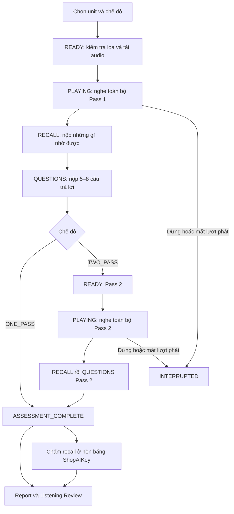
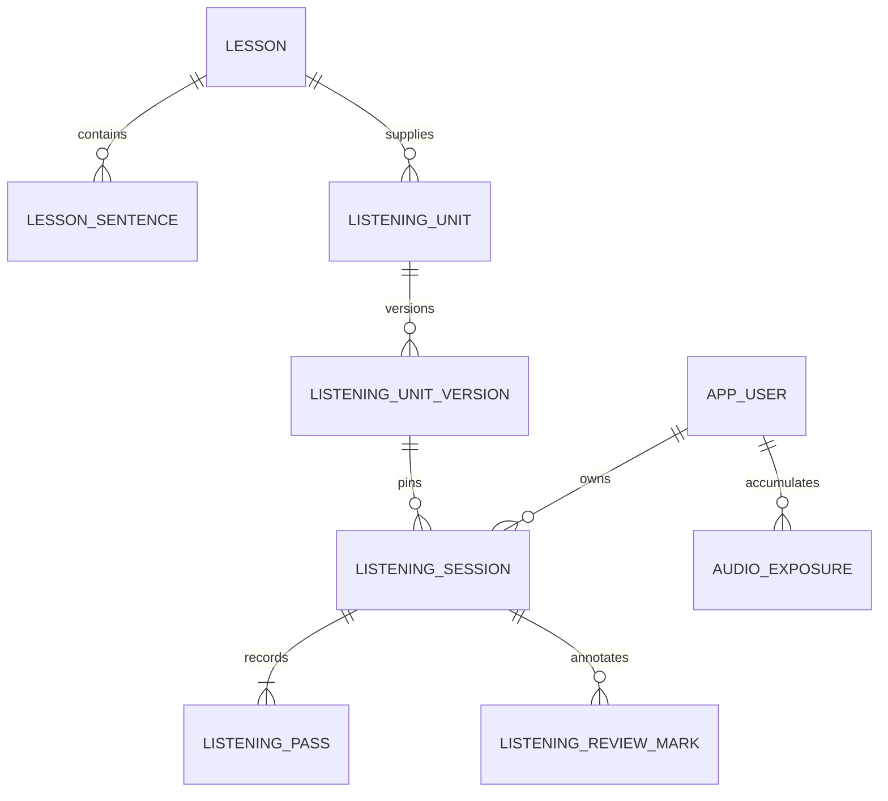

# DictaLab — Thiết kế Listening Comprehension

**Trạng thái:** Bản thiết kế v1 để review, chưa triển khai tính năng.  
**Ngày khảo sát:** 28/09/2026.  
**Nền tảng:** Java 17, Spring Boot 4.1.1, PostgreSQL/Flyway, HTML/CSS/JavaScript thuần.  
**AI provider:** ShopAIKey, theo quyết định của chủ project.

## 1. Mục tiêu và phạm vi

Đo người học hiểu và nhớ được gì sau lần đầu nghe trọn một audio. Cho nghe lần hai để tìm hiểu mức cải thiện, rồi mở transcript và công cụ luyện lại. Kết quả comprehension và recall được giữ riêng; không dùng khả năng viết tiếng Anh làm đại diện cho khả năng nghe hiểu.

Bao gồm One-Pass, Two-Pass, recall English/Vietnamese, 5–8 câu hỏi, report, review theo sentence/chunk, đánh dấu khó khăn, quản trị nội dung và lịch sử. Dùng chung lesson/audio/transcript/tài khoản với Dictation. Phần mềm vẫn là một ứng dụng Spring Boot.

Chưa thuộc phiên bản này: nhận câu trả lời bằng giọng nói, chấm phát âm, tạo audio mới, adaptive testing, quy đổi CEFR/IELTS, bảng xếp hạng, xây Error Bank hoàn chỉnh, phòng học chung cho Listening. Annotation được thiết kế đủ thông tin để Error Bank dùng sau.

## 2. Các quyết định cần review

Đây là phương án mặc định đề xuất, không phải các lựa chọn đã được người dùng duyệt.

| ID | Quyết định đề xuất | Lý do / ảnh hưởng |
|---|---|---|
| D01 | Một Listening Unit tương ứng một audio hội thoại hoàn chỉnh | Một lesson ELLLO đang gom nhiều hội thoại; dùng nguyên lesson sẽ trộn tình huống |
| D02 | UI, câu hỏi, lựa chọn đáp án và explanation bằng tiếng Việt; tên riêng giữ nguyên | Giảm ảnh hưởng của kỹ năng đọc tiếng Anh. Ngôn ngữ câu hỏi cố định trong phiên bản nội dung |
| D03 | Chọn One-Pass hoặc Two-Pass trước khi bắt đầu; mặc định Two-Pass | Không cho xem kết quả rồi quyết định nghe thêm trong cùng benchmark |
| D04 | Hai pass dùng cùng questions và facts; Pass 2 mở form trống | So sánh trực tiếp nhưng Pass 2 đã chịu gợi ý từ câu hỏi Pass 1; chỉ dùng diagnostic |
| D05 | Recall: captured = 1; partial = 0,5; missed/incorrect = 0; các fact cùng trọng số | Dễ giải thích, dễ đối chiếu; incorrect vẫn được thống kê riêng |
| D06 | Questions dùng trắc nghiệm một đáp án ở phiên bản đầu | Backend chấm xác định; không cần thêm lần gọi AI cho questions |
| D07 | Review mở khi đã khóa mọi bài nộp bắt buộc, không chờ AI chấm xong | Người học tiếp tục học khi AI chậm; AI chỉ chấm bản nộp đã khóa |
| D08 | Audio gián đoạn sau khi đã bắt đầu: dừng attempt; luyện lại bằng session mới có nhãn đã tiếp xúc | Không giả lập một lượt nghe trọn vẹn bằng nhiều lần nghe nối lại |
| D09 | Lịch sử exposure thiếu bằng chứng được ghi UNKNOWN và loại khỏi benchmark nghiêm ngặt | Bài cũ vẫn luyện được; không tuyên bố chắc chắn chưa nghe chỉ vì thiếu log |
| D10 | Không gộp điểm comprehension với recall hoặc điểm Dictation | Mỗi chỉ số đo một khía cạnh khác nhau |

Thay D02/D04/D05 sau khi có dữ liệu phải tạo protocol/content version mới. Không tính lại âm thầm kết quả cũ.

## 3. Kết quả khảo sát và ranh giới tái sử dụng

| Thành phần hiện có | Cách dùng trong thiết kế |
|---|---|
| `Lesson`, `LessonSentence`, `LessonRepository`, `LessonSentenceRepository` | Dùng lesson gốc và mốc câu; thêm Listening Unit để xác định một hội thoại |
| `LessonSentence.audioUrl/audioStartSeconds/audioEndSeconds/transcript` | Audio nguồn cho pass; transcript và timing cho review |
| `app.js`: `playRecordedAudio`, `loadAudioBuffer`, `audioSegment` | Giữ cơ chế Web Audio và cache; bổ sung progress callback/lifecycle cho Listening |
| `ApiDtos.SentenceReview` và UI review hiện tại | Tham khảo cấu trúc sentence/word; Listening có DTO riêng, không giả tạo WordAttempt |
| `PracticeSession`, `ScoringService`, `ListeningAssessmentService` | Tiếp tục phục vụ Dictation; Listening có session và scorer riêng |
| `SecurityConfig`, `DictaLabPrincipal`, CSRF, `SpaController` | Dùng chung bảo mật, định danh và điều hướng |
| `AdminContentService`, `MediaStorageService` | Dùng quyền quản trị, upload và quy tắc khóa nội dung; mở rộng kiểm tra tham chiếu Listening |
| `PersonalContentImportService` | Giữ quyền ADMIN của nội dung cá nhân; có thể tạo Listening Unit nếu đủ audio/timing |
| `scripts/enrich-preview-vocabulary.py` | Dùng lại cách xác thực và định dạng gọi ShopAIKey; Java backend tự gọi HTTP, không chạy Python theo request |

Các điểm phải sửa có chủ đích:

- `PracticeService.toState()` hiện trả toàn bộ câu qua `speechText`. Việc cấp nội dung này phải ghi exposure; DTO Listening không có trường tương đương.
- `CatalogService` trả preview words và preview audio. Cấp preview gắn với bài sẽ được ghi là đã tiếp xúc; catalog Listening dùng DTO tối giản riêng.
- `/audio/**` hiện công khai cả MP3 và các JSON/TXT có transcript. Cần chặn tài nguyên văn bản nội bộ qua HTTP trước khi mở benchmark.
- `AdminContentService.ensureContentEditable()` chỉ kiểm tra phiên Dictation. Cần bảo vệ cả Listening và tránh xóa file còn được dùng bởi nội dung/phiên bản Listening.
- Router, Voice Room và V14 đang có thay đổi chưa commit tại thời điểm khảo sát. Khi triển khai phải giữ các thay đổi này; chọn migration tiếp theo còn trống, không mặc định ghi đè V15 nếu đã có.

## 4. Nội dung và điều kiện xuất bản

### 4.1 Listening Unit

Một unit tham chiếu một lesson, một audio nguồn liên tục và tập sentence tương ứng. ELLLO được nhóm theo `audioUrl`; metadata nguồn còn có conversation number và speaker. Không nối các MP3 câu rời để giả lập hội thoại tự nhiên.

Mỗi pass phát file từ đầu đến cuối ở tốc độ 1×. Duration lấy từ metadata audio đã kiểm chứng khi chuẩn bị nội dung, không cộng duration các câu vì sẽ bỏ mất khoảng nghỉ.

Unit chỉ sẵn sàng khi:

1. Lesson được phép hiển thị với người học; audio truy cập được theo quyền gốc.
2. Có file hội thoại đầy đủ, duration hợp lệ, câu/timing khớp phạm vi file.
3. Có 4–12 key facts độc lập; khuyến nghị 4–8 fact cho audio ngắn.
4. Có 5–8 câu hỏi, mỗi câu đúng một lựa chọn; mọi đáp án có bằng chứng.
5. Có ít nhất một main idea và hai detail. Inference/speaker intent chỉ đưa vào khi có cơ sở rõ; loại không có được ghi N/A.
6. Câu hỏi không trùng ý quá nhiều, không cần kiến thức ngoài audio và không tiết lộ trực tiếp đáp án câu khác.
7. Admin đã nghe đối chiếu, sửa bản nháp AI và xuất bản phiên bản cụ thể.

Không cố ép audio quá ít thông tin thành đủ năm câu. Bài đó tiếp tục dùng cho Dictation.

### 4.2 Facts và questions

Mỗi fact có ID ổn định trong version, phát biểu chuẩn, các thành phần ý cần có, tiêu chí partial/incorrect, và sentence IDs làm bằng chứng. Facts phải độc lập để cùng một chi tiết không bị tính điểm hai lần.

Mỗi question có ID, loại, câu hỏi, 3–4 option IDs và nội dung, correct option ID, explanation tiếng Việt, evidence sentence IDs. Chỉ xáo thứ tự options một lần khi tạo session và giữ nguyên qua hai pass; không xáo lại khi refresh. Không dùng thứ tự option làm định danh.

Inference phải diễn giải được từ lời nói/ngữ cảnh; speaker intent phải có bằng chứng, không đoán cảm xúc từ văn bản khi audio không hỗ trợ. Nếu cần thông tin ngữ điệu, admin phải xác nhận từ audio khi duyệt.

### 4.3 Phiên bản và nguồn

Unit có các version DRAFT, PUBLISHED, RETIRED. Một unit chỉ có tối đa một version đang published. Session ghim version từ lúc tạo. Bản published không sửa trực tiếp; chỉnh sửa tạo draft mới. Retired ngăn session mới nhưng không làm mất report cũ.

Version chứa snapshot transcript/timing/questions/facts để lịch sử không phụ thuộc việc đổi thứ tự câu sau này. Audio đã có phiên học được giữ nguyên hoặc giữ file theo version; không xóa file còn tham chiếu.

Level và metadata hiển thị trên report lấy từ snapshot. Trước assessment chỉ dùng tiêu đề trung tính như “Bài nghe B1 · 03”, level và thời lượng; title/topic tiết lộ đáp án main idea chỉ hiển thị sau assessment.

## 5. Luồng người học và state machine



Session lưu `stage` và `currentPass` là nguồn trạng thái duy nhất. Kết quả chấm AI là trạng thái riêng của từng pass.

| Stage | Hành động hợp lệ | Điều kiện chuyển |
|---|---|---|
| READY | Chuẩn bị audio, bắt đầu, hủy | Pass 2 chỉ tồn tại sau khi Questions 1 đã nộp |
| PLAYING | Báo hoàn tất hoặc gián đoạn | Backend đã cấp một playback token và tiêu thụ lượt start |
| RECALL | Lưu nháp, nộp recall | Playback đã hoàn tất hợp lệ |
| QUESTIONS | Lưu lựa chọn, nộp cả bộ | Recall đã khóa; questions mới được cấp |
| ASSESSMENT_COMPLETE | Xem report/review, ghi annotation | Đã nộp pass cuối theo mode; bài làm bất biến |
| INTERRUPTED / ABANDONED | Xem lý do, bắt đầu session mới | Không tiếp tục lượt phát; không mở đáp án theo URL review |

One-Pass kết thúc ngay sau Questions 1. Two-Pass không có nút “xem điểm Pass 1”. Đã chọn Two-Pass nhưng bỏ dở sau Pass 1: lưu bài nộp Pass 1 như evidence chưa hoàn tất toàn flow; không mở review, không đưa vào thống kê session hoàn thành mặc định.

Nếu muốn chuyển sang luyện/review khi bỏ dở, thao tác riêng phải đóng session dưới trạng thái ABANDONED, ghi exposure/reveal và không trình bày nó như assessment đã hoàn thành. Phiên bản đầu có thể chỉ cung cấp “Bắt đầu bài khác”, chưa cần thêm luồng bỏ qua assessment.

### 5.1 Khóa và phục hồi dữ liệu

- Lưu nháp recall/questions sau khoảng 1 giây ngừng nhập; hiển thị “Đã lưu” hoặc “Chưa lưu được”.
- Nháp chỉ tồn tại phía server khi chưa nộp; `sessionStorage` giữ bản dự phòng ngắn hạn theo user/session/pass, xóa khi nộp thành công hoặc logout.
- Refresh tại RECALL/QUESTIONS phục hồi đúng nháp; không cho phát lại audio.
- Recall cho phép để trống với lựa chọn rõ “Tôi không nhớ được”; backend chấm tất cả facts là missed mà không gọi AI.
- Questions cho phép nộp thiếu sau nhắc số câu chưa trả lời; câu bỏ trống nhận 0 và lưu là unanswered.
- Nút nộp gửi toàn bộ nội dung cuối cùng cùng version; backend lưu và khóa trong một transaction để không mất ký tự chưa kịp autosave. Autosave đến muộn không được sửa bài đã khóa. Nộp trùng cùng nội dung trả kết quả cũ; nội dung khác sau khi khóa trả 409.
- Hai tab cùng sửa nháp dùng `version` để phát hiện xung đột. Không ghi đè bản mới bằng request cũ.

## 6. Playback một lượt

### 6.1 Trình tự

1. Trang chuẩn bị dùng âm thanh kiểm tra loa riêng, không thuộc bài.
2. Tải/giải mã audio bài vào buffer; chưa tiêu thụ lượt phát. Việc cấp file vẫn được ghi exposure gắn với session hiện tại.
3. Khi bấm bắt đầu, frontend gửi start với một `clientPlaybackId` và request ID. Backend ghi thời điểm, khóa lượt và trả playback token.
4. Frontend phát ngay buffer ở 1×; progress theo đồng hồ AudioContext. Không có controls mặc định cho seek/replay/rate.
5. Khi phát hết tự nhiên, gửi complete với token. Backend kiểm tra session/pass/stage, token và thời lượng hợp lý rồi mở RECALL.
6. Complete trùng với cùng token phải thành công idempotent; mất response không buộc nghe lại.

Thời gian server phải tối thiểu `duration - tolerance`; tolerance ban đầu 1 giây để xử lý sai số, cần kiểm thử thực tế. Đây chỉ là kiểm tra hợp lý, không chứng minh âm thanh đã đến tai người dùng. Client không được tự chọn duration hoặc tốc độ để tính điều kiện.

### 6.2 Các trường hợp lỗi

| Trường hợp | Hành vi |
|---|---|
| Tải audio thất bại trước start | Cho tải lại; chưa tiêu thụ lượt. Không tự chuyển sang TTS |
| Start bị từ chối/mất response | Retry cùng request ID; đối chiếu trạng thái, không tạo start thứ hai |
| Trình duyệt không phát được sau khi server cấp lượt | Ghi INTERRUPTED; session mới có nhãn đã tiếp xúc, nêu lý do kỹ thuật |
| Rớt mạng nhưng buffer tiếp tục phát | Cho phát hết; giữ complete pending và thử gửi lại khi có mạng |
| AudioContext bị suspend giữa chừng, người dùng bấm dừng, rời trang hoặc refresh khi đang phát | Dừng attempt và ghi gián đoạn; không tự phát tiếp |
| Chuyển tab nhưng audio vẫn chạy liên tục | Không tự đánh trượt chỉ vì tab ẩn; chỉ ghi gián đoạn khi playback thực sự dừng |
| Tab thứ hai mở cùng session | Chỉ hiển thị trạng thái; không giành quyền hoặc tự cấp lượt |
| Backend khởi động lại | Trạng thái DB giữ nguyên; lượt đã start không được reset |

Một lượt PLAYING không có complete sẽ hết hạn sau duration cộng khoảng đệm 5 phút để gửi lại completion. Hết hạn đóng attempt. Nếu browser đã mất buffer/timeline do refresh, không dùng khoảng đệm để phát lại. Có nút dừng/hủy cho người học; dừng đồng nghĩa lượt bị gián đoạn.

Reuse `playRecordedAudio()` với callback tiến trình tùy chọn và phân biệt kết thúc tự nhiên với cancel. Các caller Dictation không truyền tùy chọn phải giữ hành vi cũ. Không tạo player thứ hai cạnh tranh AudioContext hoặc mic Voice Room; phải rời cuộc gọi trước khi bắt đầu Listening.

## 7. Exposure và benchmark

### 7.1 Định danh audio

Thêm `audio_content_key` vào `lesson_sentences`; cùng file dùng cùng key. Công cụ nhập nội dung tính SHA-256 một lần, không hash MP3 mỗi request. Key của file trùng byte được dùng chung ngay cả khi URL/lesson khác.

Hash không nhận diện được mọi bản re-encode hoặc audio đã cắt. Khi biết chúng là cùng nội dung, quy trình import phải liên kết về identity gốc và giữ digest file riêng trong metadata kiểm tra. Không tuyên bố file mới là audio mới chỉ dựa vào tên file. Tự động nhận diện nội dung âm thanh tương đương nằm ngoài phiên bản đầu.

### 7.2 Sự kiện cần ghi

| Nguồn | Thời điểm ghi | Tác động |
|---|---|---|
| DICTATION_CONTENT | API cấp `speechText`/hint/reveal/review | Nội dung đã có thể được đọc; coi là tiếp xúc |
| DICTATION_AUDIO / SHARED_PRACTICE | Bắt đầu nghe, gồm phòng học chung | Đã tiếp xúc dù chưa hoàn thành bài |
| CATALOG_PREVIEW | Backend cấp preview words gắn với bài; hoặc phát preview audio | Preview một phần cũng loại khỏi clean benchmark |
| LISTENING_PREPARE / LISTENING_PLAY | Cấp buffer/start trong session | Loại trừ chính session khỏi baseline; session kế tiếp biết đã tiếp xúc |
| LISTENING_REVIEW | Cấp transcript/answer hoặc nghe review | Đã tiếp xúc |
| ADMIN_CONTENT | Admin xem transcript/duyệt nội dung | Tác giả/người duyệt không là người nghe mới |
| SELF_REPORTED | Người học báo đã nghe ở nơi khác | Đã tiếp xúc |

Ghi exposure idempotent theo user + audio key + source + source reference. Nếu một catalog trả preview của nhiều bài, ghi cho đúng các bài đã cấp preview, không chỉ bài được click. Ghi khi server cấp nội dung là cách bảo thủ vì không thể biết người học có thực sự đọc hay không.

### 7.3 Điều kiện và snapshot

Session lưu riêng:

- `priorExposure`: UNSEEN_RECORDED / EXPOSED / UNKNOWN.
- Mỗi pass có `protocolValid` và `validityReasons`: lượt nghe, thứ tự bước và sự trợ giúp ngoài protocol của riêng pass đó.
- `benchmarkEligible`: kết quả tổng hợp cho Pass 1.
- `benchmarkReasons`: các mã lý do, không chỉ một boolean.
- `exposureCheckedAt`, `protocolVersion` và version nội dung.

Pass 1 đủ điều kiện benchmark khi baseline là UNSEEN_RECORDED, không có tiếp xúc từ nguồn khác trước khi khóa Questions 1, phát trọn vẹn đúng protocol và đã nộp Recall 1/Questions 1. Pass 2 không bao giờ là benchmark lần đầu. `benchmarkEligible` mô tả evidence Pass 1; thống kê session hoàn tất còn lọc theo stage tại mục 8.4.

Khi khởi tạo session và ghi exposure từ nguồn khác, dùng transaction ngắn với khóa cùng user để tránh hai request đồng thời cùng nhận “chưa học”. Session đang diễn ra không được tự loại vì exposure do chính nó tạo. Nguồn ngoài session cấp nội dung cùng audio trước khi khóa Questions 1 làm `benchmarkEligible=false` và thêm lý do; không phá flow Dictation ở tab còn lại.

Exposure ngoài protocol xuất hiện sau khi Questions 1 đã khóa chỉ làm Pass 2 không hợp lệ để so sánh. Không hồi tố xóa điều kiện Pass 1 vì người học xem review sau đó, và không làm mất bài nộp Pass 1 khi audio Pass 2 bị gián đoạn. Nếu một pass không hợp lệ, vẫn giữ câu trả lời nhưng improvement trả null kèm lý do “không đủ điều kiện so sánh”.

### 7.4 Dữ liệu cũ

Backfill từ PracticeSession/SentenceAttempt/WordAttempt và dữ liệu đã cấp transcript có thể suy ra. Với phiên đã tạo nhưng chưa đủ telemetry để biết audio nào trong lesson đã được tiếp xúc, gắn nhãn bảo thủ cho các audio có thể bị ảnh hưởng.

Preview và file transcript công khai trước ngày bật tracking không có log đầy đủ. Lưu mốc `exposureTrackingSince` cho unit; với tài khoản cũ và audio đã tồn tại trước mốc đó, trạng thái chưa có bằng chứng là UNKNOWN. Audio mới được đưa vào sau khi tracking đầy đủ có thể tạo benchmark mới cho tài khoản cũ. Tài khoản mới sau mốc tracking có baseline theo dữ liệu ghi nhận và tự khai báo.

Hệ quả của D09: một phần kho audio cũ sẽ chỉ dùng luyện/diagnostic cho người dùng lâu năm. Report phải nói rõ lý do thay vì giấu bài. Không sửa lại các điểm Dictation cũ; các phiên Dictation mới có thể tham khảo exposure chung để tránh coi audio vừa học ở Listening là bài mới.

Không có bảo đảm chống việc nghe ngoài ứng dụng, audio công khai đã cache hoặc can thiệp DevTools. UI dùng “Đủ điều kiện đo lần đầu theo lịch sử ứng dụng”, không tuyên bố kỳ thi chống gian lận.

## 8. Chấm điểm

### 8.1 Recall

Chấm theo từng fact, không theo độ giống câu chữ. Cho phép English, Vietnamese, pha trộn hai ngôn ngữ và tiếng Việt không dấu khi vẫn hiểu được. Không trừ grammar/spelling; nếu cách viết làm nghĩa không xác định thì ghi cần kiểm tra, không tự đoán.

| Trạng thái | Tiêu chí | Điểm |
|---|---|---:|
| CAPTURED | Đủ các thành phần ý cốt lõi, đúng quan hệ người/hành động/thời gian | 1 |
| PARTIAL | Nêu đúng một phần đáng kể, thiếu chi tiết; không có mâu thuẫn trực tiếp | 0,5 |
| MISSED | Không có ý tương ứng trong recall | 0 |
| INCORRECT | Nêu ý liên quan nhưng sai nội dung cốt lõi, phủ định, chủ thể hoặc số liệu | 0 |

Nếu cùng fact vừa được nêu đúng vừa bị phủ định ở phần khác mà không có câu tự sửa rõ, xếp INCORRECT. Nếu người học tự sửa rõ trong bài, dùng ý cuối đã sửa. Một câu có thể bao phủ nhiều facts độc lập; một fact chỉ tính một lần. Thông tin bịa thêm không khớp fact nào được lưu ở `unsupportedClaims`, không tự tạo thêm mẫu số hay điểm phạt ngoài rubric v1.

`recallPercent = 100 × (captured + 0,5 × partial) / totalFacts`.

Backend tính điểm từ các nhãn hợp lệ; bỏ qua mọi overall score do model tự đề xuất. Model phải trả đúng toàn bộ fact IDs, không thiếu, trùng hoặc thêm ID. Evidence từ recall phải là đoạn trích có thật trong bài nộp; evidence từ audio phải dùng sentence IDs nằm trong version.

### 8.2 Questions và improvement

`comprehensionPercent = 100 × correctQuestions / totalQuestions`. Sai hoặc unanswered = 0; không trừ điểm đoán sai, không cho partial trong MCQ một đáp án.

Accuracy từng loại = số đúng / tổng câu loại đó, kèm số lượng quan sát. Tổng câu loại bằng 0 trả `null`/N/A, không trả 0%. Một bài có một câu inference không đủ để kết luận người học yếu inference nói chung.

`recallImprovementPp = recall2 - recall1`; tương tự comprehension. Tính bằng giá trị chưa làm tròn rồi hiển thị một chữ số thập phân. Không dùng phần trăm tương đối, không ép delta âm thành 0. One-Pass hoặc pass chưa chấm xong trả null cho delta tương ứng.

Ví dụ minh họa: 6 câu hỏi, Pass 1 đúng 4, Pass 2 đúng 5: 66,7% và 83,3%, tăng 16,7 điểm phần trăm. Bốn facts từ 2 captured + 1 partial + 1 missed sang 3 captured + 1 partial: recall 62,5% lên 87,5%, tăng 25 điểm phần trăm.

### 8.3 Insight

Sinh insight ngắn bằng quy tắc trên điểm đã tính để giảm thêm một lần gọi AI. Tối đa ba câu, có dẫn chứng: “Bạn đúng 1/3 câu chi tiết ở lượt đầu; lượt hai đúng 3/3.” Dữ liệu ít dùng diễn đạt “trong bài này”.

Lỗi nghe âm/từ hoặc hiểu nghĩa lấy từ annotation người học, không suy ra chắc chắn chỉ từ đáp án sai. Không đưa kết luận về trí nhớ, nhận thức hoặc CEFR từ một bài. Chỉ insight nào cần giải thích ngữ nghĩa mới dùng explanation đã soạn/chấm từ AI và luôn gắn với fact/câu cụ thể.

### 8.4 Lịch sử và thống kê nhiều bài

History có thể liệt kê mọi session theo filter, nhưng dashboard mặc định chỉ tổng hợp `ASSESSMENT_COMPLETE`. Các bài EXPOSED/UNKNOWN có nhóm luyện tập riêng; nhóm benchmark chỉ lấy Pass 1 đủ điều kiện và không đếm lặp cùng audio identity. Session Two-Pass bỏ dở vẫn giữ evidence Pass 1, chưa được tính như một buổi hoàn tất.

Điểm trung bình comprehension/recall là trung bình điểm các bài trong nhóm đang xem, kèm số bài có điểm. Recall PENDING/FAILED/NEEDS_REVIEW không vào mẫu số recall; UI nêu số bài còn chờ. Accuracy theo loại câu hỏi tính tổng số đúng chia tổng số câu của loại đó trong nhóm, không trung bình các tỷ lệ từ mẫu có kích thước khác nhau. Improvement chỉ tổng hợp những cặp pass hợp lệ và đã chấm đủ cho metric tương ứng.

Report và history luôn ghi nguồn chấm `AI` hoặc `ADMIN_REVIEWED` cùng revision. COMPLETED của AI chỉ nghĩa là đã có output hợp lệ theo hợp đồng, không bảo đảm nhãn ngữ nghĩa luôn đúng. Khi admin sửa nhãn, giữ bản gốc và thời điểm sửa; cập nhật score/delta/summary có nguồn revision mới.

## 9. ShopAIKey và hợp đồng AI

### 9.1 Cấu hình và trách nhiệm

Tích hợp phía Java backend với `java.net.http.HttpClient` và Jackson đã có trong project. Một `ShopAiKeyClient` dùng cho hai mục đích nội dung và recall; không cần Spring AI, LangChain hay Python service.

| Cấu hình đề xuất | Ý nghĩa |
|---|---|
| `SHOPAIKEY_API_KEY` | Khóa môi trường phía server; không lưu DB/browser/log |
| `SHOPAIKEY_BASE_URL` | Mặc định `https://api.shopaikey.com/v1`; chỉ cấu hình vận hành được phép đổi |
| `SHOPAIKEY_MODEL` | Model dùng cho grading; bắt buộc khi bật AI, kiểm tra khả dụng khi thiết lập |
| `SHOPAIKEY_CONTENT_MODEL` | Tùy chọn model soạn nội dung; mặc định dùng model grading |
| `DICTALAB_LISTENING_ENABLED` | Bật/tắt nhận session mới và điều hướng tính năng |

Script cũ mặc định `claude-opus-5`. Đây là dấu vết cấu hình, không phải xác nhận model còn khả dụng hoặc là lựa chọn tốt nhất cho grading. Dùng endpoint danh sách model của ShopAIKey và phép thử nhỏ khi có khóa; chọn một model qua bộ mẫu được gán nhãn trước. Ghim model/prompt/rubric version trong session để hai pass có cùng điều kiện chấm. Không âm thầm đổi sang model khác khi lỗi.

Khóa hiện chưa có trong biến môi trường đang chạy hoặc `.env` project tại lần kiểm tra trước. Thiết kế không chứa khóa. Khi triển khai cần nối cấu hình vào script local/Windows Service; không giả định Spring tự đọc `.env`.

### 9.2 Sinh nội dung

Admin chọn unit và bấm “Tạo bản nháp bằng AI”. Backend gửi transcript có sentence IDs, CEFR, ngôn ngữ câu hỏi và yêu cầu 5–8 questions/4–12 facts. AI tạo JSON bản nháp gồm facts, questions, evidence và explanations. Không cần gửi MP3 vì transcript/timing đã có; admin chịu trách nhiệm kiểm chứng các câu liên quan ngữ điệu.

Validate kiểu dữ liệu, độ dài, IDs, số lượng, option duy nhất, evidence hợp lệ và tính đầy đủ. Các kiểm tra tự động không thay thế việc duyệt đáp án. Lỗi trả draft chưa hợp lệ cùng lý do; tuyệt đối không tự publish.

Thao tác tạo nội dung lưu job state và input hash/version trên bản draft, trả 202. Worker dùng cùng cơ chế DB pending/lease với grading, không thêm broker. Nếu admin đã sửa draft khi AI đang chạy, kết quả cũ không được ghi đè draft mới; đánh dấu generation hết hiệu lực và cho tạo lại theo nội dung mới. Retry cùng request ID không tạo thêm draft hoặc trả phí lại nếu kết quả đã lưu.

### 9.3 Grading recall

Sau `ASSESSMENT_COMPLETE`, enqueue tối đa một grading job cho mỗi pass có recall không rỗng. Chấm hai pass bằng hai request độc lập với cùng cấu hình; không gửi câu trả lời pass còn lại hay nhãn “Pass 2 tốt hơn” để tránh thiên lệch so sánh.

Đầu vào: rubric version, facts có bằng chứng, transcript liên quan và recall nguyên văn. Không gửi email, tên tài khoản hoặc lịch sử khác. Prompt coi recall/transcript là dữ liệu, không làm theo chỉ dẫn được chèn vào chúng. Giới hạn input theo hợp đồng trước khi gọi.

Hợp đồng đầu ra tối thiểu:

```json
{
  "schemaVersion": 1,
  "facts": [
    {
      "factId": "F1",
      "status": "CAPTURED",
      "recallEvidence": ["đoạn nguyên văn trong bài nộp"],
      "evidenceSentenceIds": [301],
      "explanationVi": "Giải thích ngắn đối chiếu ý.",
      "needsReview": false
    }
  ],
  "unsupportedClaims": [],
  "needsReview": false
}
```

Đây là ví dụ rút gọn một fact; response thật phải chứa đủ facts của version. Với MISSED, `recallEvidence` rỗng. Explanation là lý do ngắn có bằng chứng, không yêu cầu chuỗi suy luận nội bộ của model.

Yêu cầu JSON; dùng structured output/JSON mode nếu model đã được kiểm chứng hỗ trợ. Dù provider hỗ trợ hay không, backend luôn validate. `finish_reason` cho thấy output bị cắt, refusal, content rỗng hoặc schema sai đều không được tính điểm. Không dùng regex tìm một con số rồi xem đó là điểm.

### 9.4 Bền vững, retry và kiểm soát chi phí

Grading status: NOT_REQUESTED, PENDING, RUNNING, COMPLETED, NEEDS_REVIEW, FAILED. Chỉ COMPLETED có recall score trong report; NEEDS_REVIEW giữ phản hồi dự thảo và báo chưa có điểm xác nhận. Admin có thể sửa nhãn với lý do, lưu người sửa/thời điểm/giá trị AI gốc; người học không tự sửa điểm.

Worker claim row bằng cập nhật có điều kiện và lease; commit trước khi gọi AI. Lưu kết quả bằng điều kiện lease/token để worker cũ không ghi đè worker mới. Không giữ transaction DB suốt HTTP request. Khi process chết, lease hết hạn cho phép retry từ đúng snapshot.

Mặc định thử tối đa ba lần: lần đầu và hai retry có backoff khoảng 5/30 giây kèm jitter. Tôn trọng Retry-After có giới hạn; chỉ retry lỗi mạng/429/5xx hoặc một lần sửa output không hợp lệ trong ngân sách ba lần. 401/403/400 cấu hình không retry mù. Timeout ban đầu 45 giây/request, kiểm tra với model được chọn; output budget riêng cho content và recall. Kết quả hợp lệ đã lưu không gọi lại khi refresh report.

Không thể hứa exactly-once với dịch vụ AI ngoài: timeout có thể xảy ra sau khi provider đã xử lý, nên retry có thể tính phí lần nữa. DB dedup bảo đảm một kết quả được chấp nhận cho mỗi job, không bảo đảm một lần tính phí.

Giới hạn concurrency ban đầu hai request/server, quota khởi tạo assessment theo user/ngày cấu hình được. Admin content generation có quota riêng. Lưu model, usage token, latency, status và request ID khi provider trả; không log khóa, raw recall hoặc toàn bộ transcript. Khi mất cấu hình AI, khóa tạo session mới với thông báo rõ; phiên đang làm vẫn nhận bài nộp và giữ PENDING/FAILED để xử lý sau.

## 10. Mô hình dữ liệu đề xuất

Sáu bảng mới. Facts/questions nằm trong JSONB version bất biến; responses/evaluations nằm trong JSONB pass. Đây là lựa chọn giảm số bảng khi mỗi unit chỉ có 5–8 questions và số facts nhỏ. Các trường cần lọc, join, kiểm soát trạng thái hoặc tổng hợp điểm vẫn là cột quan hệ.

| Bảng | Trường chính |
|---|---|
| `listening_units` | id, lesson_id, audio_content_key, audio_url, duration_ms, safe_title, active, exposure_tracking_since, audio_available_since, created_at |
| `listening_unit_versions` | id, unit_id, revision, status, level_snapshot, question_language, definition_json, content_hash, rubric_version, created_by, published_at, generation_status/attempts/lease/request_id/input_hash, version |
| `listening_sessions` | UUID id, user_id, unit_version_id, audio_content_key, mode, stage, current_pass, protocol_version, prior_exposure, benchmark_eligible, benchmark_reasons_json, exposure_checked_at, option_order_json, grader_model/prompt_version, create_request_id/payload_hash, created_at, assessment_completed_at, closed_at, version |
| `listening_passes` | id, session_id, pass_number, playback_token, client_playback_id, start_request_id/payload_hash, playback_started_at/ended_at, protocol_valid, validity_reasons_json, interruption_reason, recall_text, recall_submitted_at, answers_json, answers_submitted_at, comprehension_score, recall_score, type_scores_json, grading_status, grading_attempts, next_attempt_at, lease_until/lease_token, evaluation_json, usage_json, graded_at, manual_review_json, version |
| `listening_review_marks` | id, session_id, unit_version_id, sentence_id, word_start/word_end nullable, audio_start_ms/audio_end_ms, difficulty_type, note, created_at, updated_at |
| `audio_exposures` | id, user_id, audio_content_key, source_type, source_reference, first_seen_at, last_seen_at |

`definition_json` có `schemaVersion`, snapshot sentences/chunks, facts và questions. `evaluation_json` lưu kết quả AI đã validate cùng model/prompt version; `manual_review_json` giữ revision sửa của admin, không ghi đè bằng chứng AI gốc. Dữ liệu đánh giá lưu bền vững, không phụ thuộc một cache có thể mất.

Thêm cột nullable `lesson_sentences.audio_content_key` để backfill dần. Unit chưa có mapping/hash/duration đúng chưa được publish. Không ép toàn bộ lesson cũ phải có Listening Unit.

Ràng buộc và index:

- FK user/lesson/unit/version/session; không cascade xóa nội dung có history. Xóa tài khoản theo quy trình có chủ đích, xóa toàn bộ responses/exposures/marks của tài khoản đó.
- Unique `(unit_id, revision)`; partial unique một PUBLISHED version/unit.
- Unique `(session_id, pass_number)`; CHECK pass thuộc 1/2, current_pass phù hợp mode, score nullable hoặc 0–100, duration > 0.
- Partial unique một session đang hoạt động cho `(user_id, audio_content_key)`; kết hợp user lock ở bước tạo session. Session dở phải hủy rõ trước khi tạo lượt khác cùng audio.
- Unique exposure `(user_id, audio_content_key, source_type, source_reference)` để retry không nhân bản.
- Index `(user_id, created_at DESC)` cho history; `(user_id, audio_content_key)` cho exposure; `(grading_status, next_attempt_at)` cho worker.
- Playback token là nonce gắn với user/session/pass, không thay xác thực hoặc kiểm tra owner; lưu để retry start có thể trả lại đúng response khi bị mất mạng, không ghi log. Idempotency key lưu cùng payload hash, dùng lại key cho payload khác trả 409. Unique `(user_id, create_request_id)` chống tạo session trùng; các transition đã khóa được dedup bằng dữ liệu pass, không cần bảng idempotency tổng quát.
- Validate JSON schema ở server; không nhận `score`, `correctAnswer`, `stage`, `userId` hoặc `benchmarkEligible` từ client làm nguồn thật.

PostgreSQL là môi trường xác minh ràng buộc JSONB/partial index/concurrency. H2 hiện tại vẫn dùng cho test phù hợp; test H2 không được coi là bằng chứng các đặc tính PostgreSQL đã chạy đúng.



## 11. API và dữ liệu được cấp theo stage

Tất cả learner API dưới `/api/v1/listening`; lấy user ID từ `DictaLabPrincipal`. API quản trị dưới `/api/admin/listening`. Dùng CSRF hiện có cho mutation. UUID khó đoán không thay cho kiểm tra owner.

### 11.1 Learner API

| Method / path tương đối | Mục đích và điều kiện |
|---|---|
| GET `/units?level=B1&exposure=all&page=0` | Danh sách an toàn: unit ID, safe title, level, duration, exposure badge, session dở; không có preview/transcript |
| POST `/sessions` | `{unitId, mode, heardBefore}`; kiểm tra published/version/quyền/quota, trả session state. Header request ID chống tạo trùng |
| GET `/sessions/{id}` | Trả stage, currentPass, allowedActions, benchmark badge và dữ liệu đúng bước |
| GET `/sessions/{id}/passes/{n}/audio` | Cấp audio/buffer theo quyền và stage; ghi exposure, không mở transcript; request tải lại trước start không tiêu thụ lượt |
| POST `/sessions/{id}/passes/{n}/playback/start` | `{clientPlaybackId}` + request ID; cấp token duy nhất, READY → PLAYING |
| POST `/sessions/{id}/passes/{n}/playback/complete` | `{playbackToken}`; hoàn tất hợp lệ, PLAYING → RECALL |
| POST `/sessions/{id}/passes/{n}/playback/interrupt` | `{playbackToken, reason}`; ghi gián đoạn, đóng attempt |
| PUT `/sessions/{id}/passes/{n}/recall` | `{text, version}`; lưu nháp RECALL, tối đa 6.000 ký tự |
| POST `/sessions/{id}/passes/{n}/recall/submit` | `{text, version}`; lưu nội dung cuối và khóa, RECALL → QUESTIONS; trả câu hỏi không có key |
| PUT `/sessions/{id}/passes/{n}/answers` | `{answers: [{questionId, optionId}], version}`; lưu nháp; tối đa một đáp án/question |
| POST `/sessions/{id}/passes/{n}/answers/submit` | `{answers, version}`; lưu và khóa câu trả lời cuối; mở READY Pass 2 hoặc ASSESSMENT_COMPLETE; không trả điểm Pass 1 trước pass cuối |
| POST `/sessions/{id}/abandon` | Đóng session chủ động, giữ evidence; không mở review |
| GET `/sessions/{id}/report` | Sau ASSESSMENT_COMPLETE; trả điểm có sẵn và grading status, không gọi AI trực tiếp |
| GET `/sessions/{id}/review` | Sau ASSESSMENT_COMPLETE; cấp transcript, keys, facts, explanations và timing |
| GET/POST `/sessions/{id}/review-marks` | Liệt kê/thêm lỗi tự đánh dấu sau assessment |
| PUT/DELETE `/sessions/{id}/review-marks/{markId}` | Sửa/xóa annotation thuộc đúng owner và session |
| GET `/history?level=all&mode=all&page=0` | History Listening phân trang; có cả hoàn tất và dở nếu chọn filter |
| GET `/summary?range=30d` | Thống kê Listening riêng, chỉ evidence hợp lệ cho từng metric |

Server không dựa vào `allowedActions` do client gửi; đây chỉ là hướng dẫn render UI. Request không đúng stage trả 409. Owner/quyền nội dung không hợp lệ trả 404; thiếu đăng nhập 401; CSRF 403; payload sai 400; quota 429. Error Listening có `code` ổn định bên cạnh message/path/timestamp, không cần thay contract lỗi cũ toàn hệ thống.

Trước assessment không trả questions chưa đến bước, facts, đáp án đúng, explanations, transcript, speechText, word masks, source page hay title tiết lộ nội dung. Khi đã nộp Pass 1, endpoint session ở Pass 2 không trả bài nộp cũ cho UI; bài cũ vẫn lưu ở DB và mở lại trong report.

### 11.2 Admin API

- GET/POST `/units`: tìm lesson/audio phù hợp, tạo unit draft từ dữ liệu sẵn có.
- POST `/units/{id}/versions`: tạo bản sửa dựa trên version cũ.
- PUT `/versions/{versionId}`: sửa facts/questions/snapshot trong DRAFT.
- POST `/versions/{versionId}/generate`: tạo nội dung qua ShopAIKey, trả job status; chỉ ghi vào draft đúng revision.
- GET `/versions/{versionId}`: lấy nội dung và trạng thái generation để review.
- PUT `/versions/{versionId}/publication`: publish/retire sau validation; không nhận AI output từ browser làm đã duyệt.
- GET `/grading?status=NEEDS_REVIEW`: danh sách cần kiểm tra, phân trang.
- POST `/passes/{passId}/grading/retry`: retry có kiểm soát; giữ model/rubric đã ghim.
- POST `/passes/{passId}/grading/review`: lưu điều chỉnh nhãn, lý do và audit; backend tính lại điểm/delta theo revision mới, report ghi “đã kiểm tra”.

### 11.3 Ranh giới transcript và audio

Thêm deny/handler rõ cho file metadata transcript dưới `/audio/elllo/**`: `segments.json`, `manifest.json`, `lesson.json`, `transcript.txt`; dùng whitelist MP3 thực tế hoặc matcher đã kiểm thử. Giữ file nguồn cho các script offline, tránh sửa đồng loạt đường dẫn của importer nếu chỉ cần chặn HTTP. Kiểm tra cả request chưa đăng nhập, đã đăng nhập, encoding đường dẫn và cache/reverse proxy đang có.

DTO Listening luôn lọc server-side theo stage. Các endpoint Dictation cũ vẫn cấp nội dung theo flow cũ nhưng phải ghi exposure và làm mất điều kiện benchmark của session Listening liên quan. Nội dung đã cache hoặc đọc ngoài ứng dụng là giới hạn được nêu tại mục 7, không thể thu hồi bằng cách giấu HTML.

Private media vẫn chỉ ADMIN; không tạo endpoint Listening proxy cho phép user thường đọc nội dung cá nhân. URL audio do server lấy từ dữ liệu được duyệt, không nhận URL tùy ý để fetch nhằm tránh SSRF.

## 12. Thiết kế màn hình

Giữ typography, màu sắc, spacing, button và cách báo lỗi của DictaLab. Dùng hai nhãn rõ trong mục Luyện tập: **Dictation** và **Nghe hiểu**. History/Progress có bộ lọc theo chế độ; chọn Listening gọi endpoint mới, chọn Dictation giữ contract cũ.

| Màn hình / route | Nội dung chính | Hành động |
|---|---|---|
| Catalog `/listening?level=B1` | Level, thẻ bài có mã trung tính, duration, badge exposure | Chọn bài; filter chưa ghi nhận/đã học/không rõ |
| Session `/listening/sessions/{id}` — READY | Mode, quy tắc một lượt, trạng thái tải, kiểm tra loa, tự khai báo trước khi tạo session | Bắt đầu; hủy |
| Session — PLAYING | “Lượt nghe 1/2”, progress và thời gian; không hiển thị câu hỏi | Dừng và kết thúc lượt |
| Session — RECALL | Textarea lớn, lời nhắc chấp nhận Anh/Việt và không chấm chính tả, trạng thái lưu | Nộp recall; chọn không nhớ |
| Session — QUESTIONS | 5–8 câu dưới dạng fieldset/radio; tiến độ đã trả lời | Nộp bộ câu hỏi |
| Session — READY Pass 2 | “Đã lưu lượt đầu. Bạn sẽ nghe lại toàn bộ một lần.” | Bắt đầu lượt hai; không có điểm/đáp án |
| Result `/listening/sessions/{id}/report` | Bảng hai pass, delta, loại câu hỏi, fact breakdown, benchmark badge | Mở Review; xem bài nộp của từng pass |
| Review `/listening/sessions/{id}/review` | Player, transcript đồng bộ, explanation và marks | Phát toàn bài/segment, tốc độ, đánh dấu đoạn khó |
| History `/listening/history` | Ngày, unit, mode, điểm Pass 1, trạng thái chấm và exposure | Mở report hoặc tiếp tục đúng stage |
| Admin `/admin/listening` | Unit/version, published state, jobs/needs review | Soạn, duyệt, xuất bản |

Ví dụ bố cục report; số liệu chỉ minh họa:

```text
Nghe hiểu · Bài B1-03                         [Đủ điều kiện lần đầu]

                        Lượt đầu       Lượt hai      Thay đổi
Hiểu qua câu hỏi         66,7%          83,3%         +16,7 điểm %
Nhớ ý chính/chi tiết     62,5%          87,5%         +25,0 điểm %

Theo loại câu hỏi: Ý chính 1/1 · Chi tiết 1/3 · Suy luận 1/1 · Ý định 1/1
Recall lượt đầu: 2 đủ ý · 1 một phần · 1 bỏ sót · 0 hiểu sai

Lượt hai dùng để chẩn đoán sau khi bạn đã xem câu hỏi lượt đầu.
[Xem bài nộp]                                      [Review bài nghe]
```

Nếu AI chưa xong, ô recall ghi “Đang chấm”, không hiển thị 0%. Report poll có backoff 2/5/10 giây và dừng khi rời trang/tab ẩn hoặc đạt trạng thái cuối; có nút tải lại. Không dùng WebSocket chỉ để cập nhật điểm.

### 12.1 Review chi tiết

Desktop: transcript và player ở vùng chính, explanation/annotation cạnh bên. Mobile: các vùng xếp dọc; giữ controls dễ chạm. Click một câu phát đúng segment; nghe toàn bài cập nhật câu active theo AudioContext timeline, xử lý khoảng nghỉ không nhảy sớm sang câu tiếp theo.

Tốc độ 0,75×, 1×, 1,25×. Với cách Web Audio hiện có, thay playbackRate cũng ảnh hưởng cao độ; UI chỉ gọi “nghe chậm”. Giữ nguyên cao độ cần khảo sát media element/native pitch preservation sau, không âm thầm hứa có tính năng đó.

Hai loại mark độc lập với nhãn chấm recall:

- `NOT_HEARD`: “Tôi không nhận ra âm/từ này khi nghe”.
- `HEARD_NOT_UNDERSTOOD`: “Tôi nghe được nhưng không hiểu nghĩa”.

Chọn một câu hoặc dải từ; token index dùng cùng tokenizer với snapshot. Với dải từ chưa có timestamp từng từ, replay cả sentence/chunk và ghi rõ như vậy. Không giả lập mốc từ từ độ dài chữ. Note tối đa 500 ký tự; timestamp do server suy ra từ segment được chọn, không tin khoảng thời gian tùy ý từ client.

Annotation là tự báo cáo sau assessment; không tự thay đổi điểm Pass 1/2. Sau này Error Bank có thể tham chiếu session/version/sentence/word range và evidence này.

### 12.2 Accessibility và an toàn dữ liệu UI

Focus chuyển về heading khi đổi bước; dùng fieldset/legend và radio native; error có mô tả và focus hợp lý. Không dùng màu làm tín hiệu duy nhất. Screen reader đọc nhãn/nút/trạng thái nhưng không được nhận transcript ẩn trước assessment.

Không giới hạn thời gian viết hoặc đọc câu hỏi trong bản đầu. Ghi thời gian để phân tích nhưng không đưa vào score. Tắt spellcheck của recall để giảm phân tâm; không thể chặn mọi công cụ bên ngoài. Cảnh báo rời trang khi nháp chưa lưu; audio có nút dừng để người học chủ động kết thúc.

Render recall/AI explanation như text đã escape, không đưa HTML từ model vào `innerHTML`. Logout xóa nháp/cache gắn người dùng; report và API nhạy cảm dùng `Cache-Control: no-store`.

## 13. Cấu trúc triển khai và điểm sửa code

Giữ cách chia domain/dto/repository/service/web của project. Không tạo microservice hoặc framework frontend mới.

| Phạm vi | Tệp/thành phần dự kiến |
|---|---|
| Cấu hình | `ListeningProperties`, `ShopAiKeyProperties`; cấu hình trong `application.yml` và `.env.example` |
| Domain/repository | Entity/repository cho sáu bảng mới; enum mode/stage/fact status/question type/difficulty type |
| DTO | `ListeningDtos`, `ListeningAdminDtos`; không kéo field riêng của Listening vào `ApiDtos.SentenceState` |
| Flow | `ListeningService`: owner, state transitions, drafts, submit, playback; transaction nhỏ |
| Điểm/report | `ComprehensionScoringService`: chấm MCQ, tính recall từ nhãn, delta, type breakdown, insight; `ListeningQueryService` đọc catalog/report/history |
| Nội dung | `ListeningContentService`: nhóm audio, version, validation, publish và draft generation |
| AI | `ShopAiKeyClient`, `RecallGradingService`, `ListeningAiWorker`; dùng pending rows, không thêm queue server |
| Exposure | `AudioExposureService`; gọi từ `PracticeService`, `CatalogService`, `HistoryService`, admin và Listening |
| Web | `ListeningController`, `ListeningAdminController`; cập nhật `SpaController`, `SecurityConfig`, lỗi Listening |
| Frontend | Thêm `listening.js` cho flow/render của module, cập nhật router và các mount point trong `app.js`/`index.html`; CSS scoped theo view |
| Shared frontend | `app.js` truyền các hàm `api`, điều hướng, audio và báo lỗi vào hàm khởi tạo Listening; không chuyển toàn app sang module system chỉ vì tính năng này |
| Bảo toàn media | Mở rộng `AdminContentService`/`MediaStorageService` để kiểm tra mọi tham chiếu trước sửa/xóa |
| Nội dung ban đầu | Công cụ tạo manifest unit/duration/hash từ audio và sentence hiện có; metadata AI là draft có thể review |
| CI/deploy | Bổ sung test JS, xác minh PostgreSQL trên DB riêng, đưa env AI vào service config an toàn |

Đây là danh sách trách nhiệm, không phải yêu cầu tạo interface/wrapper cho từng dòng. Khi implement, gộp những lớp nhỏ nếu chưa có lý do tách. Giữ API công khai của Dictation ổn định; phần exposure là sửa chéo có chủ đích và cần regression test.

## 14. Kiểm thử và tiêu chí nghiệm thu

### 14.1 Flow, bảo mật và hồi quy

| Nhóm | Kịch bản bắt buộc |
|---|---|
| Một lượt | Start lần hai bị chặn; complete trước duration bị chặn; hoàn tất trùng không lỗi; tải lại buffer trước start không tiêu thụ lượt |
| Thứ tự | Không lấy questions trước recall; không submit answers trước nghe; không review khi Pass 2 chưa nộp |
| Bất biến | Nộp lại payload khác bị chặn; đổi model/version không thay bài đã ghim; refresh giữ bài nộp |
| Quyền | User A không đọc/sửa session/marks/report của B; ADMIN-only media không bị endpoint mới làm lộ; CSRF hoạt động |
| Rò rỉ | Network DTO, HTML ẩn, accessibility tree và static JSON/TXT không chứa đáp án trước khi được phép; Dictation exposure làm mất điều kiện phiên liên quan |
| Concurrency | Hai tab start/submit đồng thời; hai session cùng audio; exposure từ room/catalog đồng thời với start; worker lease hết hạn |
| Lỗi thật | Mất mạng khi audio vẫn phát; refresh giữa audio; reload khi recall; server restart; AI timeout/429/401/output thiếu fact |
| Nội dung | Publish bị chặn khi thiếu audio/timing/fact/question/evidence; xóa media vẫn được tham chiếu bị chặn |
| Hồi quy | Dictation, history, scoring, recommendation, Voice Room, admin upload và SPA direct links hiện tại |

### 14.2 Bộ mẫu kiểm chứng recall

Chuẩn bị tối thiểu 40 bài recall ngắn gán nhãn theo fact thủ công, phủ A1–B2 và ba kiểu English/Vietnamese/pha trộn. Đây là tập kiểm thử riêng, không chứa tài khoản người học thật.

Có các trường hợp: paraphrase, tiếng Việt không dấu, lỗi spelling vẫn đúng ý, đúng một phần, không đề cập, đảo người, phủ định, nhầm số/thời gian, mâu thuẫn nội bộ, tự sửa, liệt kê lặp ý, nội dung bịa và prompt injection trong bài nộp.

Chạy mỗi mẫu hai lần để đo mức dao động. Gate đề xuất cho pilot: schema hợp lệ 100% sau retry trong bộ mẫu; agreement từng fact với nhãn đã duyệt ít nhất 90%; không lỗi ở nhóm phủ định/đảo chủ thể trọng yếu đã chọn. Các ngưỡng này là gate nội bộ để review, không là tuyên bố model đã đạt. Không đạt thì sửa rubric/prompt hoặc đổi model rồi ghi version mới.

### 14.3 Cách chạy kiểm tra khi implement

- `mvn test` và CI `mvn --batch-mode --no-transfer-progress clean verify`.
- `node --check` cho `app.js`, `listening.js`; `node --test src/test/js/*.test.cjs` cho logic browser độc lập, theo nền test Node hiện có.
- Test integration PostgreSQL riêng cho Flyway, JSONB, partial unique và concurrent transitions; không dùng PostgreSQL production hoặc volume local đang học.
- Test UI trên Chrome/Edge desktop và mobile viewport; ít nhất một thiết bị mobile thật cho autoplay/AudioContext gián đoạn trước mở rộng rollout.
- Test mock ShopAIKey bằng HTTP server local; live smoke test bằng khóa môi trường có sẵn và mẫu tổng hợp, không chép khóa vào test.
- Kiểm tra UTF-8 với skill Vietnamese Encoding Guard cho file tiếng Việt được sửa.

## 15. Migration, triển khai và vận hành

1. Chốt D01–D10 và protocol v1, thêm schema mới bằng migration tiến tới. Các bảng mới chưa ảnh hưởng lượt học cũ; cột audio key nullable cho phép backfill.
2. Tính duration/audio identity, tạo unit draft, backfill exposure và kiểm tra nội dung quyền riêng tư. Bắt đầu tracking ở mọi đường cấp nội dung trước khi bật benchmark.
3. Chặn metadata transcript công khai và kiểm tra regression audio/import scripts. Ghi mốc tracking thực sự hoạt động, không dùng mốc schema migration nếu instrumentation chưa bật đủ.
4. Cấu hình ShopAIKey trên server, chọn model bằng bộ mẫu, tạo và duyệt 8–12 unit đầu nếu đủ audio phù hợp. Không tự publish toàn bộ kho bằng AI.
5. Mở feature flag cho nhóm thử nghiệm, theo dõi completion rate, tỷ lệ interruption, AI failure/retry, token usage, số phiên EXPOSED/UNKNOWN, và phản hồi câu hỏi mơ hồ.
6. Mở rộng khi đạt nghiệm thu. Nếu có lỗi, tắt tạo session mới; phiên đang làm vẫn được nộp, report cũ vẫn đọc được. Giữ migration và dữ liệu; không rollback bằng drop tables.

Backup PostgreSQL/media trước migration production. Bản deploy cũ phải bỏ qua được các bảng/cột mới; validate điều này trong staging. Worker dừng nhận job mới khi tắt AI nhưng job đã lưu không mất. Lỗi provider không được làm health của toàn bộ Dictation chuyển thành down; Listening có trạng thái sẵn sàng riêng.

Nhật ký vận hành có correlation ID, session/pass ID, transition, provider status, latency, retry count và token usage. Raw recall được bảo vệ theo owner trong DB, không ghi log. Không đặt thời hạn xóa lịch sử mới tùy tiện; khi bổ sung xóa tài khoản phải xóa cả evidence và grading data theo cùng quy trình.

## 16. Thứ tự sửa code có thể review độc lập

| Đợt | Deliverable | Gate trước đợt tiếp theo |
|---|---|---|
| 1 — Dữ liệu và exposure | Schema, audio mapping, unit/version, theo dõi exposure, chặn metadata transcript | Migration/PostgreSQL + regression Dictation; chưa public Listening |
| 2 — Nội dung và AI | ShopAIKey client, draft generation, admin review/publish, bộ mẫu recall | Mock lỗi + live smoke khi có key + nội dung pilot được duyệt |
| 3 — Assessment | State machine, playback, recall/questions, One-Pass/Two-Pass, nháp và idempotency | Test đầy đủ thứ tự, retry, refresh, nhiều tab và giấu đáp án |
| 4 — Report và Review | Grading worker, điểm hai pass, transcript đồng bộ, annotations, history | Scoring fixtures, AI rubric gate, quyền report/review và UI keyboard/mobile |
| 5 — Pilot | Feature flag, metrics, deploy staging rồi nhóm thử | Nghiệm thu trọn flow, đủ evidence rằng Dictation vẫn hoạt động |

Các đợt là cách chia review, không có nghĩa xuất bản một bản Listening thiếu Recall hoặc thiếu Two-Pass như đã yêu cầu.

## 17. Nguồn tham khảo và quyết định dùng lại

- Code hiện có: `LessonSentence`, `PracticeService`, `CatalogService`, `ListeningAssessmentService`, `AdminContentService`, `MediaStorageService`, router/player trong `app.js`, script `enrich-preview-vocabulary.py`, các migration V1–V14 và test hiện có đã khảo sát.
- [ShopAIKey — định dạng gọi API](https://shopaikey.com/docs/openai-format): endpoint chat completions và Bearer authentication. Hỗ trợ tham số/model cụ thể cần live probe, không suy ra từ giao thức chung.
- [LingoLearn — tạo quiz từ transcript](https://github.com/Prateek1771/LingoLearn/blob/main/src/lib/groq.ts): tham khảo thiết kế prompt, options/explanation và evidence theo thời gian. README ghi MIT nhưng lần khảo sát chưa thấy LICENSE riêng; không đưa nguyên mã/prompt vào bản thiết kế này.
- [DeepListen — SubtitleSession](https://github.com/swiftczz/DeepListen/blob/main/Sources/DeepListen/Services/SubtitleSession.swift): tham khảo việc xác định câu active và xử lý khoảng nghỉ; repository công bố Apache-2.0. DictaLab dùng player và timestamp của mình.
- [Automated Students' Short Answers Assessment](https://github.com/f74dragon/Automated-Students-short-answers-assessment/blob/main/backend/app/services/ollama_service.py): tham khảo đối chiếu câu trả lời, nhưng không dùng parser điểm/fallback 0,5 hay bê kiến trúc FastAPI/Ollama vào project.

Thiết kế này chưa sao chép source code của repository bên ngoài. Nếu sau này lấy đoạn mã cụ thể, kiểm tra license ở commit đã ghim và giữ attribution tương ứng.

## 18. Checklist review

- [ ] Đồng ý unit theo một hội thoại/audio, và chỉ publish nội dung đủ thông tin.
- [ ] Chốt ngôn ngữ questions/explanations (D02).
- [ ] Đồng ý cùng questions cho hai pass và nhãn diagnostic có ảnh hưởng từ câu hỏi (D04).
- [ ] Chốt rubric 1 / 0,5 / 0 và cách xử lý mâu thuẫn, unsupported claims (D05).
- [ ] Đồng ý Review mở sau nộp đủ bài dù AI chưa xong (D07).
- [ ] Chốt cách xử lý audio gián đoạn và UNKNOWN cho dữ liệu cũ (D08–D09).
- [ ] Xác nhận bộ pilot, người duyệt nội dung và model ShopAIKey sau phép thử.
- [ ] Review sáu bảng mới, API theo stage và các điểm sửa chéo Dictation.
- [ ] Review gate kiểm thử, feature flag và thứ tự triển khai trước khi sửa code tính năng.
