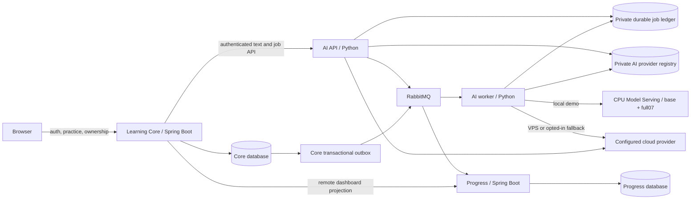

# Microservice demo and evidence

This is the local implementation guide. The running VPS has not been migrated.
The accepted scope and outstanding acceptance gates remain in
[the delivery ledger](microservices-implementation.md).

## Architecture



There are three business services. The API and worker are processes of the same
AI service; Model Serving is a separate inference process. Each business service
owns its data and build. Separate databases/roles may share a PostgreSQL cluster;
neither AI nor Progress reads Core tables. Redis coordinates JWT sessions and
provider quotas; it is omitted from the diagram for readability.

Core owns identity, sessions, scoring, recommendations and listening assessment.
Progress projects completed solo dictation sessions. Its dashboard is eventually
consistent; the response reports its source. Broker delivery is at least once.
Consumers handle duplicates, revisions and deletion tombstones. A Progress outage
can make the dashboard unavailable while Core still accepts completed practice.

## Start the local application

Prerequisites: Java 17, Maven, the pinned Python application dependencies,
PostgreSQL, Redis and RabbitMQ. Follow
[private database/configuration setup](ai-provider-database.md) to prepare the
protected `data/microservices/{core,ai,progress,model}.env` files. They are ignored
by Git. Do not copy provider credentials into Core's file.

Build from the repository root:

```powershell
mvn --batch-mode --no-transfer-progress -DskipTests package
mvn -f services/progress/pom.xml --batch-mode --no-transfer-progress -DskipTests package
python scripts/run-service.py stack --config-dir data/microservices --with-model --check-only
python scripts/run-service.py stack --config-dir data/microservices --with-model
```

The check confirms business-service health and model-server liveness. Model
weights load at the first inference request and still require at least 20 GiB
available RAM. Protected logs are under `data/microservices/logs/`. Ctrl+C stops
the processes owned by the supervisor. Infrastructure remains running.

Open the local Core UI, sign in, then open Conversation. The model-demo panel is
part of that screen, enabled only when the local demo flags are configured.
No separate public model endpoint or frontend provider credential is needed.

## Interview/demo sequence

1. Complete a dictation lesson. Show Core history and the remote Progress
   dashboard; explain outbox delivery and the response's freshness metadata.
2. In Conversation, submit a full07 demo job. Show queued/running/terminal states,
   stored history and the provider/model/prompt identifiers in the result.
3. Compare base and full07 on the same context. They run sequentially to reduce
   memory use. Comparisons never use cloud fallback. Compare actual content and
   validation outcomes; invalid output cannot bypass acceptance gates.
4. Explain the difference between a model result and a validated practice task.
   Show the original training and GPU evaluation evidence separately from
   application integration results. Fresh R13 application CPU generation is an
   outstanding gate while RAM is insufficient.
5. Show the automated recovery evidence: duplicate delivery/lost ACK, broker
   outage, service restart, durable jobs and deletion before late delivery.
   Do not kill a supervised child for a manual isolation demo: the supervisor
   deliberately stops the whole owned stack when one child exits. Use separate
   service launchers or the disposable integration test for that demonstration.

R13 adds source-derived glossary and clause/fact alignment for delivery scenes.
It does not change weights. The original GPU study found improvements in that
scope, including both base and adapter; it does not establish general adapter
superiority. B1 soft length targets remain imperfect. See
[the R13 evidence and limits](model-demo-guided-r13.md).

## Repeat the Linux resource rehearsal

Prerequisites: built JARs, Docker Engine, k6 and the existing Python dependencies.
Build the Progress image once, then run:

```powershell
docker build -t dictalab-progress:local services/progress
python -X utf8 tools/ai-eval/stack_capacity.py --users 5 --seconds 30
python -X utf8 tools/ai-eval/stack_capacity.py --users 20 --seconds 60
python -X utf8 -m pytest -q tools/ai-eval/test_stack_capacity.py
```

Each run creates its own PostgreSQL databases/roles, Redis, broker, AI registry,
AI ledger and random loopback ports. It uses the existing k6 mixed practice/read
journeys, with enabled authentication, CSRF and rate limits. Concurrent Coach
jobs traverse API, RabbitMQ and worker. All provider responses are synthetic;
there are no paid model calls or CPU-model weights in this rehearsal.

New evidence goes under a fresh protected `target/stack-capacity-<timestamp>/`:
`result.json`, `samples.json`, `k6.json`, `k6.log` and container logs. The run
checks unauthenticated requests, cross-service database access denial,
per-user completed-practice/projection accounting,
outbox drain, generic AI text, child liveness, OOM state and owned-resource
cleanup. Never commit private runtime configs or raw application logs.

Docker working-set samples use rounded display units. Kernel cgroup peaks also
include cache. These exclude the host OS and unrelated processes. Docker-host
CPU count differs from the VPS: local latency is not a VPS throughput claim.
`passed=true` means the stated functional rehearsal passed; the capacity verdict
remains measurement-only until the actual VPS passes its own acceptance.

### Measurements recorded on 28 October 2026

| Local Linux run | 5 users / 30 seconds | 20 users / 60 seconds |
| --- | ---: | ---: |
| Completed mixed journeys | 117 | 964 |
| HTTP requests | 396 | 3,168 |
| HTTP/business failure rate | 0% / 0% | 0% / 0% |
| Work HTTP p95 | 62.2 ms | 30.0 ms |
| Dashboard HTTP p95 | 65.4 ms | 35.6 ms |
| Completed practices / matching projections | 5 / 5 | 36 / 36 |
| Completed concurrent AI jobs | 20 | 36 |
| Pending Core outbox at acceptance | 0 | 0 |
| Simultaneous business processes + RabbitMQ working-set peak | 925.5 MiB | 1,006.8 MiB |
| All container working-set peak, including DB/Redis/fake provider | 1,050.4 MiB | 1,137.2 MiB |
| Core container limit | 512 MiB | 640 MiB |

These are separate functional/resource rehearsals, not a scaling comparison.
The 5-user run reached its Core limit. The 20-user run used a larger limit;
its kernel cgroup evidence records zero max/oom/oom-kill events for every
container. All owned resources were removed after each run. Host OS and other
services, long-duration soak, real audio traffic and real model inference are
excluded. Docker had 16 logical CPUs; the VPS has 2 vCPU.

The sanitized, hash-linked [measurement report](../artifacts/reports/microservices-stack-20261028.json)
contains artifact hashes, sample counts, per-component memory and kernel events.
Original data remains under the protected local `target/` directories above.

A read-only two-sample VPS check at 04:15 UTC found 953,704,448 bytes physical
RAM, at least 189,698,048 bytes available and up to 560,840,704 bytes swap used.
Core was active with restart count zero; Redis responded. PostgreSQL probing and
Prometheus scraping were unavailable in that bounded check, so the production
baseline is incomplete. No VPS state was changed.

## Prepare one release for all three services

The package builder requires Git, Maven, Java 17 and Python 3.12 or later.
It exports the selected Git commit into a temporary source tree and builds both
JARs there. Core uses the existing `production-s3` profile and published-page
verifier. Uncommitted source changes and existing local JARs are not build inputs.

```powershell
python scripts/linux/service-bundle.py build --revision HEAD --output target/microservices-release.tar.gz
python -m unittest discover -s scripts/linux -p test_service_bundle.py
```

Choose a new output name for each build; existing releases cannot be overwritten.
The output contains `dictalab.jar`, `progress.jar`, `ai/app/`, pinned
`ai/requirements.lock`, `artifacts/prompts/`, three `systemd/` units and
`manifest.json`. The manifest
records the source commit plus every payload's byte length and SHA-256.
Configuration, provider credentials, SQLite ledgers, model weights and caches
are excluded. The Linux staging command installs AI's pinned dependencies in a
separate venv and checks imports using the extracted prompt registry.

Pass the SHA-256 emitted by the build through the established SSH channel for
verification of the transferred copy:

```text
python3 scripts/linux/service-bundle.py verify RELEASE.tar.gz --sha256 BUILD_SHA256
```

Verification rejects missing/corrupted files, duplicate paths, links, traversal
and unexpected payload types. Build skips tests to produce artifacts; the
existing test/CI gates remain required. AI Platform CI runs the integrity checks,
builds the bundle from its checked-out commit and stages it in a disposable
Linux container. This gives the rehearsal its own root filesystem while keeping
the installer's production ownership/permission checks intact.

### Stage the Linux runtime

On Linux with root access and Python 3.12 or later, use the independently supplied
build checksum. Python must support `venv`/`ensurepip`; package installation needs
access to the configured Python package index.

```text
sudo python3 scripts/linux/service-bundle.py stage RELEASE.tar.gz --sha256 BUILD_SHA256
```

This creates `/opt/dictalab/services/releases/<sourceRevision>/`. It rejects
symlinked, non-root-owned or group/world-writable release ancestors and preserves
existing release directories. A private copied bundle is verified again before
extraction. The venv is created at its final path because its scripts contain
absolute paths. Dependency installation, `pip check`, API/worker imports and both
conversation prompt loaders must succeed. Runtime subprocesses receive no
inherited application secrets or Python/pip injection settings. No service is
started and no database/provider is contacted by the import check.

After payload checks pass again, `stage-ready.json` records the commit and bundle
checksum. Root-owned directories become 0755 and files 0644, retaining executable
bits for venv tools. Failed staging stays 0700 without a ready marker for operator
inspection; an existing failed directory is also never overwritten. Its removal
or replacement requires a separate operator decision. Staging does not change
`current`, systemd units/accounts, protected configuration or persistent state.
It does not establish health, resource capacity or rollback safety.

The existing automated `release.py` flow activates Core only. The manual
`service-release.py` command below coordinates all four business processes with
a verified snapshot and optional reviewed application rollback. Actual-host
activation and workflow acceptance remain deployment gates. Do not use a
Core-only activation as proof all three services were deployed.

### Linux process layout

Release format v2 carries `dictalab-ai.service`, `dictalab-ai-worker.service` and
`dictalab-progress.service`. The verifier continues to accept existing v1 bundles;
v2 requires all three units. A v2 build needs a source commit containing these
units. Each unit has its own restart policy; none requires another business
service to stop or restart with it. Ordering, draining and health checks remain
the release operator's responsibility.

| Process | Unix account | Protected environment | Persistent writes | Endpoint |
| --- | --- | --- | --- | --- |
| Core, existing unit | `dictalab` | `/etc/dictalab/app.env` | Existing Core state | Loopback 18082 |
| AI API | `dictalab-ai` | `/etc/dictalab/ai.env` | `/var/lib/dictalab-ai` | Loopback 8091 |
| AI worker | `dictalab-ai` | Same AI file | Same private AI ledger | No HTTP listener |
| Progress | `dictalab-progress` | `/etc/dictalab/progress.env` | None; separate PostgreSQL | Loopback 8092 |

After the main-release, AWS database and capacity gates pass, provisioning must:

1. Create the two dedicated system accounts with no interactive login. Do not
   add them to the existing `dictalab` group. If an account already exists,
   inspect its identity and permissions before reusing it.
2. Keep runtime files in a root-owned release directory under
   `/opt/dictalab/services/releases/<commit>/`, exposed through
   `/opt/dictalab/services/current`. New accounts need directory traversal:
   the existing `/opt/dictalab` is 0750, so set that parent to 0751, leaving
   Core's `app/` and `tools/` directories 0750. Use 0755 for the new service/code
   directories, 0644 for public payload files, and preserve executable modes in
   the venv. No service account may modify release code, the venv or `current`.
3. Create a Python 3.12+ venv at `<release>/venv` and install only
   `<release>/ai/requirements.lock`. The bundle contains source and pinned
   direct requirements, not a dependency wheelhouse or a preinstalled venv.
   Verify imports and artifact hashes before activation.
4. Prepare the three environment files as root-owned 0600 files. PID 1 reads
   them before changing identity; service accounts do not need permission to
   read them. Apply the same service ownership rules as the local launcher:
   Core receives no provider/master keys, AI receives no Core database access,
   Progress receives only its database/broker/token settings. Use private AI
   registry ownership, production guards, shared Redis quotas and consistent
   internal tokens. Keep model demo disabled on VPS. Management/owner credentials
   stay outside runtime files.
5. In `ai.env`, retain the unit's absolute registry and ledger paths if those
   keys are present: `/opt/dictalab/services/current/artifacts/prompts` and
   `/var/lib/dictalab-ai/jobs.sqlite3`. systemd environment files override
   `Environment=` defaults. API and worker must share the same ledger; keep its
   committed database and WAL pages together during quiescent backup. The
   coordinated backup consolidates private copies into a standalone SQLite file
   and leaves the original DB/WAL/SHM ownership untouched. `StateDirectory=`
   creates the 0700 AI state directory without deleting it on stop.
6. Install the exact verified units under `/etc/systemd/system/` as root-owned
   0644 files. Run `systemd-analyze verify` against the installed paths after the
   executable paths exist, then `systemctl daemon-reload`. Coordinate activation
   with backup, migrations and health checks; unit installation alone is not
   authorization to cut over reads or claim deployment success.

For the first installation, `service-provision.py` implements the identity,
filesystem and inactive-unit parts above using an already staged v2 bundle:

```text
sudo python3 scripts/linux/service-provision.py /path/to/microservices-release.tar.gz --sha256 BUNDLE_SHA256
```

Keep this script beside `service-bundle.py`. The established Core account/group,
root:dictalab 0750 `app/` and `tools/`, and the three root-only environment files
must already exist. The command rechecks the verified bundle against the staged
manifest/payload and staging marker. Root ownership, writable paths, unsafe venv
links and unreadable code are rejected before host changes. Runtime config
contents and database grants still require the service ownership/TLS checks
above; checking file permissions does not validate credentials or routing.

It creates or validates locked, separate system identities without supplementary
groups; creates private AI state and root-only service backups; changes only the
Core parent from 0750 to 0751; and creates the initial `current` link exclusively.
Existing AI ledger bytes/ownership are preserved. It copies the exact verified
units, runs `systemd-analyze verify` and `daemon-reload`, and requires the three
new processes to remain loaded/inactive with zero PIDs. It never starts, enables,
stops or restarts a service, replaces Core's JAR/config, or initializes/migrates
databases. The existing Core process can continue using its original JAR.

An existing `current`, installed unit, startup link or unit override is rejected. Subsequent
upgrades need coordinated activation. Failure after preparation begins can leave
accounts/files/the initial link in place; it reports no success and never deletes
those paths to retry. Inspect partial state before proceeding. The acceptance
result is `initial-filesystem-and-inactive-units-only-not-deployment`. Initialize
and verify the private databases and AI ledger under their dedicated identities
before attempting a coordinated backup or activation.

After initial host preparation, initialize a missing AI ledger separately:

```text
sudo python3 scripts/linux/service-provision.py /path/to/microservices-release.tar.gz --sha256 BUNDLE_SHA256 --initialize-ledger
```

Keep `cloud-backup.py` beside the provisioning script for its protected config
parser. This command rechecks the prepared release, locked AI identity, private
state directory, configured ledger path and exact inactive API/worker units.
The verified release's Python creates the existing `JobStore` schema as
`dictalab-ai`, using exclusive file creation and umask 0077. It checks SQLite
integrity and service ownership/mode 0600 without loading runtime credentials
or calling a database/provider. Core may remain active. No service is started
or stopped, and existing PostgreSQL schema/data/configuration stay unchanged.

An existing ledger, orphan WAL/SHM/journal or dangling link is rejected without
modification. Do not use this command to upgrade or repair an existing ledger;
back up and inspect that state separately. Failure after exclusive creation can
leave a partial private file, retained for inspection. The acceptance result is
`new-private-ledger-only-not-database-or-deployment-acceptance`. Separate
PostgreSQL owner/runtime/backup grants, schema setup and restore verification
are still required before activation.

Repeat the isolated identity/filesystem checks with the AI image built by CI:

```text
docker run --rm --network none --env TEST_SERVICE_PROVISION_DISPOSABLE=1 --mount "type=bind,source=$PWD,target=/workspace,readonly" --workdir /workspace/scripts/linux dictalab-ai-check python -m unittest -v test_service_provision
```

These tests create real locked identities and test unprivileged read/write
access inside the disposable container. Live systemd calls are simulated; the
separate unit syntax check above uses real `systemd-analyze`. This is not service
startup, actual-host provisioning, database or VPS capacity acceptance.

### Coordinated activation and application rollback

After the AWS database, restore, main-release and VPS capacity gates pass, use
the staged bundle with the manual release command. Keep `service-release.py`,
`service-provision.py`, `service-bundle.py`, `cloud-backup.py` and `release.py`
together under `scripts/linux/`, with `run-service.py` in its parent `scripts/`
directory. Run from a protected checkout using Linux root and Python 3.12+.

The private databases, migrations/grants, AI ledger and runtime configuration
must already be prepared and verified. This command does not bootstrap them or
roll out configuration changes. It requires the exact candidate units installed
and loaded without drop-ins or pending daemon reloads. All three databases and
runtime roles must be distinct, and backup roles must match their runtime targets
with verified TLS. Internal tokens must agree. AI uses the private registry,
durable jobs and cloud inference; Core routes text/jobs to AI and publishes
Progress events while dashboard reads remain `legacy`. Model demo stays disabled.

For the first activation, `current` must already point to the candidate prepared
by `service-provision.py`; Core must be active and the other processes inactive:

```text
sudo python3 scripts/linux/service-release.py /path/to/microservices-release.tar.gz --sha256 BUNDLE_SHA256 --initial
```

For an upgrade, stage a different release and require all four original processes
active and healthy. Omit `--initial`:

```text
sudo python3 scripts/linux/service-release.py /path/to/microservices-release.tar.gz --sha256 BUNDLE_SHA256
```

An exclusive root-only release lock prevents overlapping uses of this command.
Coordinate separately with the existing Core release flow, operators and backup
jobs; they do not share this lock. The command stops Core, AI API, AI worker and
Progress in that order, allowing bounded worker drain. It takes and verifies the
coordinated snapshot, rechecks immutable payload/configuration, atomically
replaces `current` and Core's JAR, then starts Progress, worker, API and Core.
HTTP readiness and a fresh worker heartbeat are required. A root-private,
fsynced `activation-*/activation.json` receipt records the phase and snapshot.
Services are not enabled at boot by this command. Remote Progress read cutover
and learner/payment workflow acceptance remain separate steps.

Before a switch, a failed preparation attempts to resume the original process
set and verify readiness. After a switch, automatic application rollback requires
adding `--rollback-compatible` to the command. This flag is an operator assertion
after reviewing/testing backwards-compatible migrations, contracts and durable
state; it is not proof of compatibility. The independent existing financial-write
guard still rejects unsafe or uncertain rollback even with the flag. If rollback
is permitted, only the old Core JAR and previous release link are restored and
the original active processes restarted. Databases, SQLite jobs/budgets, media,
Redis and RabbitMQ retain their current state. Keep the previous release/venv.

Without that review, or if rollback/verification fails, the tool attempts to
leave the processes stopped and records `forward-repair-required`. Inspect actual
service state and the protected receipt/snapshot before forward repair. A failed
stop can leave process state uncertain. An interrupted or incomplete receipt
blocks subsequent releases; do not delete receipts, restore old data or rerun
blindly. Resolve the recorded phase and reconcile code/config/state first.

The success result is `process-readiness-only-not-production-workflow-acceptance`.
Repeat its isolated regression checks with:

```text
docker run --rm --network none --mount "type=bind,source=$PWD,target=/workspace,readonly" --workdir /workspace/scripts/linux dictalab-ai-check python -m unittest -v test_service_release
```

These tests use real staged files, atomic replacements, locks, an HTTP server
and the isolated financial helper, while systemd and snapshot composition are
simulated. The separate backup suite below performs real PostgreSQL/SQLite
restore checks. Neither suite replaces activation, recovery and capacity
acceptance on the intended host.

The unit limits are 256 MiB each for API/worker and 384 MiB for Progress. They
are initial measured-process guardrails, not acceptance of the complete 2 GB
VPS. Strict filesystem protection and separate identities restrict access;
database isolation and authentication remain independently required. AI gets
up to 650 seconds to drain bounded provider work before a forced stop. Drain
jobs before changing the release pointer; the local CPU demo's longer deadline
does not belong on these VPS units.

Repeatable syntax/dependency validation on Linux:

```text
python3 -m unittest discover -s scripts/linux -p test_service_units.py
```

The check uses a temporary filesystem root and stub executable paths with the
actual unit files. It does not start services or prove production permissions,
health, graceful drain or reboot recovery. Those still require the real host.

### Coordinated application-state backup

`cloud-backup.py --services` is separate from the existing Core-only backup and
timer. It requires Linux root, PostgreSQL 18 clients at
`/usr/lib/postgresql/18/bin/`, the installed four units already inactive with
zero main PIDs, three initialized private databases, the existing AI job ledger
and an explicit `current` release symlink. Provision initial databases/ledger and
units before the first rollout; missing state is rejected rather than interpreted
as an empty backup. No command in this section stops/starts services or changes
the release pointer. Keep ingress, batch writers and registry edits quiescent
throughout the snapshot; systemd checks cannot exclude unrelated writers.

Create `/var/lib/dictalab-service-backups` as root:root 0700. This separate path
keeps provider credentials and AI state inaccessible to the Core Unix account.
Protect `/etc/dictalab/{app,ai,progress}.env` and
`/etc/dictalab/backup.pg_service.conf` as root-owned 0600 files. The latter is a
libpq service file with exactly `[core]`, `[ai]` and `[progress]`. Each section
must explicitly contain these eight keys:

```ini
[core]
host=DIRECT_DATABASE_HOST
port=5432
dbname=CORE_DATABASE_NAME
user=CORE_BACKUP_ROLE
password=SET_IN_PROTECTED_FILE_ONLY
sslmode=verify-full
sslrootcert=/etc/dictalab/verified-database-ca.pem
channel_binding=require
```

Add the `[ai]` and `[progress]` sections with their own database names and backup
roles. No defaults or implicit credential sources are accepted. Endpoints must
match the corresponding protected runtime configuration; a proxy/alias change
needs an explicit configuration review. Backup roles must differ from runtime
roles and have enough access to dump their database, without cross-service
permissions. Provision those grants against the selected AWS target before use.
Install the verified database CA separately; keep TLS and channel binding enabled.
The backup command supplies each child only its selected libpq service name and
bounded connection/statement settings, never inherited PG/provider credentials.

```text
sudo python3 scripts/linux/cloud-backup.py --services
sudo python3 scripts/linux/cloud-backup.py --verify-services /var/lib/dictalab-service-backups/services-ID --sha256 MANIFEST_SHA256
```

Retain the emitted manifest checksum independently. The snapshot includes three
custom PostgreSQL dumps, consolidated SQLite jobs/budgets/reservations/admission
data, both Core media directories including empty directories, protected runtime
and backup configs, the Core/Progress JARs, release provenance and installed units.
Files are root-owned 0600 beneath 0700 directories. Verification rejects checksum,
membership, permission or link changes and checks PostgreSQL archive structure
and SQLite integrity. Failed attempts remain private and do not emit success.

Keep the previous immutable release directory and its venv: the snapshot records
its revision but does not duplicate the AI runtime. Retain live RabbitMQ and
Redis state during deployment/rollback. They are not captured or rewound here;
resetting them can lose messages, admissions, sessions or provider quota state.
PostgreSQL dumps omit ownership/ACL so restore can target a fresh database;
reapply reviewed owner/runtime grants before reconnecting service processes.
Keep restored configs root-only and restore the ledger with the dedicated AI
account's ownership. Do not automatically rewind live databases, reservations
or queues after new writes. This is an application-state snapshot prerequisite,
not a complete disaster-recovery or coordinated rollback implementation.

CI restores all three dumps into separate databases in a disposable PostgreSQL
18 instance with verified TLS/SCRAM channel binding, compares fixture rows, and
checks WAL-backed jobs/reservations/budgets/admissions. Only systemd states are
simulated; the PostgreSQL dump/restore and SQLite operations are real. That
evidence does not replace a restore drill using the actual AWS schema/data,
least-privilege grants and measured recovery time. No production credentials or
databases are used in CI.

## VPS deployment gates

The existing VPS has about 0.89 GiB physical RAM, and current baseline samples
show little available RAM plus substantial swap use. Complete Linux resource
measurements before selecting a RAM upgrade. Do not deploy extra services into
that remaining memory or assume managed databases remove all process overhead.
The owner selected upgrading the existing VPS to 2 GB on 28 October. This is a
deployment prerequisite and must be confirmed on the host; it is not evidence
that a 2 GB VPS has already passed acceptance.

After capacity is resolved, use the established main-branch release gates.
Provision separate runtime roles/config files, back up and verify restores,
deploy all three services, backfill the VPS's own history, compare shadow reads,
then enable remote reads. Verify health, existing practice/AI workflows, restart
recovery, database isolation and rollback on the actual host. Cloud inference
credentials stay in AI. The fine-tuned model remains local.

The owner is migrating the production database to AWS and will provide the
updated state. That cutover and the VPS RAM upgrade are not yet verified here.
The last direct Neon probe was refused due to account/project quota. Core health
and Prometheus subsequently returned HTTP 200; production database availability,
backup and restore still need fresh verification against the selected AWS target.

GitHub Actions artifact storage quota currently prevents evidence upload; a
workflow with a failed upload is not green CI. Fresh CPU R13 generation and
actual VPS rollout are still required before claiming the migration complete.

## Main integration and deployment pause (2026-10-28)

Production activation is paused during the owner's AWS database migration.
The deploy job requires the repository Actions variable
`PRODUCTION_DEPLOY_ENABLED` to be exactly `true`; missing/false keeps deployment
paused while all test and packaging jobs still run. Enable it only after the AWS
database backup/restore and VPS capacity gates pass, then use the established
main release flow. Never use the variable to bypass a failed check.

Main already owns Core migrations V42 (provider registry) and V43 (local grading).
The new Progress outbox and model demo ledger are V44 and V45 respectively.
Earlier isolated local rehearsal databases using the old V42/V43 numbering are
not compatible production baselines. Preserve their data and use a fresh isolated
rehearsal database or an explicitly reviewed migration procedure; do not repair
checksums or rewrite production Flyway history.
