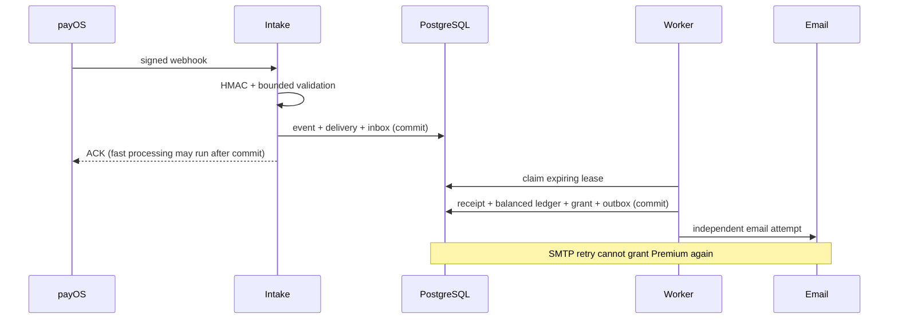

# Payment Operations

Triển khai theo `fintech-payments-implementation-plan.md`. Ngày kiểm tra: 17/10/2026. Người kiểm tra: Codex, bằng test tự động; owner cần nghiệm thu nghiệp vụ trước khi mở chuyển hoàn thật.

## Hợp đồng và ADR

- **ADR 1 — PostgreSQL là nguồn quyết định.** Modular monolith, VND nguyên `long`/`BIGINT`, miền 1–10^12 mỗi khoản; tổng dùng NUMERIC/BigDecimal rồi chuyển chính xác. Không dùng Redis để quyết định tiền. Giá 49.000đ/30 ngày và policy được snapshot trên đơn.
- **ADR 2 — Receipt độc lập với order.** Định danh `(provider, channel, reference)`; callback trùng chỉ thêm delivery. Khác nội dung cùng reference tạo case. Receipt thừa/thiếu/chưa khớp vẫn ghi tiền vào UNALLOCATED. Chỉ exact tự cấp grant. Overpaid cần bank evidence, xem trước, quyền đối soát và TOTP để phân bổ đúng giá; phần thừa giữ nguyên nghĩa vụ.
- **ADR 3 — Inbox trước ACK, HTTP ngoài transaction.** Mất tiến trình sau intake được worker phục hồi. Receipt → journal → allocation → grant → outbox chung transaction. Kết quả create chưa rõ giữ CREATING; không tạo lại sau timeout. Idempotency cùng key khác body trả 409. Version/challenge và unique nghiệp vụ chặn replay lệnh tài chính; không tự retry một POST không rõ kết quả.
- **ADR 4 — Khóa đơn giản cho lưu lượng nhỏ.** Mutex DB → user → order → inbox/refund/grant. Không giữ khóa trong HTTP provider/SMTP. Một batch tối đa 20, một worker lookup tuần tự, lease 60 giây. Mở rộng lưu lượng cần đo contention trước khi phân vùng khóa; chưa tuyên bố throughput ngân hàng.
- **ADR 5 — Chứng từ ngân hàng độc lập.** Lookup payOS chỉ bao phủ mã đơn đã biết. CSV chuẩn hóa do người có quyền xác nhận nguồn; kiểm tra hash, reference/amount/date; PERSONAL ngoài tập báo cáo. Không coi CSV tự khai là feed được ngân hàng xác thực. Người xác nhận refund phải khác maker, executor và importer chứng từ OUT.
- **ADR 6 — Chưa tích hợp chi hộ.** Chuyển hoàn thủ công ngoài ứng dụng. APPROVED giữ tiền; execution chỉ ghi UNKNOWN; chứng từ OUT và checker độc lập mới SUCCEEDED. UNKNOWN không có nút chuyển lại hay tự giải phóng. Có thể bổ sung chứng từ sau. Chỉ APPROVED chưa có execution mới hủy được bằng step-up và journal bù. Thất bại sau thực hiện cần xác minh ngoài ứng dụng; không giả định FAILED để giải phóng tiền.
- **ADR 7 — Baseline lịch sử có giới hạn.** Backfill lặp an toàn, giữ chính xác `premium_until`, không gửi email/cộng hạn. LEGACY_BASELINE không được suy diễn thành lịch sử doanh thu hay cho hoàn qua công thức tự động. Nhiều đơn lịch sử có thể chung boundary; cần người kiểm soát tái dựng từ chứng cứ trước khi phân bổ doanh thu/hoàn tiền. Dữ liệu mới có grant riêng đầy đủ.
- **ADR 8 — Feature flags độc lập.** Checkout/intake/worker/reconcile tách nhau. Refund/partial mặc định tắt. Không có API automatic payout. Không đổi điều khoản hoàn tiền công khai hay phát sinh chuyển tiền thật trong demo.



## Trạng thái và sổ phụ

| Đối tượng | Trạng thái / bất biến |
|---|---|
| Order | CREATING/PENDING/PAID/CANCELLED/EXPIRED; PAID không bị callback cũ hạ; CANCELLED không bị view đổi EXPIRED |
| Inbox | RECEIVED/PROCESSING/RETRY/PROCESSED/QUARANTINED; lease cũ hết hạn được thu hồi; tối đa 8 lần trước case |
| Case | OPEN/INVESTIGATING/RESOLVED/ACCEPTED_EXCEPTION; version + lý do/chứng cứ; đóng case không tự đổi tiền |
| Refund | REQUESTED → APPROVED → UNKNOWN → SUCCEEDED; REQUESTED → REJECTED; APPROVED → CANCELLED trước execution |
| Grant | Một/order; cộng dồn từ max(now, expiry); refund chỉ thu hồi giây chưa dùng của grant được chọn và dịch các grant nối tiếp |
| Close | Snapshot append-only, cutoff 00:00 ngày sau theo giờ VN; mở lại cần người khác + TOTP, tạo version mới |

| Nghiệp vụ | Nợ | Có |
|---|---|---|
| Receipt | COLLECTION_CLEARING | UNALLOCATED |
| Phân bổ gói | UNALLOCATED | DEFERRED_SERVICE |
| Match ngân hàng | BANK_SCOPED | COLLECTION_CLEARING |
| Phân bổ dịch vụ theo thời gian | DEFERRED_SERVICE | SERVICE_REVENUE |
| Giữ hoàn | DEFERRED_SERVICE và/hoặc REVENUE_REVERSAL | REFUND_PAYABLE |
| Xác nhận đã hoàn | REFUND_PAYABLE | BANK_SCOPED |
| Hủy phê duyệt chưa thực hiện | Đảo cặp tài khoản của từng journal giữ hoàn | Giữ liên kết event key gốc |

Doanh thu phân bổ dùng tỷ lệ giây bằng BigInteger, làm tròn xuống lũy kế và chốt đủ giá khi hết kỳ. Không ghi nhận vượt số dư nghĩa vụ sau reservation/refund. Báo cáo phân biệt receipt, refund, thu ròng, clearing, nghĩa vụ, revenue, unallocated; `recordedThrough` giải thích sự kiện đến muộn. Đây là sổ phụ vận hành, không phải số dư ngân hàng toàn bộ hay sổ kế toán pháp định.

## Bảo mật, threat model và ASVS mapping

| Đe dọa | Kiểm soát | Bằng chứng / nhóm ASVS 5 |
|---|---|---|
| Giả callback / sửa tiền | HMAC constant-time, validate shape/money, body 64 KiB, response provider 128 KiB | PayOsClientTest; Validation, API, Cryptography |
| Replay / crash | Durable inbox, unique receipt/journal/grant, lease, transaction rollback | PaymentOperationsIntegrationTest, PaymentRestoreIntegrationTest; Business Logic, Concurrency |
| IDOR / ADMIN chi tiền | Quyền DB mỗi API, ADMIN không kế thừa finance, ownership người học, CSRF cookie JWT | permissions/CSRF integration; Authorization, Session Management |
| Thay người nhận sau duyệt | Source fingerprint từ signed evidence; binding amount/recipient/policy/version; TOTP/challenge một lần | refund/step-up tests; Authentication, Transaction Authorization |
| Nội gián sửa sổ | DB runtime không sở hữu schema; trigger immutable/balanced; audit append-only; maker/checker | direct SQL tests + production role evidence; Data Protection, Logging |
| Lộ PII / export CSV | Mask reference/account, không lưu raw webhook/counterparty account; export cần PAYMENT_AUDIT, no-store, formula escape | API + CSV boundary tests; Data Protection, Files |
| Chuyển hoàn lặp | Không có payout API; UNKNOWN giữ reservation, xác nhận bằng OUT evidence duy nhất, independent checker | 100 approval test, UNKNOWN test; Business Logic |
| Provider mất / quota | HTTP timeout, bounded body, 429 Retry-After tối đa 900s, lịch retry/case; không retry create | fake HTTP tests; API, Resilience |

Mapping là hồ sơ thiết kế và kiểm tra chọn lọc; không phải chứng nhận ASVS, PCI DSS, ISO hoặc kết luận pháp lý.

### Dữ liệu và retention

- Không lưu PAN/CVV/OTP hoặc mật khẩu payment; TOTP secret được AES-256-GCM với khóa 32 byte trong cấu hình 0600. API enrollment no-store, hiện một lần. Chỉ hash tài khoản nguồn để so khớp; hash vẫn là dữ liệu cần bảo vệ.
- Xóa người dùng tách owner khỏi order/grant/outbox và xóa permission/TOTP/challenge. ID maker/auditor được giữ như định danh nội bộ để không mất kiểm soát độc lập; không lưu email trong sổ phụ. Support giữ theo cơ chế xóa hiện có. Không xóa lịch sử tài chính để làm demo.
- Không tự purge chứng cứ tài chính khi chưa chốt thời hạn pháp lý. Log hiện có xoay vòng 7 ngày; export chỉ trên máy người được cấp quyền, phải lưu/xóa trong vùng bảo vệ. Delivery/event đã giảm dữ liệu, vẫn cần lịch lưu trữ được chủ sản phẩm rà soát trước khi mở rộng.
- Khóa TOTP, cấu hình migration và database backup phải có cùng chính sách bảo vệ/khôi phục; mất khóa cần quy trình reset có kiểm soát, không vô hiệu hóa step-up.

## Chạy lại và demo 6 phút

```powershell
# Đọc UI bằng dữ liệu giả; chỉ bind localhost, không có API ngân hàng.
python scripts/payment-ui-demo.py
# Mở http://127.0.0.1:18765/payments

# Hợp đồng/chữ ký với fake HTTP
mvn --batch-mode --no-transfer-progress '-Dtest=PayOsClientTest,PaymentOperationsIntegrationTest,BillingIntegrationTest' test

# PostgreSQL + Redis + Rabbit disposable, bao gồm pg_dump/restore thật
mvn --batch-mode --no-transfer-progress '-Preliability,production-s3' '-Dtest=PaymentOperationsIntegrationTest,PaymentRestoreIntegrationTest,BillingIntegrationTest' '-Ddictalab.testcontainers.postgres-image=postgres:18.4-alpine' test

node --test src/test/js/billing.test.cjs
python -m unittest discover -s scripts/linux -p 'test_release.py'
```

Kịch bản trình bày trực tiếp khoảng 6 phút (không giả danh video đã quay):

1. **0:00–0:45:** mở Orders → chi tiết: event, receipt, grant, journal; chỉ rõ dữ liệu giả.
2. **0:45–1:45:** chạy test `hundredDeliveriesAndConcurrentLookupHaveOneFinancialEffect`, đọc assertion một receipt/grant/outbox, 100 deliveries.
3. **1:45–2:45:** đọc test mất webhook và `PaymentRestoreIntegrationTest`: event sau backup được lookup phục hồi, lease trước backup được xử lý lại, DB gốc không đổi.
4. **2:45–3:45:** maker tự duyệt bị chặn; 100 approvals chỉ giữ một khoản. UNKNOWN không chuyển lại, bổ sung chứng từ rồi checker xác nhận.
5. **3:45–4:45:** báo cáo: thu tiền khác doanh thu; tiền thừa vẫn là nghĩa vụ, baseline cũ chưa đủ chứng cứ phân bổ.
6. **4:45–6:00:** direct SQL bị trigger từ chối; rollback compatibility; flags và giới hạn live/manual/simulated.

Test báo cáo: `target/*/surefire-reports`; restore: `target/reliability/payment-restore/result.json` trên CI; screenshots khử định danh trong `docs/payment-evidence/`. Chưa có video có giọng thuyết minh. Không dùng ảnh/demo làm bằng chứng chuyển tiền thật.

## Vận hành và phát hành

Biến môi trường xem `.env.example`. `PAYMENT_BOOTSTRAP_EMAIL` chỉ một lần cho ADMIN đang enabled; sau đó quyền không tự phục hồi nếu bị thu hồi. Operator tự enrollment TOTP; không giả enrollment bằng OTP do hệ thống tự giữ.

1. Backup quiescent trước migration; schema expand V39/V40, không sửa V38. DB production lúc đọc: 2 order, 1 PAID, bảng order khoảng 80 KiB; ALTER BIGINT vẫn cần lock, không tuyên bố zero downtime.
2. `scripts/linux/provision-payment-runtime.py` chạy root qua stdin: owner cũ dành Flyway, runtime mới DML, không có ownership/DDL/createrole; V40 thu hồi quyền sửa/xóa chứng cứ. Không đưa cấu hình bí mật vào Git hoặc argument.
3. Merge commit đã hoàn thành từ agent khác; test sau merge; push main, chờ unit/PostgreSQL/reliability/deploy. Nhánh feature chưa phải production.
4. Xác minh JAR SHA, health, migration version, role, tổng receipt/grant/balanced journal, order thật đã có vẫn PAID và expiry/audit không đổi.
5. Refund/partial giữ off. Mở sau khi có chính sách được duyệt, nguồn chứng từ đáng tin, checker độc lập và nghiệm thu thủ công. Tài liệu này không công bố quyền hoàn tiền mới.

### Runbook ngắn

| Sự cố | Hành động |
|---|---|
| Key provider lộ | Dừng checkout, giữ intake nếu môi trường vẫn an toàn; rotate trên kênh được phép, cập nhật protected env, thử signed lookup; không in key |
| Provider 429/5xx | Giữ đơn CREATING/UNKNOWN, theo dõi retry/case, không gọi create lần nữa bằng key mới; không load test provider |
| Inbox >5 phút | Kiểm tra health/DB locks/lease; sửa nguyên nhân, replay từng case có lý do; không reset hàng loạt |
| Sai số tiền/reference | Xem receipt + source + statement; không đánh dấu PAID bằng tay; reviewed allocation chỉ sau bank evidence + TOTP |
| Refund UNKNOWN | Giữ reservation, kiểm tra nguồn OUT độc lập; attach evidence rồi checker xác nhận; không chuyển lại / tự gán FAILED |
| Journal lệch / nghi chi trùng | Critical: dừng checkout và refund; giữ chứng cứ; không sửa posted rows; đối chiếu và bút toán bù/forward fix |
| Deploy lỗi | Dừng writer trước rollback. Nếu JAR cũ không hiểu PaymentOperations và ledger đã có dữ liệu, giữ JAR mới, service stopped, backup; forward fix. Không rollback DB mù |
| Restore | Môi trường cách ly, workers/provider/mail off trước; restore DB + config/key; scan toàn bộ order trong khoảng mất dữ liệu, gồm PAID; statement/feed cho khoản ngoài order; verify invariants trước mở checkout |

RPO 15 phút/RTO 60 phút chỉ là mục tiêu đề xuất. Lịch backup hiện có phải được đo và nâng cấp nếu không đạt; CI restore drill không chứng minh RPO production 15 phút. Alert definitions trong `ops/observability/alerts.yml`; management endpoint chỉ nội bộ, không public. Test local/CI không tạo hoặc hoàn tiền thật.

## Ma trận nghiệm thu F01–F16

Trạng thái cụ thể và bằng chứng cập nhật trong `payment-evidence/acceptance.md`. Mỗi lần phát hành phải ghi commit/run/artifact/health thực tế; không tự đánh VERIFIED cho phần manual chưa thực hiện.

Nguồn thiết kế: [payOS API](https://payos.vn/docs/api/), [signature](https://payos.vn/docs/tich-hop-webhook/kiem-tra-du-lieu-voi-signature/), [OWASP transaction authorization](https://cheatsheetseries.owasp.org/cheatsheets/Transaction_Authorization_Cheat_Sheet.html), [ASVS](https://owasp.org/projects/asvs/).
