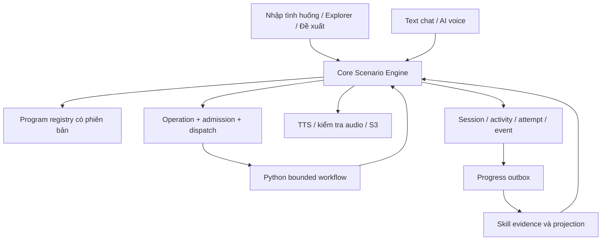

# Personalized AI Listening Scenario Engine — kế hoạch triển khai

Ngày lập: 31/10/2026. Baseline mã nguồn: `6d265391c4087cf2da09f4b707c1593b4fee92d8`.

Trạng thái: **đang triển khai theo từng phần**, theo yêu cầu tiếp theo của chủ dự án. Phần nền tảng đầu tiên bổ sung registry có hash, metadata chương trình và API lưu mục tiêu; xem mục 24. Tài liệu này không xác nhận toàn bộ engine đã hoàn tất hoặc đã triển khai production.

## 1. Cách dùng tài liệu

Model triển khai phải đọc các mục 1–17 trước khi làm ticket đầu tiên. Thực hiện ticket theo dependency ở mục 18, đọc lại mã nguồn hiện tại trước mỗi ticket và ghi nhận sai khác so với baseline. Mỗi ticket là một đơn vị có thể review, test và rollback.

Quy ước:

- **Bắt buộc:** invariant bảo vệ dữ liệu, quyền, chi phí hoặc tính đúng của kết quả.
- **Mặc định MVP:** quyết định kỹ thuật/sản phẩm cụ thể để triển khai không phải tự đoán; có thể đổi bằng policy có phiên bản và test.
- **Gate phát hành:** điều kiện phải đạt trước khi bật cho người dùng; không được hạ gate chỉ để kết thúc ticket.
- **Giai đoạn sau:** được mô tả để giữ khả năng mở rộng; chưa tạo toàn bộ bảng, provider hoặc infrastructure của giai đoạn đó trong MVP.

Definition of Done cho mỗi ticket:

1. Đúng contract và dependency; không thay đổi hành vi ngoài phạm vi.
2. Có kiểm tra chạy được cho logic mới và ca lỗi quan trọng.
3. Review toàn bộ diff; không chứa credential, dữ liệu học riêng hoặc capture runtime.
4. Tài liệu contract/fixture được cập nhật cùng thay đổi nếu contract đổi.
5. Ghi rõ kiểm tra đã chạy, kết quả và giới hạn còn lại.
6. Delivery theo AGENTS.md của repository; phân biệt push, CI và deployment.

## 2. Mục tiêu sản phẩm và thứ tự ưu tiên

Người dùng có thể nhập tiếng Việt một tình huống bất kỳ phù hợp chính sách; hệ thống chuyển thành bài luyện nghe tiếng Anh có bối cảnh, nhân vật, mục tiêu, câu hỏi, đáp án và audio nhất quán. Sáu nhóm hiện có trở thành điểm khám phá. Sau bài học có remix và gợi ý cá nhân hóa dựa trên bằng chứng.

Thứ tự: nền tảng có phiên bản → free-form hoàn chỉnh → Explorer/Remix → evidence và adaptive learning → các dạng bài TOEIC/IELTS → text chat → AI voice theo lượt → realtime và scenario cho phòng người–người.

Các quyết định kiến trúc:

| Quyết định | Cách thực hiện |
|---|---|
| Tương thích ngược | Miền Scenario v2 song song với Conversation v1 |
| Backend nghiệp vụ | Core sở hữu quyền, session, kết quả, quota và learning evidence |
| AI workflow | Python thực hiện các bước có giới hạn; không cấp công cụ tùy ý cho model |
| Khả năng mở rộng | Tách program, target scale, topic, difficulty profile, question type và interaction mode |
| Tính đúng | Validation bằng code + semantic review + benchmark/manual review |
| Cá nhân hóa | Evidence có cấu trúc; policy minh bạch trước khi dùng mô hình nâng cao |
| Hạ tầng | Tái sử dụng Spring Boot, FastAPI, RabbitMQ, Redis, S3 và Progress hiện có |
| UI | Giữ HTML/CSS/JavaScript của dự án; ưu tiên ô nhập tình huống |
| Chi phí | Admission trước provider I/O, giới hạn operation và ghi nhận UNKNOWN |

## 3. Khảo sát hiện trạng và giới hạn chứng cứ

Đã đối chiếu luồng UI → API → Core → Python/provider → audio/storage, các migration liên quan, outbox/Progress, assessment/Coach, phòng gọi và các workflow CI. Đây là khảo sát mã nguồn và schema, không phải kiểm kê dữ liệu hoặc cấu hình production mới nhất.

| Thành phần baseline | Đặc điểm đã thấy | Hệ quả cho thiết kế |
|---|---|---|
| `ConversationContent` | 24 loại tình huống, sáu nhóm, curated branches/opening | Có sinh động trong phạm vi cũ; không phải chỉ có 24 đoạn cố định |
| `ConversationService` | A1/A2/B1, tối đa bốn nhiệm vụ; bước vận dụng riêng | Không kéo dài một cách cơ học thành engine vô hạn |
| Answer flow | Lưu câu trả lời trước AI, UUID idempotency, lease/version | Tái sử dụng invariant; tránh chép nguyên service lớn |
| Grade/review | Chấm ý hiểu, exact evidence, semantic audit | Tách policy cho dạng câu hỏi mới |
| Catalog/progress | Tổng hợp từ tối đa 60 session JSON, recommendation đơn giản | Tạo projection kỹ năng thay vì quét lịch sử trên mỗi request |
| Frontend | Select tình huống/cấp độ, tiến độ `/4`, harder/easier CEFR | Renderer mới đọc capability và session plan |
| Python task schema | Level A1/A2/B1, turn 1–4, nội dung ngắn | Tạo schema/capability v2 riêng |
| Python jobs | Durable SQLite ledger + RabbitMQ, scope/idempotency | Dùng pattern; thêm loại production riêng |
| `/v1/conversation/jobs` | Lane `conversation_demo` | Không gọi lane demo để phục vụ scenario production |
| Prompt registry | Artifact version/hash, approval và eval gates | Ghim chương trình/prompt/model/config cho mỗi kết quả |
| `AiUsageBudget` | Reservation bảo thủ theo ngày, tiền microUSD và số call | Không coi reservation là hóa đơn; mở rộng admission có operation ID |
| Progress | `PracticeCompleted.v1`, `UserDeleted.v1`, projection dictation | Event/projection scenario riêng; không đổi ý nghĩa cột cũ |
| Assessment/Coach/ôn lỗi | Có first-exposure, support, lỗi từ và nhận xét có evidence | Kết hợp có loại nguồn; không đồng nhất lỗi chính tả và hiểu ý |
| Audio | Cache, S3 riêng tư, TTS và tác vụ nền | Thêm segment/speaker/fingerprint, giữ media state độc lập |
| Room | Signaling và registry trong bộ nhớ | Tái sử dụng phần phù hợp; cần thiết kế riêng nếu scale nhiều host |

Các constraint đáng chú ý: V22/V23/V37 giữ scenario/cấp độ và một số turn 1–4; V26 có loại job/payload cụ thể; V44 có bảng revision FK tới `practice_sessions`; migration Core mới nhất ở baseline là V47. Chọn số migration tiếp theo sau khi kiểm tra HEAD lúc triển khai, không mặc định V48 còn trống.

Điểm cần dọn có test: `workflow.normalize_context` tính một số bản rút gọn nhưng không chuyển tiếp; `prompt_versions.generate_content` hiện đã cắt history/recentPractice riêng. Thống nhất trách nhiệm chuẩn hóa; không mô tả sai đây là lỗ hổng không giới hạn context của toàn pipeline.

### 3.1. Nguồn nội bộ

- [Core controller](../src/main/java/com/dictalab/web/ConversationController.java)
- [Core service](../src/main/java/com/dictalab/service/ConversationService.java)
- [Curated content](../src/main/java/com/dictalab/service/ConversationContent.java)
- [Level profiles](../src/main/java/com/dictalab/service/ConversationLevelProfile.java)
- [Frontend](../src/main/resources/static/js/conversation.js)
- [Python schemas](../services/ai-generation/app/schemas.py)
- [Workflow](../services/ai-generation/app/workflow.py)
- [Prompt pipeline](../services/ai-generation/app/prompt_versions.py)
- [Job ledger](../services/ai-generation/app/jobs.py)
- [Job API](../services/ai-generation/app/job_api.py)
- [Budget](../src/main/java/com/dictalab/service/AiUsageBudget.java)
- [Progress outbox](../src/main/java/com/dictalab/service/ProgressOutbox.java)
- [Progress consumer contract](../services/progress/src/main/java/com/dictalab/progress/ProgressEvent.java)
- [Listening assessment](../src/main/java/com/dictalab/service/ListeningAssessmentService.java)
- [Room registry](../src/main/java/com/dictalab/room/RoomRegistry.java)
- [AI evaluation tools](../tools/ai-eval/README.md)
- [CI/deploy](../.github/workflows/deploy.yml)

## 4. Mô hình miền: sáu trục độc lập

| Trục | Ví dụ | Quy tắc |
|---|---|---|
| Topic | `transport`, `workstudy`, `services` | Nhiều tag hoặc không có tag cũ; không quyết định score scale |
| Program | `general-communication`, `toeic-listening`, `ielts-listening` | Có version, capability và gate phát hành |
| Target | IELTS Listening 6.5; TOEIC Listening 350 | Mục tiêu khác kết quả đã chứng minh |
| Difficulty profile | Tốc độ, độ dài, số người, distractor, suy luận | Hồ sơ đa chiều, versioned, có mức đã review |
| Practice mode | `guided-listening`, `exam-practice` | Chính sách câu hỏi/hỗ trợ/chấm riêng |
| Interaction mode | `listening`; tương lai `text-chat`, `voice-dialogue` | MVP chỉ công khai capability đã triển khai |

Không tạo một enum trộn A1, A2, IELTS_6_5 và TOEIC_750. CEFR vẫn là anchor tùy chọn cho legacy/giao tiếp. Không ép mọi chứng chỉ phải chuyển qua CEFR trước khi sinh bài.

### 4.1. Target và đánh giá

- Lưu riêng goal, tự khai trình độ, điểm thi người dùng cung cấp và evidence DictaLab.
- `target.component` bắt buộc: `LISTENING`, `OVERALL` hoặc component mà program khai báo.
- Nhập overall IELTS/TOEIC tổng không tự suy ra mục tiêu Listening. Cho lưu overall làm bối cảnh; bài Listening dùng một mục tiêu Listening đã chọn hoặc profile luyện nội bộ không mang nhãn điểm suy diễn.
- Target IELTS dùng thang band; TOEIC Listening dùng thang điểm riêng. Không đổi tên mọi giá trị thành band.
- Điều chỉnh độ khó bài không tự thay đổi goal dài hạn.
- Nhãn public: “luyện hướng tới mục tiêu …”, “chỉ số luyện tập”, “chưa đủ dữ liệu”. Không xuất điểm chứng chỉ ước lượng trong MVP.

### 4.2. ProgramDefinition

Schema chương trình bắt buộc có:

| Trường | Quy tắc |
|---|---|
| `schemaVersion` | `scenario-program.v1` |
| `code`, `version` | Slug ổn định; version số nguyên dương |
| `status` | `DRAFT`, `APPROVED`, `RETIRED` |
| `displayNameVi` | Nhãn tiếng Việt |
| `targetScales` | scaleId/component/min/max/step hoặc labels, rules đã review |
| `supportedPracticeModes` | Chỉ mode có code và test |
| `supportedQuestionTypes` | Question policy/renderer thật |
| `difficultyProfiles` | ID, version, limits, skills, audio constraints |
| `skillTaxonomyVersion` | Ghim phiên bản kỹ năng |
| `generationPolicy` | Deadline, calls, token/output/input caps, repair limit |
| `gradingPolicy` | Cách chấm theo type, số lần trả lời, uncertainty policy |
| `supportPolicy` | Replay, slow, transcript, translation, reveal |
| `qualityPolicyVersion` | Bộ gate được ghim |
| `promptArtifactRefs` | Artifact/hash từng purpose |
| `definitionHash` | Hash của bản định nghĩa đã canonical hóa |

Nguồn được review là file definition trong repository; khi bật phiên bản, import vào bảng Core bất biến, kiểm tra hash và unique key. Không có hai nguồn cùng được sửa độc lập. Bản Python dùng artifact riêng được tham chiếu trong release manifest; không đọc database Core.

Thiếu artifact/capability/hash tương ứng → trả unavailable trước provider I/O. Program retired vẫn đọc được session cũ; session mới chỉ dùng version approved và được flag bật.

### 4.3. DifficultyProfile

Các chiều tối thiểu: word bounds mỗi activity và toàn session; số speaker/segment; vocabulary/syntax guidance; information density; question/fact count; distractor/correction limits; inference policy; target speech rate và pause; allowed voice profiles; support policy.

MVP general có thể bắt đầu từ ba profile nội bộ `supported`, `standard`, `challenge`, nhưng phải review bounds. Mặc định giới hạn an toàn: 1–3 speaker, 1–4 activity, mặc định 3; tối đa 6 segment/activity, 12 question/session và 480 từ transcript/session. Profile dễ hơn được đặt trần thấp hơn. Những số này là trần sản phẩm, không phải chuẩn TOEIC/IELTS.

Không tăng đồng thời tất cả chiều khi chọn khó hơn. Policy tăng tối đa hai chiều đã chỉ định; target score giữ nguyên.

## 5. Kiến trúc và ownership



Core quyết định auth, entitlement, quota, session state, grade được chấp nhận và DTO public. Python tạo nội dung/kết quả theo contract. Progress tổng hợp evidence và xếp hạng candidate. Frontend chỉ gửi tương tác, không quyết định điểm hoặc quality pass.

Tái sử dụng `PremiumAccessService`, `AiUsageBudget`, `AiPlatformClient`, provider gateway/quota, `MediaStorageService`, S3 lifecycle và outbox. Chỉ tách logic thuần khỏi Conversation v1 khi đã có regression test. Không sao chép toàn bộ service thành một bản thứ hai.

Package đề xuất Core: `com.dictalab.scenario`. Dùng các lớp theo nghiệp vụ: controller/DTO, registry, draft/session, operation/repository, question policy, media và evidence. Không tạo interface cho mọi lớp; chỉ dùng strategy cho những cách chấm/render thực sự khác nhau. Python thêm module scenario bên service hiện có, không lập microservice mới trong MVP.

## 6. Contract nội dung và dữ liệu hiển thị

### 6.1. Các đối tượng

| Đối tượng | Nội dung bắt buộc |
|---|---|
| Brief | inputVi, lựa chọn program/mode/target, tùy chọn được phép |
| Specification | setting, characters, learnerRole, goal, constraints, assumptions, topicIds |
| SessionPlan | ordered activities, skill focus, difficulty snapshot, completion policy |
| Activity | ID, ordinal, dialogue segments, questions, quality metadata, contentHash |
| Segment | segmentId, speakerId, textEn, translationVi private, order |
| Question | questionId, type, primarySkill, prompt, options nếu có, private answerKey/rubric/evidence |
| Attempt | ID, request ID, answer, support snapshot, grade status/revision/result |
| Evidence | ID, grade revision, skill, result, exposure/support/family/profile/quality |

Phân biệt `speaker turn`, `activity`, `question`, `attempt`, `playback` và `support event`. Không dùng một turnNumber cho cả sáu nghĩa.

Question types theo thứ tự triển khai: `MEANING_RECALL_VI` → `SINGLE_CHOICE` → `SHORT_ANSWER_EN`. Dạng mapping/map/diagram chỉ được xuất hiện khi có schema, renderer và scorer tương ứng.

Mỗi evidence span tham chiếu segmentId và chuỗi con chính xác textEn; suy luận có tập cue và rationale riêng. Stable ID duy nhất trong activity. Không yêu cầu answer text suy luận phải nằm nguyên văn trong transcript.

### 6.2. Bất biến nội dung

- Session ghim specification, program, prompt/model/config và policy versions.
- Activity đã cho học không bị sửa ngầm. Regenerate tạo revision/draft khác trước khi publish hoặc session mới sau khi đã học.
- Đổi transcript làm mất hiệu lực hash/audio/grade tương ứng; không ghép audio cũ vào nội dung mới.
- Private content gồm transcript chưa mở, translation, answerKey, evidence, rubric, model metadata nội bộ.
- Public view dựng bằng allowlist theo trạng thái. Không serialize object private rồi xóa một vài trường theo blacklist.
- Prompt output/model prose không được chèn thành HTML; mọi text được escape.

### 6.3. Provenance

Lưu `contractVersion`, program/profile/skill/quality versions, prompt artifact hash, provider/model định danh thực, generation config hash, contentHash, timestamps, call purposes và verdict. Cloud không có digest bất biến phải ghi đúng tình trạng đó; không tạo digest giả hoặc hứa tái lập bit-for-bit.

## 7. Database và migration

UUID dùng dạng VARCHAR(36) theo quy ước hiện tại; timestamps UTC có timezone; version BIGINT không âm; JSON dùng TEXT có schemaVersion và được validate ở application. Không thêm phụ thuộc JSON query PostgreSQL cho những truy vấn thông thường nếu H2 test đang cần tương thích.

### 7.1. Bảng Core

| Bảng | Cột/nhóm cột chính | Constraint/index |
|---|---|---|
| `scenario_program_versions` | program_code, version, definition_json, definition_hash, status, approved_at | PK(code,version); immutable content cho version đã tạo |
| `scenario_learning_goals` | id, user_id, program_code/version, component, scale_id, target_value hoặc label, provenance, updated_at | FK user/program; một goal hiện hành cho user/program/component |
| `scenario_drafts` | id, user_id, input_vi, specification_json, program_ref, target_json, status, version, created_at, expires_at | owner index, expiry index; optimistic version |
| `scenario_sessions` | id, user_id, draft_id, program_ref, spec/target/profile/plan snapshots, status, version, created_at, completed_at, parent_session_id, legacy_parent_id, family_id | owner/time/id index; parent ownership application check; parent mới FK; legacy parent FK v1 |
| `scenario_activities` | id, session_id, ordinal, private_content_json, content_hash, quality_json, status | unique(session_id,ordinal); FK session |
| `scenario_attempts` | id, activity_id, user_id, request_id, payload_hash, answer_json, support_snapshot_json, grading_status, grade_revision, result_json, created_at | unique(user_id,request_id); owner phải khớp activity/session; immutable answer |
| `scenario_events` | id, session_id, activity_id nullable, sequence, event_type, payload_json, revision, created_at, client_event_id nullable | unique(session_id,sequence); dedup client event theo session; FK ownership |
| `scenario_media` | id, session/activity/segment refs, fingerprint, object_key nullable, status, operation_id, audio_metadata_json, created_at | unique(activity_id,segment_key,variant,fingerprint); media private |
| `scenario_operations` | id, user_id, scope, idem_key, input_hash, payload_json, kind, stage, status, result_ref, deadline, lease_id/until, dispatch_after, attempts, error_code, version, created/updated_at | unique(user_id,scope,idem_key); status/dispatch index |

Không dùng polymorphic FK không được kiểm tra. `parent_session_id` và `legacy_parent_id` không cùng có giá trị. Remix chỉ tham chiếu session cùng owner. Xóa user/session xử lý các FK và media lifecycle có kiểm soát; không để outbox đang xử lý làm sống lại dữ liệu đã xóa.

Giới hạn độ dài mỗi cột string và size JSON phải có trong migration/DTO. Snapshot JSON có trần kích thước operation; mặc định request public tối đa 32 KiB, payload nội bộ tối đa 256 KiB, result tối đa 256 KiB. Profile được đặt giới hạn nhỏ hơn; client không tăng được giới hạn.

### 7.2. Budget ledger bổ sung

`AiUsageBudget.reserve` hiện không có operation key. Để admission idempotent cho operation nhiều call, bổ sung ledger có reservation ID, operation ID, scope/day UTC, tiền/call giữ chỗ, trạng thái và timestamps. Có call entries unique `(operation_id,purpose,attempt_index)` để ghi bước được phép/sent/known result/UNKNOWN và usage nếu provider có trả.

Thiết kế extension giữ API v1 hiện tại; không sửa lại ý nghĩa số tiền lịch sử. Kiểm tra đường `premium.takeAi` để không tính quota hai lần khi giữ envelope rồi thực hiện call con. Reservation, user quota và operation admission phải được nối bằng khóa idempotent; crash sau reserve trước tạo job phải tiếp tục được cùng reservation hoặc giữ ở trạng thái có thể reconcile, không âm thầm reserve lần nữa.

Không cộng cả toàn envelope và từng call vào cùng usage tổng như hai khoản độc lập. Những khoản chưa chắc provider đã thu giữ reservation; phần chưa gửi có thể release theo policy có chứng cứ. Không tuyên bố exactly-once billing tại provider.

### 7.3. Progress projection

Tái sử dụng `progress_outbox` cho publish. Không dùng bảng `progress_projection_versions` hiện có cho scenario vì FK của nó tới `practice_sessions`.

Progress thêm:

- `scenario_skill_evidence`: evidence ID, user/session/activity, revision, payload hash, skill/profile/family, result/support/exposure/quality, timestamps, retracted.
- `scenario_skill_profiles`: user/program/skill/compatible difficulty bucket, methodVersion, weighted counts, practiceIndex, sample/coverage, updatedAt/lastEventAt.

Grade và outbox snapshot commit trong cùng transaction Core. Progress kiểm tra owner, revision/hash, dedup và user deletion tombstone. Duplicate event không cộng lại; revision cũ không ghi đè; cùng revision khác hash là conflict; correction thay contribution cũ, không cộng contribution mới chồng lên.

### 7.4. Migration và lịch sử

1. Tạo schema additive rỗng; flag tắt.
2. Deploy reader/contract tương thích.
3. Import definition/template đã duyệt.
4. Bật nội bộ rồi canary.
5. Backfill evidence cũ, nếu làm, là job có cursor, version và kiểm tra riêng; không chạy trong Flyway.

V1 tiếp tục mở theo engineVersion. Unified history phân trang keyset theo `(created_at,id,engineVersion)`, không tải hết hai lịch sử rồi cắt trang. Nếu ưu tiên release sớm, hiển thị hai nhóm phân trang độc lập cho tới khi unified cursor có test; không phát hành pagination sai.

## 8. API v2 và ví dụ contract

Namespace public `/api/v2/scenarios`; internal job route mới `/v1/scenario/jobs`. Không dùng `/v1/conversation/jobs` lane demo.

### 8.1. Endpoint

| Method/path | Hành vi | Admission |
|---|---|---|
| GET `/catalog` | Definition/capability public, template metadata | Không gọi AI |
| PUT `/learning-goal` | Lưu goal đã validate | Không gọi AI |
| GET `/suggestions` | Template/cache hợp lệ | Không gọi AI mặc định |
| POST `/suggestion-requests` | Tạo gợi ý bằng AI có giới hạn | Quyền + quota + budget |
| POST `/drafts` | Trích xuất specification từ brief | Quyền + budget extraction |
| GET `/drafts/{id}` | Public specification/assumptions | Owner |
| PATCH `/drafts/{id}` | Sửa fields cho phép, expectedVersion | Owner; không nhận system prompt |
| POST `/sessions` | Tạo bài từ draft revision hợp lệ | Quyền + quota chung v1/v2 + budget |
| GET `/sessions/{id}` | State khôi phục, DTO theo quyền xem | Owner |
| GET `/sessions` | History phân trang, có engineVersion | Owner |
| POST `/sessions/{s}/activities/{a}/answers` | Lưu answer, chấm theo type | Owner; AI budget nếu cần |
| POST `/sessions/{s}/activities/{a}/help` | Ghi support trước khi mở nội dung | Owner; AI budget nếu phát sinh |
| POST `/sessions/{s}/activities/{a}/play` | Trả asset hiện có hoặc operation media | Cached read theo policy; tạo mới cần quyền/budget |
| POST `/sessions/{s}/activities/{a}/playback-events` | Playback start/end/error; dedup | Không gọi AI; tín hiệu client có giới hạn tin cậy |
| POST `/sessions/{s}/complete` | Hoàn tất theo completion policy | Không tự bỏ qua câu bắt buộc |
| POST `/sessions/{s}/remixes` | Tạo draft con từ session đã hoàn tất | Owner; extraction budget nếu cần |
| GET `/recommendations` | Tối đa ba đề xuất, reason/evidence refs | Projection/cache; không gọi LLM mặc định |
| GET `/operations/{id}` | State/stage/progress có thật | Owner; không lộ payload private |
| POST `/operations/{id}/cancel` | Hủy commit về sau theo policy | Không hứa provider chưa thu phí |

Mọi mutation có `Idempotency-Key` UUID; update có `expectedVersion`. Request ID trace riêng với idempotency key. Same owner/scope/key + same hash trả operation/resource đã có; hash khác trả 409. Server sinh mọi model/provider/budget/quality decision.

### 8.2. Ví dụ draft request

```json
{
  "inputVi": "Tôi muốn gọi cho khách sạn để đổi phòng quá ồn, không trả thêm phí.",
  "programCode": "general-communication",
  "programVersion": 1,
  "practiceMode": "guided-listening",
  "interactionMode": "listening",
  "difficultyPreference": "standard",
  "target": null
}
```

Response accepted:

```json
{
  "contractVersion": "scenario-public.v1",
  "draftId": "00000000-0000-4000-8000-000000000001",
  "operationId": "00000000-0000-4000-8000-000000000002",
  "status": "PENDING",
  "pollAfterMs": 2000
}
```

Khi extraction xong, draft trả specification, assumptions và `version`. `POST /sessions` gửi draftId/draftVersion; backend tự dùng program/profile snapshot đã validate. Sửa draft trong lúc generation chạy làm operation cũ không được publish vào revision mới.

### 8.3. Target example và answer example

Target public mẫu: `{ "scaleId": "ielts-listening-band", "component": "LISTENING", "value": "6.5" }`. Decimal truyền dạng chuỗi canonical, parse bằng BigDecimal/Decimal, lưu numeric phù hợp; không dùng số thực để kiểm tra step. Chương trình IELTS chỉ được public khi scale/rubric đã review; ví dụ này là contract, không phải trạng thái đã phát hành.

Answer request gồm `expectedVersion`, `answers: [{questionId, textVi}]` cho recall; choice dùng `optionId`, short answer dùng `textEn`. Discriminator questionType được server đối chiếu từ activity, không tin loại do client khai để thay scorer. Gửi các câu của activity cùng batch; tối đa ba lần bổ sung/activity trong MVP. Retry chấm cùng câu trả lời không tạo answer attempt mới.

### 8.4. Error contract

Lỗi public: `code`, `messageVi`, `requestId`, `retryable`, `operationId?`, `retryAfterSeconds?`. Không trả stack trace/provider body.

| Code | HTTP | Hành động UI |
|---|---:|---|
| `PREMIUM_REQUIRED` | 402 | Giải thích quyền; không tự retry |
| `USER_QUOTA_EXCEEDED` | 429 | Hiển thị giới hạn/thời điểm có thể thử |
| `GLOBAL_AI_BUDGET_EXCEEDED` | 429 | Giữ bài, thông báo tạm hết ngân sách |
| `SESSION_VERSION_CONFLICT` | 409 | Đọc state mới và giữ draft người dùng |
| `IDEMPOTENCY_CONFLICT` | 409 | Không tự tạo key mới để né conflict |
| `UNSUPPORTED_PROGRAM_MODE` | 400 | Yêu cầu capability chưa hỗ trợ |
| `DRAFT_NEEDS_CLARIFICATION` | 422 | Hiển thị một câu làm rõ |
| `GENERATION_REJECTED` | 422 | Bài chưa đạt gate; cho sửa brief |
| `PROVIDER_UNAVAILABLE` | 503 | Theo dõi operation, retry theo policy |
| `AUDIO_GENERATION_FAILED` | 503 | Giữ session và answer |
| `OPERATION_UNKNOWN` | 503 | Giữ operation; không retry provider tự động |

Foreign/missing resource dùng phản hồi thống nhất không tiết lộ owner. Status operation terminal vẫn lấy được bằng GET 200 với error metadata phù hợp.

## 9. State machine và recovery

### 9.1. Các state độc lập

- Draft: `PENDING`, `READY`, `NEEDS_CLARIFICATION`, `FAILED`, `EXPIRED`.
- Session: `PREPARING`, `ACTIVE`, `COMPLETED`, `ABANDONED`, `PREPARATION_FAILED`.
- Activity: `LOCKED`, `READY`, `IN_PROGRESS`, `COMPLETED`, `INVALIDATED`.
- Attempt grading: `PENDING`, `RUNNING`, `GRADED`, `UNCERTAIN`, `FAILED`, `UNKNOWN`.
- Operation: `PENDING`, `RUNNING`, `SUCCEEDED`, `FAILED`, `UNKNOWN`, `CANCELLED`, `EXPIRED`.
- Media: `NOT_REQUESTED`, `PENDING`, `RUNNING`, `READY`, `FAILED`, `UNKNOWN`, `EXPIRED`.

`stage` ghi bước workflow, không thay status: extraction/generation/translation/validation/review/repair/audio/storage. Media lỗi không chuyển session ACTIVE thành training/content FAILED.

### 9.2. Transaction boundaries

1. Xác thực và kiểm tra owner/capability.
2. Claim idempotent admission; reserve có operation key và fingerprint.
3. Lưu operation/resource và durable dispatch marker bằng transaction ngắn; không provider I/O trong transaction.
4. Dispatcher gửi lại cùng job ID/scope/hash nếu chưa có ACK. Python register trả đúng job cũ.
5. Worker claim lease có attempt/version. Lease hết không mặc nhiên cho phép gọi provider lại.
6. Khi có kết quả, Core kiểm tra owner/current revision/fingerprint/quality rồi commit atomically.
7. Grade commit và evidence outbox commit cùng nhau; upload S3 xong mới commit reference.

Budget reservation riêng bền vững cần reconciler cho trạng thái admission dang dở. Kiểm tra crash ở từng ranh giới, nhất là reserve thành công nhưng operation transaction rollback.

### 9.3. Recovery matrix

| Điểm gián đoạn | Cách phục hồi |
|---|---|
| Trước provider send | Có thể tiếp tục call chưa gửi nếu còn deadline và budget |
| Sau send, chưa nhận kết quả | UNKNOWN; giữ reservation; reconcile, không phát request mới mù |
| Provider result đã lưu ledger, chưa Core commit | Poll lại cùng job, validate rồi commit idempotent |
| Upload S3 xong, DB commit thất bại | Object orphan theo lifecycle; retry commit không tạo text mới |
| User hủy khi queued | Không dispatch; release phần chắc chắn chưa dùng |
| User hủy khi provider đang chạy | Không commit nội dung vào session; usage vẫn ghi thực tế/UNKNOWN |
| Generation job trễ hơn draft revision | Không publish; kết quả stale không sửa revision mới |
| Frontend reload | Đọc operation/session có sẵn |
| Broker phát trùng | Claim/dedup chặn thực thi trùng |
| User bị xóa | Tombstone chặn commit/projection đến muộn |

UNKNOWN cần thao tác vận hành có audit và chứng cứ. Không có nút retry tự động chuyển UNKNOWN thành FAILED. Không xóa ledger để ép thực thi.

## 10. Workflow sinh nội dung và quality control

### 10.1. Extraction

Validate brief 1–2.000 ký tự, Unicode NFC, giới hạn tổng bytes. Chỉ coi brief là dữ liệu. Model trả specification với characters/roles/goals/constraints/assumptions. Mặc định dùng giả định được hiển thị; chỉ hỏi lại khi thiếu thông tin thiết yếu, nhiều nhất một câu trong bước extraction.

Kiểm tra chính sách nội dung và PII trước khi gửi provider; không log nguyên văn. Không mở URL hoặc chạy instruction nằm trong brief. Giữ tên giả nhất quán nếu đã thay PII.

### 10.2. Bài học

Core chọn profile từ registry và recommendation snapshot có version. Workflow Python:

1. Normalize context và truy xuất rubric/example đã duyệt.
2. Sinh kế hoạch, English segments, questions, answer keys và evidence.
3. Dịch các trường cần thiết bằng một bước riêng, temperature thấp.
4. Validate deterministic toàn bộ cấu trúc/limits/evidence.
5. Semantic review logic, ngôn ngữ, question alignment và độ phù hợp.
6. Một repair tối đa nếu lỗi cụ thể, đủ budget/deadline và policy bật.
7. Sửa transcript thì dịch/validate/review lại; không giữ verdict cũ.
8. Lưu kết quả và provenance; Core validate contract trước publish.
9. Tạo media sau content pass.

Extraction là operation riêng tối đa một call. Generation bình thường ba call text: content/translation/review. Repair tối đa ba call thêm. Tổng hành trình free-form tối đa bảy call text trước grading/TTS; không biến bước review thành hai call giống nhau ở hai service.

Mặc định repair tắt cho tới khi benchmark đo được first-pass/repair/final và budget. `UNKNOWN`, quota rejection hoặc timeout không phải lý do kích hoạt repair nội dung.

### 10.3. Quality invariants

- Speaker ID tồn tại; lời thoại/goal/địa điểm/thời gian nhất quán.
- Đề xuất khác quyết định đã xác nhận; distractor khác final value.
- Mọi câu hỏi có đáp án được hỗ trợ bởi audio/transcript.
- Exact evidence spans phải tồn tại; inferred answer cần cues hợp lệ, không kiến thức ngoài bài.
- Đáp án không xuất hiện trong instruction/hint làm lộ bài.
- Question chỉ hỏi các ý được chấm; không gộp ngày+giờ thành một ý tùy tiện.
- Mỗi single-choice có một lựa chọn đúng, distractor khác nghĩa và có giải thích.
- Translation không đổi điều kiện, phủ định, số, tên hoặc quyết định cuối.
- Từ vựng/độ dài/suy luận khớp profile; không dùng số từ làm chứng nhận trình độ.
- Không lặp task-answer combination chỉ bằng đổi tên/số/paraphrase.
- Verdict thiếu/lỗi/không chắc chắn không pass.

Semantic review owner v2 nằm ở Python; Core làm kiểm tra contract/provenance và business rules. V1 giữ luồng hiện có cho tới ticket chuyển đổi được duyệt.

### 10.4. Chấm theo loại

| Type | Scorer | Quy tắc |
|---|---|---|
| `MEANING_RECALL_VI` | AI có deterministic validation | Chấm ý được hỏi, quote evidence từ answer, chấp nhận paraphrase; CAPTURED/PARTIAL/MISSED/INCORRECT/UNCERTAIN |
| `SINGLE_CHOICE` | Code | Stable option ID; không gọi LLM; không tin index sau shuffle |
| `SHORT_ANSWER_EN` | Code theo policy | Unicode/space/case/number/accepted variants và word limit rõ; không semantic-pass mọi lỗi |

Attempt lưu answer trước provider I/O. Snapshot hỗ trợ tại thời điểm nộp; hỗ trợ mở sau đó không sửa ngược điều kiện của lần nộp trước. Grade retry dùng cùng answer và operation identity; không đếm là câu trả lời mới. Sửa grade tạo audit revision và evidence replacement/retraction, giữ lịch sử gốc.

## 11. Audio và độ tin cậy

### 11.1. Media fingerprint

Gồm content hash, segment order, speaker/voice mapping, provider/model/voice version có thể xác định, normalization version, tốc độ, format/sample rate/channel. Asset phải private, owner checked, lifecycle theo session. Cache nội dung cá nhân không được dùng như cache public.

MVP gán voice server-side trong allowlist, một voice ổn định/speaker. Tái sử dụng TTS gateway; contract hiện chỉ text cần extension có test nếu thêm voice controls. Không mặc định provider đã hỗ trợ multi-speaker một call.

Generate segment hoặc nhóm segment liên tiếp; ghép chỉ khi format tương thích. PCM WAV có thể dùng thư viện chuẩn để ghép sau kiểm tra header; không nối byte MP3 tùy tiện. Chọn chiến lược một lần trong ticket media và test với định dạng provider thực.

### 11.2. Readiness và prefetch

- Text được lưu trước audio. Session có thể ACTIVE nhưng activity chưa playable.
- Chỉ media pass kiểm tra mới READY: format hợp lệ, bytes có audio, duration hợp lý và đủ segment.
- Tạo audio hoạt động đầu trước; prefetch nhiều nhất một hoạt động tiếp theo trong MVP.
- Tổng tối đa 24 segment/session theo trần profile, budget phải bao gồm từng call thực.
- Nghe chậm bằng playbackRate nếu phù hợp policy, không tạo TTS mới chỉ để phát 0,8×.
- Transcript generation không được chạy lại để chữa audio lỗi.
- Cached audio theo quyền đọc hiện có; tạo lại audio cần entitlement/budget.
- Playback event từ browser chỉ là tín hiệu, không phải bằng chứng chống gian lận hay xác nhận chắc chắn đã nghe.

### 11.3. Ma trận lỗi bắt buộc

Tách entitlement, quota, provider, timeout UNKNOWN, invalid media, upload/storage và browser playback. UI có mã lỗi và hành động riêng; lưu state/answer xuyên suốt. Không chỉ test admin: free/Premium/expired/admin, cached/missing media, quota exhausted và provider failure đều cần integration tests.

## 12. Explorer và Remix

Giữ ID sáu nhóm: `food`, `transport`, `shopping`, `workstudy`, `services`, `social`. Map 24 template cũ vào nguồn gợi ý có parity test. Free-form không bắt buộc thuộc một trong 24 ID hoặc sáu nhóm.

Explorer đọc template/cache. “Gợi ý khác” là mutation có quota, sinh tối đa sáu brief ngắn, không sinh transcript/TTS. AI gợi ý tag từ taxonomy hoặc để trống; không tự publish category public mới. Cache public chỉ chứa nội dung đã xác định không có PII/cá nhân hóa.

Remix sau session completed tạo draft mới với:

- source session/engine/version, parent lineage, root family ID;
- `keep`: những trường giữ nguyên;
- `changeRequestVi`: thay đổi bằng ngôn ngữ tự do;
- `changeDimensions`: characters/setting/goal/obstacle/plot/difficulty/voice/skill;
- specification và profile mới đã validate.

Backend xác minh owner và không sửa nguồn. Thay tên/số không tự chứng minh novelty. Cùng family vẫn được luyện nhưng giảm/giới hạn đóng góp vào evidence độc lập. Từ v1 chỉ chuyển dữ liệu thật có; trường thiếu đánh dấu unknown/assumption, không tạo provenance giả.

## 13. Adaptive learning và evidence

### 13.1. Taxonomy MVP

`gist`, `details`, `numbers_time_place`, `change`, `reason`, `condition`, `instructions`, `intention`, `attitude`, `inference`, `cross_speaker_linking`, `final_decision`.

Một question có một primary skill. Secondary tags không làm một câu tự cộng nhiều mẫu mastery. Profile/program có mapping skill version; không gán band theo keyword.

### 13.2. Eligibility

Evidence gồm owner/source/activity/question/grade revision/profile/family/quality, outcome, firstExposure, answerAttempt, replayCount, slow/transcript/translation/reveal flags, occurrence time và support snapshot sequence.

- Outcome chỉ được tính khi câu hỏi/grade hợp lệ.
- UNCERTAIN, lỗi kỹ thuật, item invalidated: loại khỏi mẫu số.
- Đúng sau hỗ trợ lưu assisted bucket riêng.
- Independent bucket: lần đầu, không support, theo exposure policy phiên bản hóa.
- Một family/skill/ngày chỉ đóng góp tối đa một mẫu độc lập đầy đủ trong MVP; mẫu lặp giữ để quan sát luyện tập.
- Không suy từ lượt xin audio thất bại thành replay hỗ trợ; tách play requested và playback started. Các tín hiệu không đủ rõ phải được ghi là unknown.
- Room/shared practice giữ nguồn riêng, không trộn với solo independent.

### 13.3. Policy khởi đầu

Trong mỗi bucket tương thích program/skill/difficulty, lấy tối đa 20 evidence độc lập mới nhất trong 30 ngày. Điểm nội bộ:

`practiceIndex = (1 + sum(weight * outcome)) / (2 + sum(weight))`

Đúng = 1; partial = 0,5 chỉ khi scorer cho phép; sai/thiếu ý = 0. Unknown loại khỏi mẫu. Mỗi mẫu đầy đủ weight 1 sau family cap. Không gộp profile chưa có compatibility mapping; không gộp mọi track thành một khả năng duy nhất.

Trước sáu evidence, ba session và ba family: status `INSUFFICIENT_EVIDENCE`; không kết luận chắc chắn điểm yếu. Đây là guard sản phẩm đề xuất, không phải chuẩn đo lường khoa học hay xác suất năng lực.

Recommendation candidate score v1 là policy có test: goal match, valid weakness, due, novelty và recent-family penalty. Chốt weights trong cấu hình: 0,30 goal + 0,30 weakness + 0,20 due + 0,20 novelty − 0,30 recentFamily; tất cả feature chuẩn hóa [0,1]. Không đủ evidence thì weakness=0 và dùng cold-start policy, không bịa score. Tie-break stable theo candidate ID. Filter capability/quality/budget trước ranking.

Lịch ôn ban đầu 1/3/7/14/30 ngày là lựa chọn sản phẩm, phải ghi methodVersion; không tuyên bố đây là lịch tối ưu đã được xác nhận. Tính từ completed/evidence time, không lấy created_at làm ngày học xong.

Trả tối đa ba suggestion với reason code và evidence refs. Có thể dùng template tiếng Việt để giải thích mà không gọi LLM. LLM nếu dùng chỉ diễn đạt dữ liệu đã cung cấp, không thêm nhận xét/điểm.

### 13.4. Đồng bộ và degrade

Event mới `ScenarioActivityEvaluated.v1` chứa snapshot contribution đầy đủ/revision; `ScenarioEvidenceRetracted.v1` vô hiệu hóa evidence. Consumer cập nhật idempotent, correction thay mẫu cũ. UserDeleted tombstone chặn event đến muộn.

Progress lỗi không ngăn nộp bài. Core giữ outbox và dùng projection gần nhất có updatedAt; không có snapshot thì gợi ý theo mục tiêu/template. Backfill chỉ dùng thông tin có thật, không suy first exposure/support bị thiếu trong dữ liệu cũ.

Không coi lỗi spelling/word form trong dictation là lỗi hiểu ý. Dùng source-specific evidence adapter cho assessment/Coach/ôn lỗi nếu mở rộng sau. Không chuyển dictation score trực tiếp thành TOEIC/IELTS.

## 14. AI techniques và governance

| Kỹ thuật | Quyết định | Điều kiện |
|---|---|---|
| Structured output | Dùng ngay | Validate lại bằng code, giới hạn schema hỗ trợ provider |
| Prompt chaining | Dùng ngay | Extraction/content/translation/review/grading riêng |
| Retrieval có cấu trúc | Dùng ngay | Rubric/example theo SQL/tag/registry, corpus đã duyệt |
| Semantic judge | Dùng có giới hạn | Owner rõ, uncertainty fail closed, benchmark riêng |
| Repair | Sau gate | Một vòng; lưu first-pass/final denominator |
| Vector RAG | Hoãn | Chỉ thêm nếu đo được thiếu hụt retrieval hiện có |
| Knowledge tracing nâng cao | Hoãn | Có evidence sạch, baseline và offline comparison |
| IRT/điểm chứng chỉ ước lượng | Giai đoạn riêng | Item bank, calibration và review chuyên môn |
| Fine-tuning/LoRA | Không bắt buộc MVP | So paired benchmark/cost/latency với baseline |
| Agent tự trị/multi-agent runtime | Hoãn | Chưa có nhu cầu công cụ tự lập kế hoạch trong đường học |
| Online training từ người học | Không bật | Cần đồng ý và governance riêng |

Full07 phải qua benchmark mới cho free-form/multi-speaker/schema/certificate/injection. Không tự promote vì đã train xong. Dataset/revision/checkpoint lịch sử không bị sửa bởi dự án này. Prompt/exemplar dùng để phát triển không đồng thời là frozen release test.

Program pack mới dùng question types đã có có thể chủ yếu là data/config. Question type, scorer, renderer hoặc transport mới cần code/test. Không hứa mọi chứng chỉ chỉ thêm JSON là hoạt động.

## 15. Ngân sách, hiệu năng và observability

### 15.1. Mặc định operation

| Operation | Deadline đề xuất | Call cap |
|---|---:|---|
| Extraction | 45 giây | Một text call |
| Suggestions | 45 giây | Một text call; tối đa sáu brief |
| Generation | 180 giây | Ba bình thường, tối đa sáu nếu repair được bật |
| Grade recall | 60 giây | Một call/batch answer; retry có policy riêng |
| TTS job | 90 giây | Một provider send cho một segment/group đã định |

Deadline là giới hạn, không phải SLA hoàn thành. Worker kiểm tra remaining time trước từng bước; thiếu thời gian không chạy repair. Output cap generation đề xuất 6.000 tokens, phải benchmark đủ schema/translation và enforce trong artifact. Không dùng nguyên generic text path max 2.200 tokens rồi âm thầm truncate bài.

Không quote giá model cố định trong kế hoạch. Dùng bảng giá cấu hình có asOf/version, ước lượng tiền microUSD và token/audio bounds; usage thực tế lưu riêng nếu provider có cung cấp. Session cap và user daily cap bao gồm grading/support/TTS, không chỉ generation.

### 15.2. Capacity

MVP cùng deployment hiện có, queue lane riêng theo kind để audio không làm đói grading. Giới hạn active expensive jobs/user mặc định hai, global theo config/capacity test. Admission fail nhanh khi queue quá tải. Catalog và recommendation không gọi model tự động.

SQLite AI ledger hiện tại chỉ được dùng trong topology đã kiểm chứng có một ledger authoritative trên một host/volume. Trước multi-host worker, chuyển ledger sang database do AI service sở hữu, có migration, restore và concurrent-claim tests. Không dùng DB Core làm kho job Python cho tiện.

Mục tiêu pilot: catalog cache P95 <500 ms, accepted operation P95 <1 s, resume không gọi AI, cached play không gọi TTS. Đo generation/audio P50/P95/P99 và backlog trước khi chốt SLO public.

### 15.3. Metrics và audit

Metric labels có cardinality hữu hạn: kind, program, questionType, provider, stage, outcome, errorCode. Không dùng userId/sessionId/raw prompt làm metric label. Trace chứa operation/request ID phù hợp, không log credential/answer/private transcript.

Đo: admission rejection, quota/budget, queue age, provider calls, known/unknown usage, first-pass/repaired/final quality, validation reasons, TTS readiness/failure, stale commit, idempotency conflict, evidence lag, recommendation insufficient-data và user-visible errors.

## 16. UI/UX và các state phải có

Giữ component/CSS/interaction conventions hiện có; trước ticket UI kiểm kê token và accessibility đang dùng. Đây là cấu trúc màn đề xuất, chưa phải mockup đã duyệt hoặc UI đã triển khai.

### 16.1. Màn bắt đầu

```text
Bạn muốn luyện nghe tình huống nào?
[Tôi muốn trao đổi với đồng nghiệp về việc đổi deadline...]
Chương trình [Giao tiếp]   Mục tiêu [Theo nhu cầu]   [Tạo bài luyện]

Phù hợp với bạn: tối đa ba bài, mỗi bài có lý do ngắn
Khám phá: Ăn uống | Di chuyển | Mua sắm | Công việc & học tập | Dịch vụ | Xã hội
Tiếp tục phiên đang học / Lịch sử
```

Màn bắt đầu ưu tiên ô nhập. Program chỉ hiện capability đã phát hành. Không bắt người dùng đọc thông số profile nội bộ. Placeholder tiếng Việt; trường ngôn ngữ rõ; prompt tiếng Anh hiển thị `lang=en` khi được phép.

### 16.2. Xác nhận và chờ

Specification preview gồm setting, vai, mục tiêu, giả định, skill, thời lượng dự kiến. Không có transcript/answer. Có sửa/tạo/hủy. Chờ hiển thị stage thật, không phần trăm bịa. Reload dùng operation ID; cảnh báo/ràng buộc entitlement có hành động cụ thể.

### 16.3. Màn học và kết quả

Màn học đọc danh sách activity, không hard-code `/4`. Player và trạng thái media riêng; question renderer theo type; save draft, submit/retry grade, hỗ trợ theo policy, pause/resume. Không ép mọi bài thi thành chat bubbles.

Kết quả tách first-pass, replay, assisted, insufficient evidence và next focus. Ba hành động: luyện điểm yếu, remix, thử thách hơn. Hiển thị “chưa kiểm tra vận dụng” nếu người dùng kết thúc trước phần đó và policy cho phép; không gọi là hoàn thành đầy đủ một bài bắt buộc chưa làm.

### 16.4. Acceptance UI

Test màn rộng và 375 px, keyboard-only, focus/error announcement, reduced motion, không mất answer draft. `aria-live=polite` cho operation/grade; không announce mỗi tick poll. Escape user/model strings. Abort/stale revision chặn response cũ ghi đè màn mới. Không autoplay audio bất ngờ.

State bắt buộc: mới/chưa có evidence, thiếu capability, brief mơ hồ, extraction/generation/review/audio đang chạy, quality rejection, quota/Premium, provider UNKNOWN, media/browser lỗi, mất mạng/reload, grading pending và completed. Tất cả có next action hợp lệ.

## 17. Bảo mật, retention và phát hành chứng chỉ

Mọi draft/session/operation/media kiểm tra owner; mutation giữ CSRF. Client không gửi system prompt/model URL/SQL/quality verdict để thực thi. Provider output không được quyết định quyền hoặc tự sửa mastery/target. Service-to-service auth và payload bounds giữ nguyên hoặc chặt hơn.

Retention phải tách draft, answer, content, media, debug captures và billing metadata. Mặc định draft chưa dùng hết hạn sau bảy ngày; audio dùng lifecycle phù hợp cấu hình hiện có; raw provider debug tắt mặc định. Việc xóa cần outbox/tombstone và orphan cleanup; không dùng deleted user để rebuild projection.

TOEIC/IELTS có hai mode: luyện kỹ năng hướng tới chứng chỉ và luyện theo định dạng. Không gắn nhãn đề chính thức. Chỉ bật format đã có đủ renderer/scorer/audio policy; map/diagram/photo cần nguồn và renderer riêng. Rules và score scale dựa nguồn chính thức, có ngày review. Không publish score estimate khi chưa có calibration.

## 18. Backlog có dependency và điều kiện nghiệm thu

### Phase 0 — baseline và contract

| Ticket | Dependency | Phạm vi và vị trí | Nghiệm thu |
|---|---|---|---|
| S00 | Không | V1 tests trong Java web/service, JS conversation/media | Catalog/history/answer/support/audio/billing/owner snapshots và regression pass |
| S01 | S00 | Contract v2, fixture hợp lệ/lỗi dùng chung; OpenAPI | Java/Python cùng verdict với fixture, max size và enums rõ |
| S02 | S01 | Bộ benchmark trong `tools/ai-eval`/fixtures mới | Manifest/hash/denominator/baseline; paid run chỉ khi đã được cấp ngân sách |

### Phase 1 — registry, schema, admission và jobs

| Ticket | Dependency | Phạm vi và vị trí | Nghiệm thu |
|---|---|---|---|
| S03 | S01 | Core scenario registry, resource definition và artifact manifest | Immutable version, hash mismatch/unsupported mode fail trước call; general pack sẵn sàng review |
| S04 | S03 | Flyway Core/Progress theo bảng cần ở phase này; repository | Upgrade từ baseline và install sạch trên PostgreSQL; v1 vẫn mở được |
| S05 | S04 | Scenario operation + budget ledger + quota shared v1/v2 | Duplicate/concurrency/crash admission không tính trùng; UNKNOWN giữ reservation |
| S06 | S05 | Python schemas/jobs/job_api/worker + Core client | Capability production riêng; Java→Python→fake provider smoke, scope/hash/lease tests |

### Phase 2 — free-form hoàn chỉnh

| Ticket | Dependency | Phạm vi và vị trí | Nghiệm thu |
|---|---|---|---|
| S07 | S03,S06 | Extraction, draft API/repository, assumptions | Brief ngoài danh mục, mơ hồ, injection, PII, same-key behavior |
| S08 | S02,S06,S07 | Generator/translation/quality artifacts, validators | Không thiếu evidence, không publish uncertain; first/repair/final metrics riêng |
| S09 | S04,S08 | Session/activity/attempt/recall scorer, public DTO | Save-before-I/O, max attempts, version conflict, hidden-answer và correction tests |
| S10 | S06,S09 | Media v2, TTS voice mapping, S3 lifecycle | Audio lỗi giữ session, format/segment/fingerprint đúng; entitlement matrix pass |
| S11 | S07–S10 | JS/CSS/HTML theo conventions dự án | Free input→preview→learn→result; reload/mobile/keyboard/stale-response pass |

### Phase 3 — khám phá và biến thể

| Ticket | Dependency | Phạm vi và vị trí | Nghiệm thu |
|---|---|---|---|
| S12 | S03,S07,S11 | Sáu nhóm/24 starter mapping, suggestions/cache | Ngoài 24 ID vẫn tạo được; open page không gọi AI/TTS; template parity |
| S13 | S09,S12 | Remix API/spec diff/lineage/family | Source immutable, giữ/thay đúng constraint, owner và novelty tests |
| S14 | S11,S13 | History routing/cursors, v1→remix adapter | Link cũ không hỏng, pagination không trùng/mất, không bịa metadata cũ |

### Phase 4 — adaptive learning

| Ticket | Dependency | Phạm vi và vị trí | Nghiệm thu |
|---|---|---|---|
| S15 | S09 | Grade/event/outbox transaction, revision/retraction | Commit rollback/duplicate/out-of-order/delete-user tests |
| S16 | S15 | Progress event/projection/rebuild/freshness | Cùng evidence ra cùng profile, correction thay contribution cũ, v1 dashboard không đổi |
| S17 | S16 | Recommendation policy v1 + cold start | Ít data không kết luận yếu; stable ranking, family cap, reason refs đúng |
| S18 | S11,S17 | Recommendation/result UI | First/replay/assisted rõ, degraded Progress có fallback thật |

### Phase 5 — chứng chỉ

| Ticket | Dependency | Phạm vi và vị trí | Nghiệm thu |
|---|---|---|---|
| S19 | S09,S11 | Single choice, short English answer policy và renderer | Shuffle option IDs, word limit/variants, không AI-call cho deterministic scorer |
| S20 | S03,S08,S19 | TOEIC/IELTS packs, scale/rubric/examples/fixtures | Component/target đúng, capability filter, mỗi pack gate riêng |
| S21 | S02,S20 | Expert review, audio/content evaluation, pilot | Báo cáo paired benchmark và manual references; không tự cấp band |

### Phase 6 — chat và giao tiếp

| Ticket | Dependency | Phạm vi | Nghiệm thu |
|---|---|---|---|
| S22 | S09,S17 | Text chat scenario: message/dialogue state/goals/context | Role continuity, context cap, budget, owner, feedback sau đoạn |
| S23 | S10,S22 | Voice theo lượt: mic→ASR→dialogue→TTS | Phân biệt ASR và hiểu ý, transcript confirmation, cancel/timeout, retention |
| S24 | S23 | Streaming, VAD, barge-in, reconnect, time quota | Audio cũ bị hủy khi ngắt, bounded latency/cost, không duplicate responses |
| S25 | S13,S22 | Scenario gắn room người–người | Quyền từng người, sync state, shared evidence riêng; multi-host registry gate nếu cần |

Sau mỗi phase có integration/release gate của phase đó. Không làm S22–S25 bằng cách tăng `turnNumber` hoặc cho session nghe chạy vô hạn.

## 19. Test plan và gate phát hành

### 19.1. Ma trận tối thiểu

| Trường hợp | Expected |
|---|---|
| Free-form ngoài danh mục | Draft hợp lệ không bị ép vào mã scene cũ |
| Không đủ quyền | Không có provider call, không mất answer |
| Cùng key/payload | Một resource/operation/admission |
| Cùng key khác payload | 409 |
| Draft đổi revision khi job chạy | Stale result không publish |
| Provider result chưa rõ | UNKNOWN, không retry mù |
| Judge thiếu/lỗi | Không content pass |
| Hai answer đồng thời | Version/idempotency đúng; không vượt attempt limit |
| Transcript mở trước answer | Assisted, không tính independent |
| Support mở sau answer | Không sửa support snapshot đã nộp |
| Audio lỗi/expired | Session/content/answer giữ nguyên; regen có quyền/budget |
| Program version thay đổi | Phiên cũ giữ cách học/chấm cũ |
| Remix | Phiên gốc/hash/grade không đổi |
| Projection duplicate/correction | Không cộng trùng; contribution cũ được thay |
| Event sau UserDeleted | Không tái tạo dữ liệu |
| IELTS overall vs Listening | Không chuyển mục tiêu ngầm |
| Tắt v2 | Lịch sử và v1 vẫn đọc được |

### 19.2. Bộ benchmark

Synthetic dataset tách development/validation/frozen release. Bao phủ sáu nhóm cũ, chủ đề mới, brief mơ hồ/mâu thuẫn, tiếng Việt lỗi gõ, speaker counts, direct/change/condition/inference, distractor, độ khó, remix và adversarial input. Certificate packs có corpus/rubric/format tests riêng.

Mẫu thiếu/timeout/judge invalid nằm trong denominator. Báo first-attempt, repair và final riêng; model/modelDigest nếu có, artifact/dataset/config hash và coverage được ghim. LLM judge không tự cấp manual approval. Manual review cần reviewer thật, ngày, case refs và quyết định.

Gate đề xuất pilot: mọi test contract/security/data/budget/migration bắt buộc pass; zero critical leak/owner/billing violations; không publish sample thiếu answer evidence; không regression nghiêm trọng so baseline; manual review phân tầng đủ loại. Tỷ lệ chất lượng định lượng chốt sau baseline, không tự đặt “95%” rồi thay mẫu để đạt.

### 19.3. Lệnh kiểm tra khi triển khai

```text
mvn --batch-mode --no-transfer-progress -Pproduction-s3,ci-unit clean verify
node --test src/test/js/*.cjs
python -m pytest -q services/ai-generation/tests tools/ai-eval
mvn -f services/progress/pom.xml test
python tools/ai-eval/check_encoding.py
git diff --check
```

Đối chiếu CI hiện hành để thêm tên scenario tests vào allowlist/paths khi cần. Chạy PostgreSQL migration thật, RabbitMQ/worker restart smoke và Java→Python provider giả. Test packaging release ba service khi thay runtime. Bộ test ứng dụng không được tự gọi model trả phí trong CI mặc định.

Paid benchmark/inference và manual expert review là gate có nguồn lực riêng, không phải unit test giả. Chưa có quyền hoặc dữ liệu thì hoàn thành code ở trạng thái flag tắt, ghi rõ gate chưa đạt.

## 20. Rollout, rollback và vận hành

Flags riêng: `scenario.v2`, `freeform`, `suggestions`, `remix`, `recommendations`, từng program và question type. Flag tắt tạo mới không chặn read session/audio hiện có theo quyền.

Thứ tự: migration additive → deploy code tắt flag → fake-provider smoke → nội bộ → canary nhỏ → đo quality/cost/error → mở rộng. Chỉ deploy theo release flow hiện có sau checks trên main; push branch chưa phải production verified.

Dừng rollout khi: owner/answer leak, quota bypass, duplicate provider calls, chi phí vượt cap, TTS failure tăng, projection double count hoặc quality regression. Ngưỡng vận hành phải nằm trong config/runbook được duyệt cùng pilot.

Rollback bằng tắt capability hoặc quay về release/artifact tương thích. Giữ bảng additive, session cũ, job và evidence. Không xóa ledger/checkpoint để ép chạy; không đổi prompt ghim của session đang học. Reconcile UNKNOWN và xử lý orphan media có audit.

Runbook cần có: nhận diện release/program/artifact, đọc operation stage/error đã redacted, đối chiếu budget, kiểm tra worker/broker/storage, phục hồi cùng job, cách invalidate câu lỗi và retract evidence, xóa user, rebuild projection, rollback flag.

## 21. Lộ trình mở rộng chat/1–1

Text chat dùng specification/roles/goals/profile chung nhưng có message và dialogue state riêng. Duy trì agreed facts, unresolved proposals, objective progress và summary có cấu trúc; không gửi toàn bộ transcript vô hạn. Coaching tách khỏi lời nhân vật để không vô tình lộ bài.

Voice theo lượt triển khai trước realtime: ASR result có confidence/unknown, cho sửa transcript khi phù hợp; đánh giá speaking khác listening. Không chấm phát âm chỉ từ văn bản ASR. Microphone consent, raw-audio retention và provider capabilities phải có contract/test.

Realtime bổ sung streaming, VAD, barge-in, cancel, reconnect, session-duration budget và transport bảo vệ quyền. Audio response cũ phải dừng khi message revision đã bị thay. Không coi WebRTC room hiện tại là engine AI voice hoàn chỉnh.

Scenario cho phòng người–người tái sử dụng room signaling phù hợp, nhưng permissions và kết quả cá nhân riêng. Khi cần nhiều server phải giải quyết registry hiện trong RAM, reconnect/invite lifetime và shared state trước khi tăng instance.

## 22. Những quyết định model triển khai không tự thay đổi

1. Giữ contract v1 và dữ liệu lịch sử.
2. Không sửa migration cũ hoặc tạo code phụ thuộc số migration đã bị dùng.
3. Không thay target score bằng CEFR mapping cứng.
4. Không publish capability chưa có renderer/scorer/benchmark.
5. Không bypass semantic gate hoặc quyền để test pass.
6. Không dùng transcript/answerKey trong DTO chưa được phép xem.
7. Không cấp model quyền shell, SQL, URL tùy ý hoặc credentials.
8. Không tự promote full07, train thêm hoặc dùng lịch sử người học làm dataset.
9. Không gọi cloud trong unit tests mặc định; không mở fallback không khai báo.
10. Không coi UNKNOWN là thất bại chắc chắn để gửi request mới.
11. Không dùng số liệu mock làm chất lượng/usage thực.
12. Không làm cả engine trong một PR; thực hiện ticket với dependency và check rõ.
13. Không tuyên bố deploy thành công từ push hoặc CI không có health verification.

## 23. Nguồn tham khảo chính thức và giới hạn

- [IELTS scoring in detail](https://ielts.org/take-a-test/your-results/ielts-scoring-in-detail): Listening có 40 câu, chuyển sang band; ngưỡng có khác biệt theo đề. Dùng để xác định ranh giới giữa luyện tập và đo điểm.
- [IELTS Listening format](https://ielts.org/take-a-test/test-types/ielts-academic-test/ielts-academic-format-listening): tham khảo dạng bài và điều kiện, kiểm tra lại khi phê duyệt program pack.
- [ETS TOEIC Listening & Reading FAQ](https://www.ets.org/content/ets-org/ca/en/toeic/test-takers/faq/product-specific-faq/toeic-listening-reading.html): Listening 100 câu/45 phút, thang 5–495; tổng L&R 10–990. Không suy Listening từ tổng điểm.
- [Gemini structured outputs](https://ai.google.dev/gemini-api/docs/structured-output): structured output phục vụ contract; không thay thế semantic validation của sản phẩm.
- [Anthropic — Building effective agents](https://www.anthropic.com/research/building-effective-agents): phân biệt workflow được code điều phối và agent tự điều khiển; ở bài toán này chọn workflow có giới hạn.

Các thông số MVP, cách tính practiceIndex, ranking weights, lịch ôn và deadline trong tài liệu là đề xuất sản phẩm/kỹ thuật, chưa được hiệu chuẩn bằng dữ liệu người dùng hoặc chứng nhận chuyên môn. Kiến trúc tái sử dụng code hiện có; configuration production, pricing và năng lực provider phải kiểm tra lại ở bước triển khai tương ứng.

## 24. Tiến độ triển khai — đợt nền tảng 31/10/2026

### 24.1. Phần đã code

- Package `com.dictalab.scenario` tách khỏi Conversation v1; cờ `dictalab.scenario.enabled` mặc định `false`.
- Registry đọc resource `scenario/programs-v1.json`, kiểm tra schema, trần sản phẩm, ID trùng và SHA-256 của nội dung canonical. Các collection được đóng băng cả ở cấp con.
- `scenario-canonical.v1`: sắp xếp key ASCII, JSON gọn, UTF-8, giữ thứ tự array; chỉ số nguyên được dùng làm JSON number, số thập phân của target/scale là string. Không tự gọi đây là RFC 8785.
- Ba definition `DRAFT`: giao tiếp đời sống, TOEIC Listening, IELTS Listening. General có ba profile nháp để review. Các definition chưa có prompt artifact được duyệt hoặc capability sinh bài.
- Scale mục tiêu giao tiếp dùng label nội bộ; TOEIC dùng điểm riêng; IELTS dùng band. Listening và Overall là hai component riêng, không quy đổi ngầm qua nhau hoặc CEFR. Scale tham chiếu nguồn chính thức được ghi ngay trong resource; ngày đối chiếu 31/10/2026. Đây chưa phải duyệt chất lượng program pack.
- Import definition sau Flyway trong transaction, `ON CONFLICT DO NOTHING` rồi đối chiếu toàn bộ nội dung/hash/status. Chạy nhiều lần không tạo bản trùng; cùng code/version khác nội dung làm import thất bại. Trạng thái cũng thuộc bản định nghĩa bất biến; phát hành thay đổi cần version mới.
- Migration V48 chỉ thêm ba bảng đang được dùng: definition, goal và biên nhận idempotency của goal. Không backfill điểm hoặc sửa dữ liệu Conversation cũ. Goal và biên nhận xóa theo tài khoản bằng FK cascade.
- `GET /api/v2/scenarios/catalog`: metadata dành cho goal, không gọi AI; trả `generationAvailable=false` và `supportedPracticeModes=[]`. `goalPrograms` không phải danh sách chương trình được phép sinh bài.
- `GET /api/v2/scenarios/learning-goals`: chỉ goal của chủ tài khoản; vẫn đọc khi tắt rollout.
- `PUT /api/v2/scenarios/learning-goal`: lưu mục tiêu tự khai, không thu quota AI. Có CSRF, UUID `Idempotency-Key`, `expectedVersion`, khóa user trong transaction ngắn, unique goal theo user/program/component, replay response gốc và conflict cho payload/version khác.
- Boundary JSON mới từ chối field lạ, field bắt buộc bị thiếu/null, key trùng, trailing payload, ép kiểu và request lớn hơn 32 KiB. Không sửa cấu hình Jackson của v1.
- Mọi response nghiệp vụ mới có `Cache-Control: no-store`; lỗi nghiệp vụ có code/tiếng Việt/request ID, không lộ body provider. Các filter bảo mật/hạ tầng hiện có vẫn giữ error contract cũ.
- Scenario mutation dùng chung nhóm rate limit với Conversation. Chưa triển khai quota/admission AI v2; chưa có endpoint gọi provider v2.
- Python có boundary goal độc lập, dùng `Decimal`, strict types và cùng 42 fixture raw JSON với Java. Chưa nối module này vào job lane production mới.
- [OpenAPI phần nền tảng](scenario-foundation-openapi.yaml) mô tả đúng endpoint hiện có; chưa công bố endpoint sinh bài.

### 24.2. Mức hoàn tất ticket

| Ticket | Trạng thái thực |
|---|---|
| S00 | Đã chạy regression Conversation/access; chưa khẳng định toàn bộ ma trận snapshot/frontend đã hoàn tất |
| S01 | Hoàn thành contract/fixture/OpenAPI cho goal; contract draft/activity/attempt/job còn tiếp tục |
| S02 | Chưa triển khai benchmark Scenario v2 |
| S03 | Registry/hash/bounds/immutable import đã có; duyệt artifact/capability và release manifest chưa hoàn tất |
| S04 | Hoàn thành ba bảng nền tảng; schema session/operation/evidence sẽ thêm khi có code sử dụng |
| S05–S25 | Chưa triển khai trong đợt này |

Không bật generation bằng cách sửa riêng flag hoặc đổi `DRAFT` sang `APPROVED`. Các bước tiếp theo phải bổ sung contract nội dung và benchmark, admission/ledger, lane production, rồi free-form end-to-end theo dependency ở mục 18. Phần chat/voice vẫn là giai đoạn sau.

### 24.3. Kiểm tra và vận hành

Các kiểm tra nền tảng không gọi model trả phí hoặc TTS thật. Đã chạy 43 Python test và 9 test phân luồng CI. Bộ Java `ci-unit` chạy 268 ca, không lỗi, 17 skip theo điều kiện sẵn có. Java regression mục tiêu đã chạy 131 ca, không lỗi, một ca skip theo điều kiện sẵn có. PostgreSQL 17.11 đã chạy 20 ca không lỗi: cài mới, nâng V47→V48 trong schema cô lập, giữ nguyên JSON phiên v1, idempotency/concurrency/rollback/owner/cascade, và regression quyền/audio cũ.

Lệnh chạy lại:

```powershell
mvn --batch-mode --no-transfer-progress -Pci-unit test
mvn --batch-mode --no-transfer-progress '-Dtest=ScenarioProgramTest,ScenarioIntegrationTest,ScenarioDisabledIntegrationTest,RequestRateLimitFilterTest,ConversationIntegrationTest,ConversationAccessIntegrationTest,ConversationLevelProfileTest' test
mvn --batch-mode --no-transfer-progress -Preliability '-Dtest=ScenarioMigrationIntegrationTest,ScenarioIntegrationTest,ScenarioDisabledIntegrationTest,ReliabilityInfrastructureTest,ConversationAccessIntegrationTest' test
python -m pytest -q services/ai-generation/tests/test_scenario_contract.py
node --test src/test/js/ci-scope.test.cjs
```

Rollout chỉ bật metadata/ghi goal khi đặt `DICTALAB_SCENARIO_ENABLED=true` tương ứng với `dictalab.scenario.enabled`. Tắt flag dừng ghi, giữ API đọc goal. Biên nhận được giữ để retry không ghi đè edit mới và được xóa cùng tài khoản; chưa có job tự dọn biên nhận. Không rollback bằng cách drop các bảng đã có goal thật. Production chưa được thay đổi hoặc xác minh trong đợt này; kết quả push/CI phải báo riêng.
