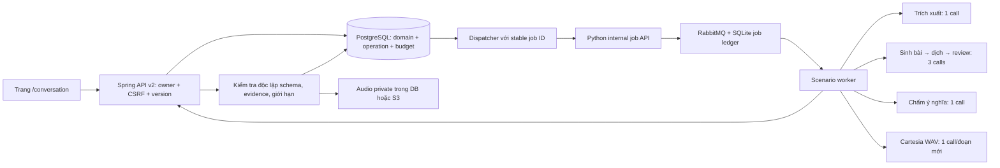

# Scenario backend — triển khai ngày 31/10/2026

## Phạm vi

Đã có luồng backend và giao diện gọi API thật cho bài luyện giao tiếp: mô tả tự do bằng tiếng Việt, trích xuất bản nháp để xác nhận, sinh ba hoạt động liên kết, nghe từng đoạn, trả lời bằng tiếng Việt, chấm ý nghĩa, hoàn thành và tạo biến thể. Không dùng điểm hoặc audio giả lập trong giao diện.

**Chưa bật sinh bài cho người dùng production.** Các program trong repository vẫn `DRAFT`. Đợt này không tự phê duyệt chất lượng sư phạm từ kết quả unit test. TOEIC/IELTS tiếp tục cho lưu mục tiêu đúng thang điểm; chưa có bộ sinh bài thi, quy đổi band, chatbot hoặc hội thoại 1–1.

## Kiến trúc đã triển khai



Tái sử dụng transport AI, broker, bộ giới hạn ngân sách, CSRF/auth và private media hiện có. Không thêm dependency. Không đổi API Conversation v1, dữ liệu bài cũ hoặc migration đã phát hành.

### Một màn hình Nghe hiểu tình huống

`/conversation` là cửa vào duy nhất. Đã bỏ mục điều hướng và view riêng `/scenario`; URL cũ chuyển về `/conversation`, giữ ID khi mở bài. Tên file/module `scenario.*` và API v2 là chi tiết triển khai nội bộ.

Ô nhập tiếng Việt gửi **nội dung đã chỉnh sửa** qua `inputVi` đến API draft v2. Sáu nhóm và 24 gợi ý tái sử dụng catalog Conversation hiện có; chọn gợi ý chỉ điền ô nhập, không khóa tình huống. Đổi nhóm không xóa nội dung. Bài v1 vẫn mở bằng renderer/API v1; chỉ phản hồi 404 thật mới thử renderer v2. Không coi lỗi mạng/auth/503 của v1 là dấu hiệu bài thuộc v2. Lịch sử cả hai thế hệ cùng hiển thị và có phân trang.

Độ khó bài giao tiếp mới đọc ba profile có phiên bản trong registry: Có hỗ trợ / Tiêu chuẩn / Thử thách. Không biến A1/A2/B1 thành thang chung cho TOEIC/IELTS; các bài v1 giữ cấp cũ.

### Dữ liệu mới: Flyway V49

| Bảng | Trách nhiệm |
|---|---|
| `scenario_drafts` | Input đã chuẩn hóa/lọc mẫu thông tin nhạy cảm, program/profile/hash, mục tiêu tự khai, spec, TTL 24 giờ |
| `scenario_sessions` | Phiên bản bài học, trạng thái, lineage parent/family và provenance của bộ sinh |
| `scenario_activities` | Nội dung riêng gồm transcript, dịch, câu hỏi, đáp án/evidence; mức hỗ trợ đã mở |
| `scenario_attempts` | Câu trả lời bất biến, support snapshot và kết quả từng lần |
| `scenario_operations` | Intent fingerprint, stable job ID, lease, deadline, trạng thái và metadata kết quả không chứa task |
| `scenario_operation_budget` | Toàn bộ số call được giữ ngân sách cùng transaction tạo operation |
| `scenario_media` | Cache WAV theo hoạt động/đoạn/fingerprint; URL S3 riêng hoặc bytes |
| `scenario_receipts` | Kết quả thao tác cục bộ theo owner, scope và Idempotency-Key |

Các FK người dùng cascade khi xóa tài khoản; xóa parent không làm mất phiên biến thể độc lập. S3 lifecycle nhận biết audio còn được scenario tham chiếu và lên lịch dọn object mồ côi. Không có job xóa bài hoặc audio scenario theo tuổi trong đợt này; cần chốt chính sách giữ dữ liệu trước khi mở rộng lưu lượng.

V49 chỉ thêm bảng/index/FK mới. Cần chạy bằng migration principal hiện có. Không khẳng định DDL không khóa trên mọi môi trường; rollout production phải dùng backup và cửa sổ triển khai của dự án. Rollback ứng dụng giữ nguyên bảng mới, không chạy DROP/down migration.

## API và hành vi

Contract đầy đủ: [OpenAPI engine](scenario-engine-openapi.yaml), bổ sung cho [catalog và goals](scenario-foundation-openapi.yaml).

| Nhóm | Endpoint dưới `/api/v2/scenarios` |
|---|---|
| Khám phá | GET `/suggestions`, `/recommendations`, `/catalog` |
| Bản nháp | POST `/drafts`, GET `/drafts/{id}` |
| Bài học | POST `/sessions`, GET `/sessions`, `/sessions/{id}` |
| Tác vụ | GET `/operations/{id}`, POST `/operations/{id}/cancel` |
| Hoạt động | POST `/sessions/{s}/activities/{a}/answers`, `/help`, `/play`, `/complete` |
| Biến thể | POST `/sessions/{s}/remixes` |
| Audio | GET `/media/{id}` sau kiểm tra owner |

- JSON tối đa 32 KiB; từ chối field lạ/trùng/thiếu/null và ép kiểu scalar. Tất cả POST giữ CSRF và UUID `Idempotency-Key`.
- Lặp key cùng body trả operation/receipt cũ. Đổi body với key cũ trả 409. Thao tác sửa bài cần `expectedVersion`; conflict giữ câu trả lời nháp trong trình duyệt.
- Không giữ transaction khi gọi provider hoặc upload S3. Chỉ publication dưới đúng owner/lease mới được ghi bài.
- Operation: `PENDING → RUNNING → SUCCEEDED | FAILED | UNKNOWN`; chỉ cancel trước dispatch. Mất ACK dùng lại cùng job ID. Không phát sinh fresh job để chữa kết quả chưa xác định.
- Rollout flag chặn admission mới. Dispatcher vẫn kết toán tác vụ đã nhận sau khi rollback flag; không coi flag là nút hủy provider đang chạy. Nếu Python tắt scenario thì worker từ chối thực thi.
- Tối đa ba operation đang chờ/chạy mỗi owner; giới hạn tạo bài 20/24 giờ dùng chung với Conversation v1. Giữ các allowance premium, emergency switch và global/user budget hiện có.
- Giữ ngân sách 1 call cho extract/grade/TTS; 3 calls cho generate/translate/review. Đây là reservation, không phải hóa đơn provider. Kết quả UNKNOWN hoặc cancel không tự hoàn ngân sách.
- Deadline tổng 240 giây cho scenario, 90 giây cho TTS. Token đầu ra từng call bị chặn tại extract 1600, generate 6000, translate 4000, review/grade 1200. Với Ollama phải chọn context phù hợp tổng input/schema/output trước rollout; không tự nâng phần cứng/model.

## Kiểm soát chất lượng và riêng tư

1. Schema server sở hữu; input chỉ là dữ liệu, không cấp tool/URL hoặc chọn model từ trình duyệt.
2. Input tiếng Việt chuẩn hóa NFC và lọc các mẫu email, số điện thoại, bearer/JWT và chuỗi giống credential. Đây là lọc mẫu, không phải bảo đảm phát hiện mọi PII.
3. Ba hoạt động, hai nhân vật giả, 2–6 đoạn và hai câu `MEANING_RECALL_VI` mỗi hoạt động. Độ dài theo profile registry, không hardcode CEFR.
4. Evidence phải là substring nguyên văn của đúng đoạn. Translation phải phủ đủ đúng ID. Không có đáp án nằm nguyên văn trong câu hỏi.
5. Lượt sinh lập sáu ý nghe trước nội dung trong cùng call; schema giới hạn speakerId theo hai nhân vật đã xác nhận. Model review tách biệt lượt sinh, xét logic, vai trò, thông tin được hỏi, dịch và độ khó; phải đối chiếu đủ sáu câu, từng đáp án/evidence và ý nghĩa có trùng hay không. Bỏ sót câu, báo không chắc chắn hoặc có issue thì không publish. Cả sinh và review nhận mô tả gốc đã lọc thông tin nhạy cảm, tránh mất ràng buộc qua bước extract. Không tự repair/gọi lại cả workflow sau lỗi giữa chừng. Review model vẫn có thể bỏ sót lỗi; đây không thay thế benchmark và review sư phạm.
6. Core tự kiểm tra cấu trúc, giới hạn, quote, metadata request/generation/provider/prompt/program và thứ tự các call trước ghi DB. Lưu model/digest/call metadata thực tế; metadata không thay thế benchmark độc lập.
7. Trước hỗ trợ, API chỉ gửi ID nhân vật/đoạn và câu hỏi; không gửi transcript/dịch/đáp án/evidence. Transcript chỉ mở sau ghi dấu hỗ trợ. Đáp án chỉ mở khi hoàn thành hoạt động.
8. Tối đa ba lần trả lời/hoạt động; không chấm lại khi grade còn pending. CAPTURED/PARTIAL/INCORRECT phải trích đúng câu người học; `UNCERTAIN` giữ nguyên.
9. Chỉ owner lấy được WAV. Không mở `/conversation-media/**` ra công khai. Cache READY không tính thêm AI call; FAILED cho người dùng chủ động thử tối đa ba lần. UNKNOWN không tự tạo audio job mới. Lượt yêu cầu phát không chứng minh người dùng đã nghe.
10. Gợi ý cá nhân hóa hiện dùng quy tắc có căn cứ: tối đa 20 lần trả lời đầu gần nhất, bỏ lần mở transcript/hint và fact UNCERTAIN; dưới sáu fact dùng cold start. Gợi ý tập trung detail/main-idea, không công bố mastery hoặc band dự đoán.

## Điều kiện bật

Hiện chưa có program APPROVED hoặc benchmark provider đủ điều kiện phát hành. **Không đặt flag/hash để né gate hoặc đổi DRAFT thành APPROVED chỉ để chạy thử.** Quy trình release production:

1. Chạy bộ prompt riêng và review sư phạm trên đúng provider/model/digest cấu hình, cùng test vận hành và TTS thật. Lưu bằng chứng; không dùng tập test training để tối ưu.
2. Thêm phiên bản program bất biến đã duyệt, có mode `guided-listening`, question `MEANING_RECALL_VI`, profile và năm artifact purpose: extraction/generation/translation/review/grading. Artifact ID `scenario-listening-v1`; hash phải khớp `src/main/resources/scenario/workflow-v1.sha256`.
3. Triển khai bundle Java/Python cùng phiên bản, Flyway bằng migration role; RabbitMQ/worker/job ledger và storage private phải sẵn sàng. Service token mạnh và đồng nhất, không ghi khóa vào Git hoặc lệnh CLI.
4. Cấu hình qua protected environment:

| Process | Cấu hình |
|---|---|
| Java | `DICTALAB_SCENARIO_ENABLED=true`, `DICTALAB_SCENARIO_ENGINE_ENABLED=true` |
| Java | `DICTALAB_SCENARIO_ENGINE_PROGRAM_VERSION`, `DICTALAB_SCENARIO_ENGINE_APPROVED_PROGRAM_HASH`, `DICTALAB_SCENARIO_ENGINE_APPROVED_PROMPT_HASH` đúng phiên bản đã duyệt |
| Java | `DICTALAB_AI_PLATFORM_BASE_URL`, `DICTALAB_AI_SERVICE_TOKEN`, `DICTALAB_AI_TEXT_PROVIDER`, budget hiện có |
| Python API + worker | `DICTALAB_AI_JOBS_ENABLED=true`, `DICTALAB_AI_SCENARIO_ENABLED=true`, cấu hình token/provider/model/broker/job DB/Cartesia hiện có |

5. Xác minh catalog `generationAvailable=true`, tạo bài thử bằng tài khoản được phép, kiểm tra từng giai đoạn, audio owner và cost. Theo dõi error/UNKNOWN/queue trước khi mở rộng.

Hash workflow đóng băng cả instructions, schema đầu ra và giới hạn token. Mọi đổi hash cần duyệt lại và cập nhật pin có chủ đích. Model không được calibrate chỉ bởi hash prompt; người vận hành phải duyệt lại khi đổi provider/model/digest. TOEIC/IELTS cần pack, rubric và benchmark riêng trước khi thêm vào generationPrograms.

### Chạy thử local có giới hạn

Không cần giả trạng thái APPROVED để kiểm thử DRAFT. Ngoại lệ `LOCAL_PREVIEW` chỉ hoạt động khi đồng thời có profile `local`, không có profile `prod`/`production`, bind `server.address=127.0.0.1` hoặc `::1`, hai rollout flag, transport AI hợp lệ, hash program/workflow khớp và ID người dùng nằm trong danh sách cho phép. Thiếu một điều kiện thì từ chối admission.

Protected environment của Java thêm `DICTALAB_SCENARIO_ENGINE_LOCAL_PREVIEW_ENABLED=true` và `DICTALAB_SCENARIO_ENGINE_LOCAL_PREVIEW_USERS=<các ID được phép>`. Mặc định cờ tắt, danh sách rỗng. Catalog trả `generationMode=LOCAL_PREVIEW`; UI ghi rõ DRAFT chưa được chuyên gia duyệt. Chế độ này vẫn giữ quota, budget, ownership, CSRF, idempotency và mọi gate kiểm định nội dung. Các biến `APPROVED_*_HASH` ở local là pin đối chiếu, không đổi trạng thái registry.

Local hiện chạy Core `127.0.0.1:18081`, management health `127.0.0.1:18183`, Python API `127.0.0.1:8091` và worker riêng. PostgreSQL/RabbitMQ/Redis hiện có được tái sử dụng; queue vhost/job ledger thử nghiệm được tách riêng. V49 đã áp dụng bằng migration principal sau backup PostgreSQL có kiểm tra danh mục restore; runtime principal chỉ nhận quyền dữ liệu cần thiết. Hai session Conversation v1 vẫn còn. Worker thông báo/thanh toán được tắt riêng trong cấu hình thử local; không thay quyền schema để chạy tác vụ ngoài phạm vi.

## Kiểm tra có thể chạy lại

```text
mvn --batch-mode --no-transfer-progress -Pci-unit test
mvn --batch-mode --no-transfer-progress -Dtest=ScenarioEngineIntegrationTest,ScenarioContentTest,ScenarioIntegrationTest,ScenarioDisabledIntegrationTest,AiUsageBudgetIntegrationTest,ConversationIntegrationTest,ConversationUxIntegrationTest,SpaRoutingTest,AiPlatformClientTest test
mvn --batch-mode --no-transfer-progress -Preliability -Dtest=ScenarioMigrationIntegrationTest,ScenarioEngineIntegrationTest,ReliabilityInfrastructureTest test
python -m pytest -q services/ai-generation/tests/test_scenario_workflow.py services/ai-generation/tests/test_jobs.py services/ai-generation/tests/test_scenario_contract.py
node --test src/test/js/scenario.test.cjs src/test/js/ui-regressions.test.cjs src/test/js/production-load.test.cjs src/test/js/load-contracts.test.cjs src/test/js/ci-scope.test.cjs
```

Test Java/Python dùng cùng fixture `workflow-example.json`. Mock semantic review chỉ kiểm tra wiring/gate, không chứng minh chất lượng model production. Testcontainers dùng PostgreSQL 17.11, Redis và RabbitMQ dùng một lần; kiểm tra cài mới, nâng từ V47, bảo toàn legacy session và account cascade. Không đụng database production.

### Kết quả đã xác minh tại máy phát triển

| Bộ kiểm tra | Kết quả |
|---|---|
| Java `ci-unit` | 273 test, 0 lỗi, 17 skip theo điều kiện |
| Java backend và regression liên quan | 151 test, 0 lỗi, 1 skip theo điều kiện |
| Java kiểm tra lại thay đổi cuối: engine/content/disabled/S3 | 30/30 đạt |
| PostgreSQL 17.11: migration, engine và infrastructure | 15/15 đạt, gồm cài mới và nâng từ V47 |
| Python workflow, jobs và contract | 82/82 đạt |
| JavaScript scenario, UI, load và CI scope | 71/71 đạt |
| UTF-8/compilation checker | 377 file đạt |
| YAML, `docker compose --env-file NUL config --quiet`, `git diff --check` | Đạt; Compose dùng biến môi trường kiểm tra, không dùng secret production |

Các bộ Java có phần trùng nhau, không cộng thành số test duy nhất. Bảng trên ghi đợt backend ban đầu; kết quả thử local sau hợp nhất UI ở dưới. Chưa chứng minh chất lượng model bằng benchmark và chưa triển khai production. Kết quả GitHub delivery/CI được báo riêng sau khi push; các kết quả trên là kiểm tra local.

### Xác minh local sau hợp nhất vào Conversation

- Java engine/foundation/disabled/SPA/Conversation regression: **130 ca, 0 lỗi, 1 skip theo điều kiện**; gồm kiểm tra payload generate giữ mô tả gốc và gate preview chỉ cho đúng người dùng/môi trường/pin.
- Python workflow/jobs/contract: **87 đạt**; gồm giới hạn body/auth job Scenario, pin dùng chung, bảo toàn mô tả gốc trong generate/review, enum nhân vật và review bắt buộc phủ đủ sáu câu. Verdict tổng thể `true` không đủ nếu từng câu báo sai/trùng hoặc thiếu audit.
- JavaScript scenario/UI/load contracts: **65 đạt**; gồm gửi đúng nội dung ô nhập, đổi nhóm giữ nội dung, điều hướng duy nhất và chỉ fallback renderer sau v1 404.
- Trình duyệt thật: desktop 1440 px và mobile 390 px, không có JS page error hoặc tràn ngang. Đủ 6 nhóm/24 gợi ý; chọn/sửa/đổi nhóm/reload giữ mô tả; mở session v2 từ URL `/conversation/{id}` thành công qua fallback v1 404. Đã sửa textarea mất style do selector cũ và padding lồng nhau.
- Provider/model cấu hình local: Gemini `gemini-3.5-flash-lite`; audio Cartesia thật. Một ca riêng không thuộc tập test training: đổi lịch nhận xe đạp đã sửa từ sáng thứ Ba sang chiều thứ Tư, hỏi giờ đóng cửa và người giao xe. Đã đọc thủ công hội thoại/dịch/sáu câu hỏi/đáp án; bản cuối giữ ràng buộc và có sáu ý hỏi khác nhau.
- Ca cuối chạy đủ extract → generate/translate/review → ACTIVE → WAV RIFF **157.518 bytes** → cache trả cùng media → ba lượt grade với **6/6 câu diễn đạt lại CAPTURED** → COMPLETED → remix extraction READY. Media không đăng nhập trả 401; payload trước hỗ trợ không lộ transcript/đáp án. Số 6/6 mô tả duy nhất ca thử này, không phải độ chính xác model trên benchmark.
- Các lần thử trước đã giữ nguyên lỗi: đoạn quá ngắn, mã nhân vật sai, câu hỏi lặp; một verdict tổng thể còn bỏ sót lỗi mà đọc thủ công phát hiện. Bản đó chỉ nằm trong tài khoản QA riêng, không dùng làm bằng chứng đạt chất lượng. Đã cải thiện planning/review như mô tả ở trên và cập nhật pin có chủ đích. Không xóa lỗi, không tự replay hay tắt gate để hoàn thành phép thử.
- Bằng chứng/log/ảnh/WAV/backup/cấu hình bảo vệ nằm trong thư mục `data/scenario-local-20261031` được Git ignore; không commit credential, cookie hoặc nội dung học riêng. Kiểm thử đăng nhập dùng tài khoản QA riêng, đóng phiên sau thử; giới hạn phiên đăng nhập giữ nguyên.
- 23 file thay đổi đọc UTF-8 hợp lệ; checker tiếng Việt trên file hỗ trợ, YAML và `git diff --check` đạt. Worker chẩn đoán chỉ trace tài khoản QA đã được thay lại bằng worker chuẩn sau khi không còn operation pending/running.

**Để thử:** mở `http://localhost:18081/conversation`, đăng nhập tài khoản chủ đã được cho phép local, nhập tình huống → Phân tích và xem trước → Xác nhận và tạo bài → Nghe/Trả lời → Hoàn thành → Remix. Backend được giữ chạy để kiểm tra. Chỉ tài khoản được chỉ định có quyền dùng preview; đây chưa phải rollout production.

Các phần chưa làm: bộ sinh/chấm bài TOEIC/IELTS theo chứng chỉ, calibrated assessment, spaced repetition scenario, chat text/realtime voice 1–1, nhiều giọng nhân vật/tốc độ TTS server, benchmark model thật và triển khai production.
