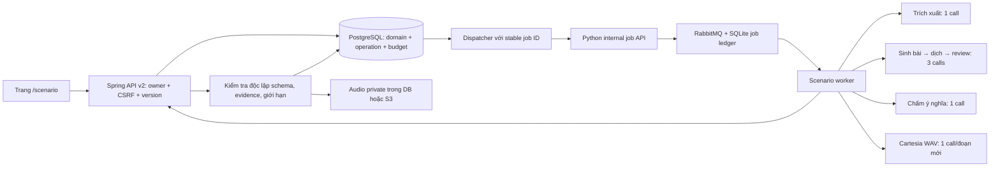

# Scenario backend — triển khai ngày 31/10/2026

## Phạm vi

Đã có luồng backend và giao diện gọi API thật cho bài luyện giao tiếp: mô tả tự do bằng tiếng Việt, trích xuất bản nháp để xác nhận, sinh ba hoạt động liên kết, nghe từng đoạn, trả lời bằng tiếng Việt, chấm ý nghĩa, hoàn thành và tạo biến thể. Không dùng điểm hoặc audio giả lập trong giao diện.

**Chưa bật sinh bài cho người dùng production.** Các program trong repository vẫn `DRAFT`. Đợt này không tự phê duyệt chất lượng sư phạm từ kết quả unit test. TOEIC/IELTS tiếp tục cho lưu mục tiêu đúng thang điểm; chưa có bộ sinh bài thi, quy đổi band, chatbot hoặc hội thoại 1–1.

## Kiến trúc đã triển khai



Tái sử dụng transport AI, broker, bộ giới hạn ngân sách, CSRF/auth và private media hiện có. Không thêm dependency. Không đổi API Conversation v1, dữ liệu bài cũ hoặc migration đã phát hành.

### Dữ liệu mới: Flyway V49

| Bảng | Trách nhiệm |
|---|---|
| `scenario_drafts` | Input đã chuẩn hóa/lọc mẫu thông tin nhạy cảm, program/profile/hash, mục tiêu tự khai, spec, TTL 24 giờ |
| `scenario_sessions` | Phiên bản bài học, trạng thái, lineage parent/family và provenance của bộ sinh |
| `scenario_activities` | Nội dung riêng gồm transcript, dịch, câu hỏi, đáp án/evidence; mức hỗ trợ đã mở |
| `scenario_attempts` | Câu trả lời bất biến, support snapshot và kết quả từng lần |
| `scenario_operations` | Intent fingerprint, stable job ID, lease, deadline, trạng thái và metadata kết quả không chứa task |
| `scenario_operation_budget` | Toàn bộ số call được giữ ngân sách cùng transaction tạo operation |
| `scenario_media` | Cache WAV theo hoạt động/đoạn/fingerprint; URL S3 riêng hoặc bytes |
| `scenario_receipts` | Kết quả thao tác cục bộ theo owner, scope và Idempotency-Key |

Các FK người dùng cascade khi xóa tài khoản; xóa parent không làm mất phiên biến thể độc lập. S3 lifecycle nhận biết audio còn được scenario tham chiếu và lên lịch dọn object mồ côi. Không có job xóa bài hoặc audio scenario theo tuổi trong đợt này; cần chốt chính sách giữ dữ liệu trước khi mở rộng lưu lượng.

V49 chỉ thêm bảng/index/FK mới. Cần chạy bằng migration principal hiện có. Không khẳng định DDL không khóa trên mọi môi trường; rollout production phải dùng backup và cửa sổ triển khai của dự án. Rollback ứng dụng giữ nguyên bảng mới, không chạy DROP/down migration.

## API và hành vi

Contract đầy đủ: [OpenAPI engine](scenario-engine-openapi.yaml), bổ sung cho [catalog và goals](scenario-foundation-openapi.yaml).

| Nhóm | Endpoint dưới `/api/v2/scenarios` |
|---|---|
| Khám phá | GET `/suggestions`, `/recommendations`, `/catalog` |
| Bản nháp | POST `/drafts`, GET `/drafts/{id}` |
| Bài học | POST `/sessions`, GET `/sessions`, `/sessions/{id}` |
| Tác vụ | GET `/operations/{id}`, POST `/operations/{id}/cancel` |
| Hoạt động | POST `/sessions/{s}/activities/{a}/answers`, `/help`, `/play`, `/complete` |
| Biến thể | POST `/sessions/{s}/remixes` |
| Audio | GET `/media/{id}` sau kiểm tra owner |

- JSON tối đa 32 KiB; từ chối field lạ/trùng/thiếu/null và ép kiểu scalar. Tất cả POST giữ CSRF và UUID `Idempotency-Key`.
- Lặp key cùng body trả operation/receipt cũ. Đổi body với key cũ trả 409. Thao tác sửa bài cần `expectedVersion`; conflict giữ câu trả lời nháp trong trình duyệt.
- Không giữ transaction khi gọi provider hoặc upload S3. Chỉ publication dưới đúng owner/lease mới được ghi bài.
- Operation: `PENDING → RUNNING → SUCCEEDED | FAILED | UNKNOWN`; chỉ cancel trước dispatch. Mất ACK dùng lại cùng job ID. Không phát sinh fresh job để chữa kết quả chưa xác định.
- Rollout flag chặn admission mới. Dispatcher vẫn kết toán tác vụ đã nhận sau khi rollback flag; không coi flag là nút hủy provider đang chạy. Nếu Python tắt scenario thì worker từ chối thực thi.
- Tối đa ba operation đang chờ/chạy mỗi owner; giới hạn tạo bài 20/24 giờ dùng chung với Conversation v1. Giữ các allowance premium, emergency switch và global/user budget hiện có.
- Giữ ngân sách 1 call cho extract/grade/TTS; 3 calls cho generate/translate/review. Đây là reservation, không phải hóa đơn provider. Kết quả UNKNOWN hoặc cancel không tự hoàn ngân sách.
- Deadline tổng 240 giây cho scenario, 90 giây cho TTS. Token đầu ra từng call bị chặn tại extract 1600, generate 6000, translate 4000, review/grade 1200. Với Ollama phải chọn context phù hợp tổng input/schema/output trước rollout; không tự nâng phần cứng/model.

## Kiểm soát chất lượng và riêng tư

1. Schema server sở hữu; input chỉ là dữ liệu, không cấp tool/URL hoặc chọn model từ trình duyệt.
2. Input tiếng Việt chuẩn hóa NFC và lọc các mẫu email, số điện thoại, bearer/JWT và chuỗi giống credential. Đây là lọc mẫu, không phải bảo đảm phát hiện mọi PII.
3. Ba hoạt động, hai nhân vật giả, 2–6 đoạn và hai câu `MEANING_RECALL_VI` mỗi hoạt động. Độ dài theo profile registry, không hardcode CEFR.
4. Evidence phải là substring nguyên văn của đúng đoạn. Translation phải phủ đủ đúng ID. Không có đáp án nằm nguyên văn trong câu hỏi.
5. Model review tách biệt lượt sinh, xét logic, vai trò, thông tin được hỏi, dịch và độ khó. Review không chắc chắn hoặc có issue thì không publish. Không tự repair/gọi lại cả workflow sau lỗi giữa chừng.
6. Core tự kiểm tra cấu trúc, giới hạn, quote, metadata request/generation/provider/prompt/program và thứ tự các call trước ghi DB. Lưu model/digest/call metadata thực tế; metadata không thay thế benchmark độc lập.
7. Trước hỗ trợ, API chỉ gửi ID nhân vật/đoạn và câu hỏi; không gửi transcript/dịch/đáp án/evidence. Transcript chỉ mở sau ghi dấu hỗ trợ. Đáp án chỉ mở khi hoàn thành hoạt động.
8. Tối đa ba lần trả lời/hoạt động; không chấm lại khi grade còn pending. CAPTURED/PARTIAL/INCORRECT phải trích đúng câu người học; `UNCERTAIN` giữ nguyên.
9. Chỉ owner lấy được WAV. Không mở `/conversation-media/**` ra công khai. Cache READY không tính thêm AI call; FAILED cho người dùng chủ động thử tối đa ba lần. UNKNOWN không tự tạo audio job mới. Lượt yêu cầu phát không chứng minh người dùng đã nghe.
10. Gợi ý cá nhân hóa hiện dùng quy tắc có căn cứ: tối đa 20 lần trả lời đầu gần nhất, bỏ lần mở transcript/hint và fact UNCERTAIN; dưới sáu fact dùng cold start. Gợi ý tập trung detail/main-idea, không công bố mastery hoặc band dự đoán.

## Điều kiện bật

Hiện chưa có program APPROVED và benchmark provider thực. **Không đặt flag/hash để né gate hoặc đổi DRAFT thành APPROVED chỉ để chạy thử.** Quy trình release:

1. Chạy bộ prompt riêng và review sư phạm trên đúng provider/model/digest cấu hình, cùng test vận hành và TTS thật. Lưu bằng chứng; không dùng tập test training để tối ưu.
2. Thêm phiên bản program bất biến đã duyệt, có mode `guided-listening`, question `MEANING_RECALL_VI`, profile và năm artifact purpose: extraction/generation/translation/review/grading. Artifact ID `scenario-listening-v1`; hash phải khớp `src/main/resources/scenario/workflow-v1.sha256`.
3. Triển khai bundle Java/Python cùng phiên bản, Flyway bằng migration role; RabbitMQ/worker/job ledger và storage private phải sẵn sàng. Service token mạnh và đồng nhất, không ghi khóa vào Git hoặc lệnh CLI.
4. Cấu hình qua protected environment:

| Process | Cấu hình |
|---|---|
| Java | `DICTALAB_SCENARIO_ENABLED=true`, `DICTALAB_SCENARIO_ENGINE_ENABLED=true` |
| Java | `DICTALAB_SCENARIO_ENGINE_PROGRAM_VERSION`, `DICTALAB_SCENARIO_ENGINE_APPROVED_PROGRAM_HASH`, `DICTALAB_SCENARIO_ENGINE_APPROVED_PROMPT_HASH` đúng phiên bản đã duyệt |
| Java | `DICTALAB_AI_PLATFORM_BASE_URL`, `DICTALAB_AI_SERVICE_TOKEN`, `DICTALAB_AI_TEXT_PROVIDER`, budget hiện có |
| Python API + worker | `DICTALAB_AI_JOBS_ENABLED=true`, `DICTALAB_AI_SCENARIO_ENABLED=true`, cấu hình token/provider/model/broker/job DB/Cartesia hiện có |

5. Xác minh catalog `generationAvailable=true`, tạo bài thử bằng tài khoản được phép, kiểm tra từng giai đoạn, audio owner và cost. Theo dõi error/UNKNOWN/queue trước khi mở rộng.

Hash workflow đóng băng cả instructions, schema đầu ra và giới hạn token. Mọi đổi hash cần duyệt lại và cập nhật pin có chủ đích. Model không được calibrate chỉ bởi hash prompt; người vận hành phải duyệt lại khi đổi provider/model/digest. TOEIC/IELTS cần pack, rubric và benchmark riêng trước khi thêm vào generationPrograms.

## Kiểm tra có thể chạy lại

```text
mvn --batch-mode --no-transfer-progress -Pci-unit test
mvn --batch-mode --no-transfer-progress -Dtest=ScenarioEngineIntegrationTest,ScenarioContentTest,ScenarioIntegrationTest,ScenarioDisabledIntegrationTest,AiUsageBudgetIntegrationTest,ConversationIntegrationTest,ConversationUxIntegrationTest,SpaRoutingTest,AiPlatformClientTest test
mvn --batch-mode --no-transfer-progress -Preliability -Dtest=ScenarioMigrationIntegrationTest,ScenarioEngineIntegrationTest,ReliabilityInfrastructureTest test
python -m pytest -q services/ai-generation/tests/test_scenario_workflow.py services/ai-generation/tests/test_jobs.py services/ai-generation/tests/test_scenario_contract.py
node --test src/test/js/scenario.test.cjs src/test/js/ui-regressions.test.cjs src/test/js/production-load.test.cjs src/test/js/load-contracts.test.cjs src/test/js/ci-scope.test.cjs
```

Test Java/Python dùng cùng fixture `workflow-example.json`. Mock semantic review chỉ kiểm tra wiring/gate, không chứng minh chất lượng model production. Testcontainers dùng PostgreSQL 17.11, Redis và RabbitMQ dùng một lần; kiểm tra cài mới, nâng từ V47, bảo toàn legacy session và account cascade. Không đụng database production.

### Kết quả đã xác minh tại máy phát triển

| Bộ kiểm tra | Kết quả |
|---|---|
| Java `ci-unit` | 273 test, 0 lỗi, 17 skip theo điều kiện |
| Java backend và regression liên quan | 151 test, 0 lỗi, 1 skip theo điều kiện |
| Java kiểm tra lại thay đổi cuối: engine/content/disabled/S3 | 30/30 đạt |
| PostgreSQL 17.11: migration, engine và infrastructure | 15/15 đạt, gồm cài mới và nâng từ V47 |
| Python workflow, jobs và contract | 82/82 đạt |
| JavaScript scenario, UI, load và CI scope | 71/71 đạt |
| UTF-8/compilation checker | 377 file đạt |
| YAML, `docker compose --env-file NUL config --quiet`, `git diff --check` | Đạt; Compose dùng biến môi trường kiểm tra, không dùng secret production |

Các bộ Java có phần trùng nhau, không cộng thành số test duy nhất. Chưa chạy kiểm thử trình duyệt với provider/TTS thật, chưa chứng minh chất lượng model bằng benchmark và chưa triển khai production. Kết quả GitHub delivery/CI được báo riêng sau khi push; các kết quả trên là kiểm tra local.

Các phần chưa làm: bộ sinh/chấm bài TOEIC/IELTS theo chứng chỉ, calibrated assessment, spaced repetition scenario, chat text/realtime voice 1–1, nhiều giọng nhân vật/tốc độ TTS server, benchmark model thật và triển khai production.
