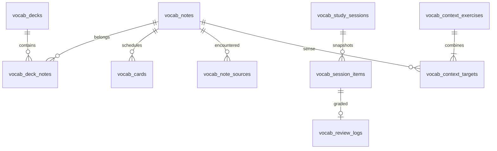

# Từ vựng: thiết kế, hợp đồng và kế hoạch mở rộng

## 1. Phạm vi phiên bản đầu

Người học chọn bộ từ trên website, tự nhập từ/cụm từ và nghĩa, nhập CSV,
hoặc lưu từ đã gặp trong bài nghe. Học bằng cách tự nhập đáp án trước khi
xem lời giải, ôn theo lịch và dịch câu ngắn kết hợp các nghĩa đã lưu.

Đã có hai bộ mẫu gốc gồm 26 mục từ và 13 câu kết hợp hai từ. Nội dung do
quản trị viên biên tập; không lấy nội dung từ website bên ngoài khi người học
bấm học. Chưa có nhập file `.apkg`, đồng bộ với Anki, tải media hoặc AI.

### Học bộ có sẵn và phân loại mở rộng

**Luồng người học:** Bộ có sẵn → mở bộ → **Học bộ này** → chọn chế độ.
Không yêu cầu tự tạo bộ hay chọn bộ đích. Quản trị viên cũng có thể học bộ đã
xuất bản qua cùng luồng, tách khỏi công việc biên tập. Bộ nháp không có nút học.

Backend `POST /api/v1/vocabulary/catalog/decks/{id}/enroll` (có CSRF và
`Idempotency-Key`) tự tạo bộ cá nhân từ nguồn công khai. Trả về deck có `id`
cá nhân; frontend dùng ID này cho cả SRS, luyện thêm, trắc nghiệm và ngữ cảnh.
Không đưa ID bộ hệ thống vào API học cá nhân. Chế độ trắc nghiệm và chọn nghĩa
ngữ cảnh hiện chỉ luyện trên trình duyệt; chưa ghi kết quả vào lịch SRS.

Hợp đồng dữ liệu:

- `vocab_decks.source_deck_id` ghi nguồn đăng ký học. Unique
  `(owner_user_id,source_deck_id)` và khóa user trong transaction bảo vệ nhiều
  tab/instance. Bấm lại với key mới vẫn trả bộ đã có; không sao chép lại hoặc
  đặt lại lịch. Cùng key dùng receipt. Bộ đã lưu trữ trả 409, không hồi sinh
  dữ liệu ngầm. Người học vẫn có thể chép từ sang bộ khác qua thao tác riêng.
- Tái sử dụng copy theo `source_note_id`: từ đã học ở bộ khác dùng cùng note
  và card cá nhân, giữ nguyên lịch, lượt ôn, nội dung tự sửa và trạng thái ngưng.
  Tạo bộ, chép từ và receipt commit cùng transaction. Vượt quota hoặc lỗi copy
  rollback toàn bộ, không để lại bộ trống do thất bại.
- Đây là bản học tại lúc đăng ký. Admin sửa/ẩn bộ gốc không ghi đè bản riêng;
  bộ cá nhân vẫn học được. Đăng ký mới cần nguồn còn công khai. Việc tiếp tục
  bản đã có qua Bộ của tôi không phụ thuộc trạng thái xuất bản của nguồn.
- `level` là chuỗi tùy chọn, tối đa 80 ký tự; có thể là C2, thang điểm, mức
  tự đặt hoặc rỗng. Không còn enum A1–B2 và không suy ra loại kỳ thi từ mức độ.
- `tags` là danh sách nhãn tùy chọn, tối đa 20 nhãn/bộ, 80 ký tự/nhãn. Người
  dùng và admin nhập bất kỳ nhãn nào, mỗi dòng một nhãn. Ví dụ một bộ có thể
  đồng thời mang nhãn IELTS, Y khoa, Đọc hiểu; không cần đổi code cho nhãn mới.
  Lưu trong `vocab_deck_tags`, chuẩn hóa NFC và so khớp không phân biệt hoa
  thường. Từ chối nhãn rỗng/ký tự điều khiển; bỏ nhãn trùng. Không dùng nhãn
  để quyết định quyền truy cập, thuật toán ôn hay gọi nhà cung cấp AI.
- Client cũ không gửi `tags` thì giữ nhãn khi sửa; gửi `[]` để xóa nhãn. API
  cũ gửi A1–B2 vẫn hoạt động. `level` không gửi hoặc null được hiểu là rỗng;
  `revision` vẫn bắt buộc theo hợp đồng cập nhật hiện có.

Danh sách bộ cá nhân, catalog và admin đều hỗ trợ `q` (tối đa 120 ký tự) và
`tag` (tối đa 80 ký tự), phân trang 20 bộ. Tìm trên tên, mô tả, mức và nhãn;
`%`/`_` trong từ khóa được hiểu là ký tự thường, SQL dùng tham số. Endpoint
`/tags`, `/catalog/tags` và `/api/admin/vocabulary/tags` trả tối đa 200 gợi ý
từ dữ liệu trong đúng phạm vi quyền; có thể nhập nhãn không nằm trong gợi ý.
Nhãn của bộ riêng hoặc bộ nháp không lọt vào gợi ý catalog. Lấy nhãn cho cả
trang bằng một truy vấn, tránh một truy vấn riêng trên mỗi bộ.

**Hướng mở rộng cho người phát triển tiếp:** Giữ nội dung, metadata, tiến độ
và provider AI độc lập. Thêm kiểu bộ, nhãn hoặc thang mức không cần nhánh
`if TOEIC/IELTS` trong service học. Nếu sản phẩm cần lọc có cấu trúc theo nhiều
chiều (kỳ thi, chương trình, chuyên ngành), thêm bảng taxonomy có ID ổn định,
tên hiển thị, loại và bảng liên kết nhiều-nhiều; chuyển nhãn cũ qua migration
bổ sung, không đổi ý nghĩa `level` hoặc lịch ôn. Nếu cần cập nhật nguồn, thêm
preview diff theo revision và lựa chọn giữ bản tự sửa trước khi áp dụng; không
đồng bộ đè tự động. Nếu tích hợp AI, provider nhận note/nghĩa, metadata và
loại bài qua hợp đồng hiện có, kiểm tra đầu ra trước khi lưu; nhãn không phải
chỉ thị thực thi. Không cần xây taxonomy engine hay AI ngay để thêm bộ mới.

### Migration V48

V48 mở rộng `level` của deck và câu ngữ cảnh từ 10 lên 80 ký tự, đổi default
của deck sang rỗng, thêm nguồn đăng ký học, unique index và bảng nhãn có index.
Giữ nguyên nội dung A1/A2 đang có, note/card/session/review và V46/V47.

Đánh giá phát hành: **an toàn có điều kiện** cho PostgreSQL 17/18 sau kiểm tra
trên dữ liệu và quyền thật. DDL `ALTER TABLE` và tạo index vẫn cần khóa; không
cam kết không chặn ghi. Chưa triển khai production trong thay đổi này. Trước
release cần xác nhận số dòng/kích thước bảng, giao dịch đang mở, backup và
thời gian bảo trì; dùng cơ chế migration/maintenance hiện có, hủy nếu chờ khóa
quá ngưỡng vận hành. Không sửa checksum hoặc drop cột để rollback. Bản cũ vẫn
đọc được schema mở rộng, nhưng không nên phục vụ form metadata cũ sau khi có
mức tùy chọn; giữ maintenance khi rollback để tránh ghi sai mức mới.

Sau migration kiểm tra schema version 48, quyền CRUD của core runtime và quyền
chỉ đọc của backup trên `vocab_deck_tags`, thử enroll/lọc/ôn với tài khoản thật.
`scripts/linux/test_service_schema.py` diễn tập nâng từ V45 lên V48, chạy lại
không đổi checksum cũ và kiểm tra quyền; không tạo job CI/CD mới.

Ba chế độ có mục tiêu và ảnh hưởng khác nhau:

| Chế độ | Câu hỏi | Ảnh hưởng lịch |
| --- | --- | --- |
| SRS | Nghĩa → từ; tùy chọn từ → nghĩa | Đổi lịch đúng thẻ vừa ôn |
| PRACTICE | Nhớ lại ngoài lịch | Chỉ lưu bằng chứng |
| CONTEXT_TRANSLATION | Câu Anh → bản dịch Việt | Lưu đánh giá câu và từng từ; không tăng lịch từng thẻ |

Lỗi nghe không tự chứng minh người học quên nghĩa. Trường phân loại do người
học tự chọn mới được hiển thị là “chưa biết từ”; lỗi mặc định của hệ thống
được ghi là “cần xác nhận nguyên nhân”. Người học phải xác nhận nghĩa khi lưu.

## 2. Bản đồ code

Các đường dẫn sau tương đối với repository:

| Thành phần | File trong `src/main/java/com/dictalab/vocabulary/` | Trách nhiệm |
| --- | --- | --- |
| Hợp đồng | `VocabularyDtos.java` | DTO, giới hạn đầu vào, trạng thái trả về |
| Cấu hình | `VocabularyProperties.java` | Bật tính năng, số thẻ mới, kích thước phiên |
| Truy cập dữ liệu | `VocabularyRepository.java` | SQL có tham số, quyền sở hữu, khóa user, receipt |
| Bộ và mục từ | `VocabularyContentService.java` | Nội dung, membership, copy catalog, batch insert, suspend |
| Bài cũ | `VocabularySourceService.java` | Gợi ý lỗi, xác minh owner, lưu snapshot nguồn |
| CSV | `VocabularyCsv.java`, `VocabularyImportService.java` | Parse, preview, confirm, export |
| Học | `VocabularyStudyService.java` | Chọn thẻ, snapshot, answer, reveal, grade, resume |
| Lịch | `ReviewScheduler.java`, `Sm2Scheduler.java` | Hàm tính lịch thuần, có phiên bản |
| Chấm | `AnswerEvaluator.java`, `RuleAnswerEvaluator.java` | So sánh độc lập với transaction học |
| Ngữ cảnh | `ContextExerciseProvider.java`, `CuratedContextProvider.java` | Chọn câu đúng nghĩa và ưu tiên từ yếu |
| Biên tập câu | `ContextExerciseService.java` | Kiểm tra target, publish, optimistic revision |
| HTTP | `VocabularyController.java`, `VocabularyAdminController.java` | REST cho user/admin |
| Bảo vệ request | `VocabularyRequestFilter.java` | Chặn body lớn trước deserialize, timing metric |

Frontend: `src/main/resources/static/js/vocabulary.js` và `css/vocabulary.css`.
Router và lifecycle kết nối trong `js/app.js`; view nằm trong `static/index.html`.
Tái sử dụng API bridge hiện có, token giao diện, xác thực, CSRF và rate limiter.
Không thêm thư viện hay dịch vụ hạ tầng mới.

Repository là Spring proxy. Service phải gọi `repo.jdbc()` / `repo.mapper()`;
không đọc trực tiếp field trên proxy.

## 3. Mô hình dữ liệu và bất biến

Flyway V46 tạo bảng mới; V47 thêm nội dung mẫu; V48 thêm đăng ký học và nhãn.
V44/V45 thuộc Progress outbox
và model demo của production EC2. Không sửa bảng điểm nghe.



- **Note là một nghĩa cụ thể**, không phải một chuỗi từ duy nhất. `bank` nghĩa
  ngân hàng và `bank` nghĩa bờ sông là hai note. Cụm từ cũng là một note.
- Note công khai có owner NULL; note cá nhân thuộc đúng một user. Composite FK
  `(note_id,user_id)` bảo vệ card và nguồn cá nhân khỏi tham chiếu chéo tài khoản.
- Một note có thể nằm trong nhiều bộ. Gỡ khỏi một bộ chỉ xóa membership; lịch
  học và note vẫn tồn tại. Thẻ đó vẫn có thể xuất hiện khi ôn toàn thư viện.
  Dùng “Tạm ngưng” để loại khỏi việc học.
- Một user/note/card type chỉ có một card. Hai chiều nhớ có lịch độc lập.
- Copy bộ công khai tạo bản riêng và giữ `source_note_id/source_revision`.
  Copy lại vào bộ khác dùng note/card đã có. Sửa bản riêng không sửa catalog.
  Bản riêng không tự cập nhật khi admin sửa nguồn.
- Nguồn bài cũ giữ transcript và tên bài tại thời điểm lưu. Xóa practice session
  làm `word_attempt_id` thành NULL; snapshot từ vựng vẫn đọc được.
- Session item giữ prompt, đáp án và feedback tại lúc tạo. Sửa nội dung sau đó
  không thay đổi đáp án của phiên đang học hoặc diễn giải lại lịch sử.
- Unique `review_logs.item_id` bảo vệ mỗi lượt chỉ ghi một lần.
- Xóa tài khoản cascade dữ liệu cá nhân của module. Không có API xóa hàng loạt
  note công khai hay sửa migration đã được áp dụng.

## 4. Lịch ôn có thể kiểm chứng

Phiên bản hiện tại: **SM2_PRODUCT_V1**, biến thể sản phẩm được định nghĩa ở đây.
Không gọi đây là FSRS hoặc tuyên bố tương đương lịch Anki.

Trạng thái ban đầu: NEW, interval 0, ease 2.5, repetitions 0, lapses 0.

| Nút | q | Hành vi |
| --- | --- | --- |
| Quên / AGAIN | 1 | RELEARNING, +10 phút, repetitions=0, lapses+1 |
| Khó / HARD | 3 | Vẫn nhớ độc lập; áp dụng bước thành công |
| Nhớ / GOOD | 4 | Áp dụng bước thành công |
| Dễ / EASY | 5 | Áp dụng bước thành công, ease tăng |

Sau mỗi lượt: `ease' = max(1.3, ease + 0.1 - (5-q)*(0.08+(5-q)*0.02))`.
Bước thành công thứ nhất là 1 ngày; thứ hai là 6 ngày; sau đó là
`min(365, ceil(interval * ease_cũ))`. HARD/GOOD/EASY dùng cùng công thức
interval trong phiên bản này, khác nhau ở ease cho các bước tiếp theo.
Mốc đến hạn tính từ lúc server nhận lượt ôn thực tế.

Các quy tắc phải giữ khi đổi thuật toán:

1. Chỉ SRS đổi lịch. Practice và dịch câu không được tăng lịch tất cả target.
2. Đã xem đáp án hoặc nhập sai ở bài nhớ từ chỉ được chọn AGAIN.
3. Bản dịch/nghĩa khác đáp án mẫu được ghi UNDETERMINED để người học tự đánh
   giá. Giữ `grading_source=SELF`; không trình bày như AI đã xác nhận đúng.
4. Ngày học cố định Asia/Bangkok (UTC+7), không lấy giờ từ trình duyệt.
5. Ưu tiên relearning, thẻ review đến hạn, rồi thẻ mới. Mặc định tối đa 10
   thẻ mới/ngày và 20 mục/phiên. Số thẻ mới tính bằng review log đã commit.
6. Không đặt hai chiều của cùng note trong một phiên. Sau khi xem lời giải,
   sibling bị ẩn tới ngày kế tiếp để tránh nhớ đáp án vừa lộ.
7. Một phiên active cho mỗi user/mode; bắt đầu lại cùng bộ sẽ tiếp tục phiên đó.
   Chọn bộ khác (hoặc đổi sang toàn thư viện) kết thúc phiên cùng chế độ đang dở
   sau khi xác nhận có thẻ/câu phù hợp cho phiên mới; mọi lượt đã chấm được giữ.
   Nếu bộ mới chưa có nội dung phù hợp, phiên cũ vẫn có thể tiếp tục từ Hôm nay.
8. Phiên hết hạn sau 24 giờ; không nhận trả lời/grade mới sau hạn.
9. Thay đổi/suspend lịch tăng revision; grade phiên SRS cũ bị từ chối nếu
   revision không khớp. UI yêu cầu kết thúc phiên rồi tải lại.

## 5. Transaction, retry và cạnh tranh

Mọi mutation chạy transaction có timeout. Thứ tự khóa: row `app_users`
trước, rồi thao tác dữ liệu module. Khóa trong PostgreSQL, không dùng khóa
trong JVM: nhiều instance và nhiều tab vẫn tuân theo cùng thứ tự.

Header `Idempotency-Key` bắt buộc, 1–100 ký tự thuộc `[A-Za-z0-9_.:-]`.
Receipt có khóa `(user_id,submission_key)`, action, SHA-256 của payload và
response. Cùng key/action/payload trả response đã lưu; đổi nội dung bị 409.
Receipt và dữ liệu nghiệp vụ commit cùng transaction. Grade còn được bảo vệ
bằng unique item và revision ngay cả khi client tạo key khác.

Frontend giữ key khi chưa biết kết quả do lỗi mạng/5xx/429. Không tự coi
timeout là thất bại nghiệp vụ rồi tạo thêm note. Draft đáp án lưu sessionStorage
theo user/item, hạn đọc 24 giờ; response muộn bị bỏ khi đổi trang/tài khoản.

Khi điều tra lỗi:

- 400: sửa validation, không thử gửi lại payload y hệt vô hạn.
- 401: xác thực lại; không chuyển draft sang tài khoản khác.
- 403: kiểm tra CSRF/role, không tắt bảo vệ.
- 404: không tồn tại hoặc không thuộc tài khoản; không tiết lộ owner khác.
- 409: refresh revision hoặc kết thúc phiên cũ; không ghi đè mù.
- 413: giảm kích thước request/file.
- 429/5xx/timeout: giữ key của cùng thao tác trước khi thử lại.
- 503 khi flag tắt: hiển thị trạng thái chưa bật, không mất note đã lưu.

## 6. Chọn câu theo từ yếu và nguồn bài cũ

Provider lấy tối đa 300 note phù hợp, ưu tiên relearning/lapse/due; tối đa
200 câu công khai chưa dùng trong 24 giờ gần đây. Tất cả target phải khớp
cả từ và nghĩa đã chuẩn hóa của note cá nhân. Source ID giống nhau không đủ
nếu người học đã đổi nghĩa. Câu phải có ít nhất hai target đã biết.

Trong tập ứng viên, priority của note được cộng 1000 nếu đánh giá target gần
nhất là FORGOTTEN, cộng 500 nếu UNSURE. Xét tối đa 1000 review log có target;
bằng chứng này không làm thay đổi card schedule. Câu có tổng priority cao hơn
được chọn trước; không lặp lại một target trong cùng phiên. Tên bài nguồn được
đưa vào snapshot feedback khi có.

Nếu thiếu câu kết hợp phù hợp, dùng ví dụ cá nhân có đủ câu Anh và bản dịch
Việt, nhãn PERSONAL_EXAMPLE. UI ghi rõ đây là ví dụ một từ. Không tự ghép
chuỗi từ thành câu có thể sai ngữ pháp. Nếu không có ví dụ, trả trạng thái rỗng
và hướng dẫn bổ sung nội dung.

Admin nhập câu tối đa 20 từ, 2–3 target không trùng, surface form phải xuất hiện
đầy đủ trong câu. API hỗ trợ thêm/sửa/publish câu. UI thêm câu từ các note ở
trang bộ đang mở; muốn chọn note trang khác hãy mở trang đó trước. Việc kiểm
tra ngữ pháp, nghĩa và quyền sử dụng nội dung vẫn cần biên tập viên.

## 7. Nhập/xuất và giới hạn tài nguyên

- CSV UTF-8 tối đa 2 MiB, 1000 dòng; header chính xác:
  `term,meaning_vi,part_of_speech,example_en,example_vi,tags`.
- Hỗ trợ BOM, dấu phẩy, dấu nháy kép escape và ô nhiều dòng.
- Preview chỉ lưu payload chờ, không tạo card. Lỗi ở bất kỳ dòng nào ngăn
  confirm cả file. Bản preview hết hạn sau 24 giờ, tối đa 10 bản chưa xác nhận
  còn hiệu lực cho mỗi user.
- Confirm atomic, dùng JDBC batch cho notes/memberships/cards. Dùng lại note
  trùng chính xác cả từ và nghĩa; không gộp hai nghĩa khác nhau. Từ trùng trong
  một CSV bị báo lỗi trước khi ghi.
- Export bảo vệ công thức bảng tính bằng dấu nháy đơn. Vì vậy export có ký tự
  nguy hiểm đầu ô có thể không round-trip nguyên văn khi nhập lại; đây là lựa
  chọn bảo vệ người mở file bằng Excel.
- Mỗi user tối đa 200 bộ, 10.000 note; mỗi lần copy catalog tối đa 1000 note.
  Trang bộ 20, trang note 50; selector bộ cá nhân đọc đủ tối đa 200 bộ.
- Body JSON bị chặn ở khoảng 4 MiB trước deserialize, kể cả request không
  khai báo Content-Length. CSV vẫn phải vượt qua giới hạn 2 MiB riêng.
- Mutation dùng rate limit `practice` hiện có. Không log raw đáp án/CSV bằng
  request filter. Timer `dictalab.vocabulary.requests` chỉ gắn method/status.

Các giới hạn là hợp đồng phiên bản đầu, không phải kết quả đo tải. Chưa có
benchmark xác nhận số người dùng đồng thời hay P95 production cho module.
Receipt, lịch sử và payload import hiện giữ trong DB tới khi xóa tài khoản;
phải theo dõi tăng trưởng dung lượng. Trước rollout lớn, triển khai chính sách
retention theo gói công việc ở mục 10, không xóa receipt tùy ý khi đang retry.

## 8. API cần biết

Prefix user: `/api/v1/vocabulary`; mọi API yêu cầu đăng nhập.
Prefix admin: `/api/admin/vocabulary`; cần role ADMIN và CSRF khi mutation.
Trang `/vocabulary` và `/vocabulary/{sessionId}` là SPA; chưa đăng nhập sẽ
chuyển tới login rồi trở lại đúng URL.

| Method | Đường dẫn sau prefix user | DTO / kết quả |
| --- | --- | --- |
| GET | `/summary` | Counts, giới hạn, phiên active, recent reviews |
| GET/POST | `/decks` | Page / DeckEdit |
| GET/PATCH | `/decks/{id}` | Detail / DeckEdit có revision |
| GET | `/catalog/decks`, `/catalog/decks/{id}` | Chỉ bộ PUBLISHED |
| POST | `/catalog/decks/{id}/add` | `{deckId}` |
| POST | `/decks/{id}/notes` | NoteEdit |
| GET/PATCH | `/notes/{id}` | Note detail / NoteEdit |
| PUT/DELETE | `/decks/{id}/notes/{noteId}` | Gắn / gỡ membership |
| PATCH | `/cards/{id}` | Suspension có revision |
| GET | `/suggestions` | Lỗi bài cũ của đúng user |
| POST | `/decks/{id}/from-practice` | SourceNote |
| POST | `/sessions` | SessionStart |
| GET | `/sessions/{id}` | Session không lộ feedback trước answer |
| POST | `/sessions/{id}/abandon` | Kết thúc phiên |
| POST | `/session-items/{id}/answer` | Answer |
| POST | `/session-items/{id}/reveal` | Ghi assisted |
| POST | `/session-items/{id}/grade` | GradeRequest, target bắt buộc cho câu |
| POST | `/imports/preview`, `/imports/{id}/confirm` | ImportCsv / confirm |
| GET | `/decks/{id}/export` | File CSV |

Admin có list/create/detail/edit deck, add/edit note, `/decks/{id}/publication`,
GET/POST `/contexts`, PATCH `/contexts/{id}`. Đọc controller và DTO là nguồn
chính xác cho tên field: row nội dung dùng snake_case; DTO request/session
dùng camelCase. Không tự đổi tên field ở một đầu kết nối.

## 9. Kiểm tra và rollout

Các lệnh chạy được từ thư mục repository:

```powershell
mvn --batch-mode --no-transfer-progress "-Dtest=VocabularyAlgorithmsTest,VocabularyIntegrationTest,VocabularyRequestFilterTest" test
node --test src/test/js/vocabulary.test.cjs
node --check src/main/resources/static/js/vocabulary.js
& ./scripts/test-postgres.ps1 -Port 15438 -MavenArgs @('-Dtest=VocabularyAlgorithmsTest,VocabularyIntegrationTest,VocabularyRequestFilterTest','test')
```

PostgreSQL test tạo cluster riêng, giữ log trong `target/postgres-test-*` và
dừng cluster sau khi chạy. Không trỏ test vào DB của người dùng thật.
Nếu chạy toàn bộ suite trên H2 dùng `-DreuseForks=false` để từng lớp có JVM
riêng; giảm context cache xuống 4 với cùng H2 URL có thể gây đóng DB lẫn nhau.

Rollout:

1. Sao lưu và kiểm tra restore theo runbook hiện có trước migration production.
2. Deploy qua release flow của dự án; không coi push branch là deploy.
3. Flag `DICTALAB_VOCABULARY_ENABLED` mặc định false ngoài profile `aurora`.
   Profile Aurora mặc định true cho bản phát hành này; giá trị trong env luôn
   có ưu tiên cao hơn. Muốn kiểm tra schema trước khi mở tính năng, đặt false
   trong env được bảo vệ trước deploy và kiểm tra health/schema V48.
4. Bật flag trong cấu hình runtime được bảo vệ nếu đã chọn rollout hai bước,
   restart theo release flow.
   Hai biến còn lại: `DICTALAB_VOCABULARY_NEW_CARDS_PER_DAY` (1–100),
   `DICTALAB_VOCABULARY_SESSION_SIZE` (1–50).
5. Smoke test tài khoản riêng: copy bộ, ôn sai/đúng/reveal, reload, CSV,
   câu dịch và quyền admin. Theo dõi 409/5xx/latency/DB locks.
6. Nếu lỗi: tắt flag và quay về bản ứng dụng tương thích. Giữ bảng/dữ liệu,
   không drop schema hoặc sửa checksum migration để rollback.

Đánh giá thủ công để sau: người học xác nhận nghĩa và câu dịch phù hợp,
biên tập viên duyệt nội dung mới, kiểm tra screen reader trên thiết bị thật,
đánh giá lịch ôn sau sử dụng thực tế. Không cần người dùng ngồi kiểm tra trong khi
code và kiểm thử tự động đang chạy.

### CI/CD trên EC2/Aurora

Workflow `deploy.yml` giữ đủ năm cổng test và đóng gói Core/AI/Progress từ đúng
Git SHA. Chỉ deploy từ main khi `PRODUCTION_DEPLOY_ENABLED=true` và
`PRODUCTION_DEPLOY_TARGET=ec2-services`. Secret `VPS_HOST` phải là EC2
`54.254.221.170`; `VPS_USER=ubuntu`, SSH key và known-host phải thuộc EC2 này.
Không tái sử dụng host key của Lightsail đã xóa. Security group phải cho phép
đúng đường SSH của runner; không mở cổng 22 cho toàn Internet để né cấu hình.

Job deploy dùng GitHub OIDC với role `dictalab-github-deploy-network`, trust và
policy tại `ops/aws/github-deploy-*.json`. Trust chỉ chấp nhận repo này ở main;
role chỉ được thêm/thu hồi ingress trên security group EC2 hiện tại. Không
truyền AWS access key vào GitHub. Tạo OIDC provider với audience
`sts.amazonaws.com` nếu chưa có, rồi tạo role bằng hai policy đã review.
Runner xác thực IPv4, chỉ mở TCP 22 từ `/32` của chính nó và thu hồi đúng rule ID
trong bước `always()`, kể cả deploy thất bại. Khi runner bị mất hoặc buộc dừng
trước cleanup, kiểm tra CloudTrail và thu hồi rule mô tả
`GitHub-Actions-<run_id>-<attempt>`; giữ rule quản trị hiện có.

Runner stage bundle có checksum trước khi bật bảo trì. Release giữ khóa liên
tiến trình, dừng bốn process, backup ba DB/media/config/SQLite, rồi chạy Flyway
từ chính JAR ứng viên bằng IAM owner trong file root-only
`/etc/dictalab/database/migration.aws-credentials`. Runtime không nhận credential
migration. Core grants được áp dụng lại; runtime vẫn không đọc provider secrets
hoặc sửa Flyway history. Log schema chỉ nằm trong thư mục receipt root-only.

Mỗi migration phải được review tương thích với bản ứng dụng cũ trước khi dùng
`--rollback-compatible`. V46/V47 chỉ tạo bảng và seed mới. Rollback giữ nguyên
schema và dữ liệu. Lỗi giữ bảo trì để người vận hành kiểm tra receipt, kể cả
trường hợp ứng dụng cũ đã phục hồi; lệnh lifecycle `start` mới mở traffic sau
kiểm tra readiness. Không xóa receipt hoặc repair Flyway để vượt gate.

GitHub Actions đã được bật lại nhưng hiện hết quota artifact và budget bằng 0.
Thay đổi workflow không tự giải quyết quota, cấu hình role hoặc cập nhật secrets. Chỉ coi deploy
thành công sau workflow xanh, receipt complete và smoke production đạt.

## 10. Gói phát triển tiếp cho model nhỏ hơn

Làm từng gói riêng. Trước khi sửa, đọc file sở hữu, DTO và test liên quan.
Mỗi gói phải có test thất bại trước khi sửa, test pass sau khi sửa, diff review
và mô tả migration/rollback nếu thay DB. Không sửa lịch nghe hoặc điểm nghe.

### A. Retention và vận hành dung lượng — ưu tiên trước rollout lớn

1. Chốt TTL receipt tối thiểu dài hơn session/import retry (đề xuất 30 ngày),
   TTL import payload và thời gian giữ lịch sử với chủ sản phẩm.
2. Thêm migration mới cho index thời gian cần dùng; không sửa V46/V47 đã chạy.
3. Thêm job xóa theo batch nhỏ, nhiều instance an toàn, transaction ngắn,
   có metric số hàng và lỗi; không xóa phiên active hay review lịch sử ngoài policy.
4. Khi xóa receipt cũ, stale grade vẫn phải bị unique item/revision ngăn chặn.
5. Test gần/qua mốc TTL, chạy job hai lần, chạy hai worker, rollback lỗi giữa batch.

### B. Mở rộng kho câu và chọn câu — không cần AI trước

1. Thêm UI danh sách/sửa/ẩn câu dùng GET/PATCH contexts đã có.
2. Thêm tìm note theo từ/nghĩa và chọn target giữa các bộ thay vì chỉ trang hiện tại.
3. Khi kho vượt giới hạn ứng viên hiện tại, thêm index/inverted lookup theo sense
   trong migration mới; đo query plan bằng dữ liệu mô phỏng 10.000 note/user.
4. Giữ interface `ContextExerciseProvider`; không nhét SQL mới vào controller.
5. Test hai nghĩa của cùng từ, target biến hình, hai bài cũ khác nhau, thiếu một
   target, vừa đổi nghĩa, câu vừa ẩn, từ yếu nằm ngoài 300 ứng viên đầu.
6. Chỉ tăng limit sau khi đo bộ nhớ, query count và P95 trên staging.

### C. AI sinh câu — khi đã có provider và ngân sách được cấu hình

1. Tạo implementation mới của `ContextExerciseProvider` hoặc bước tạo draft
   bất đồng bộ. Không gọi model khi đang giữ khóa user/transaction grade.
2. Dùng admission/budget, job queue, timeout, retry và circuit breaker có sẵn
   trong dự án; không tạo hạ tầng AI thứ hai cho module này.
3. Input gồm sense ID, từ, nghĩa, level, surface form, constraints tối đa 20 từ,
   2–3 target. Transcript và dữ liệu nhập là dữ liệu không đáng tin, không phải
   chỉ dẫn cho model. Không gửi email/password hoặc dữ liệu không cần thiết.
4. Output phải qua schema validation, kiểm tra target đúng nghĩa/đủ từ, trùng
   câu, độ dài và bản dịch. Output lỗi không tạo phiên học hoặc đổi lịch.
5. Giữ model/provider/prompt version và nội dung snapshot. Cache theo tập sense,
   revision, level và prompt version; chặn hai job tạo cùng request.
6. Có fallback curated/personal như hiện tại và UI báo nguồn câu. Draft AI cần
   review trước publish nếu chưa có bộ đánh giá chất lượng đủ tin cậy.
7. Test provider timeout, JSON lỗi, prompt injection trong transcript, đổi nghĩa
   trong lúc job chạy, vượt ngân sách, retry trùng và hủy tài khoản trước callback.

### D. AI đánh giá bản dịch — tách bằng chứng và lịch

1. Thay `AnswerEvaluator` bằng strategy chọn theo loại câu, giữ evaluator rule.
2. Bổ sung DTO đánh giá có nguồn, confidence, phiên bản và trạng thái uncertain;
   migration mới nếu thêm cột. Không đổi im lặng ý nghĩa log cũ.
3. Kiểm tra phủ định, số, chủ thể và thời gian; đưa trường hợp mơ hồ về SELF.
4. Không cho model trực tiếp gọi UPDATE card. `VocabularyStudyService` vẫn là
   nơi duy nhất áp quy tắc assisted, revision, idempotency và scheduler.
5. Test nhiều bản dịch đúng, sai phủ định, thiếu ý, trả lời rác, model timeout
   và người học phản hồi kết quả chấm sai.

### E. Thuật toán lịch mới và tùy chỉnh người học

1. Thêm scheduler có version mới, fixture đầu vào/đầu ra và test ranh giới ngày.
2. Định nghĩa dispatch theo version của card và kế hoạch chuyển dữ liệu rõ ràng.
   Không sửa ý nghĩa SM2_PRODUCT_V1 cho card cũ.
3. Thêm setting timezone/new limit chỉ khi có yêu cầu; đóng băng learning_day
   của log cũ và test thay timezone qua nửa đêm.
4. Offline sync cần protocol conflict riêng: không nhận timestamp/lịch do client
   quyết định, và không giả định receipt là giao thức đồng bộ offline đầy đủ.

### F. Từ điển ngoài, media và file Anki

1. Làm adapter nhập nội dung thành NoteEdit trước, không cho user điều khiển URL
   fetch backend tùy ý. Nếu cần URL: allowlist, giới hạn redirect, chặn IP nội bộ,
   timeout/size cap và kiểm tra quyền sử dụng dữ liệu.
2. `.apkg` cần sandbox parse archive/SQLite, quota file giải nén và chống path
   traversal; không dùng parser CSV để giả lập hỗ trợ Anki.
3. Media dùng storage/S3 lifecycle sẵn có, kiểm tra type/size/quyền truy cập.
4. Test file lỗi, archive bomb, script trong field, formula injection và nguồn
   đã bị xóa. Không render HTML do user hoặc model trả về trực tiếp.

## 11. Nguyên tắc bàn giao

Không thêm framework, event bus hay generic plugin registry chỉ để chuẩn bị
cho tương lai. Ba interface scheduler/evaluator/context đã là điểm thay thế
đúng nhu cầu. Chỉ tách thêm khi có implementation thực tế thứ hai.

Không commit runtime DB, browser cookie, credential hay log riêng tư. Báo rõ
test bị skip/thất bại; không đổi assertion để che lỗi. Giữ thay đổi ngoài nhiệm
vụ của chủ dự án và không tự triển khai production từ một branch tính năng.

## 12. Bằng chứng kiểm tra ngày 29/10/2026

| Kiểm tra | Kết quả | Log cục bộ, không commit |
| --- | --- | --- |
| Hồi quy Java toàn dự án, mỗi lớp một JVM | 664 test, 0 failure/error, 82 skip theo môi trường | `target/vocabulary-java-isolated-regression.log` |
| Bộ vocabulary cuối trên H2 | 20/20, không skip | `target/vocabulary-final-h2.log` |
| Bộ vocabulary cuối trên PostgreSQL 18.4 riêng | 20/20, không skip | `target/vocabulary-final-postgres.log` |
| JavaScript vocabulary | 4/4 | `node --test src/test/js/vocabulary.test.cjs` |
| JavaScript toàn dự án | 334 pass, 2 fail | `target/vocabulary-js-final.log` |
| Hai test CI với cấu hình từ HEAD trước tính năng | Cùng 2 lỗi | `target/vocabulary-js-baseline.log` |
| Syntax app.js/vocabulary.js và UTF-8 | Qua | Encoding kiểm tra đủ 33 file thuộc thay đổi |
| Đóng gói `-Pproduction-s3 -DskipTests package` | Qua trên nhánh phát triển; release EC2 đổi migration vocabulary thành V46/V47 | `target/vocabulary-package.log` |

Lượt hồi quy 664 test chạy trước các ca vocabulary bổ sung cuối cùng. Sau đó
toàn bộ 20 ca vocabulary đã được biên dịch và chạy lại trên cả H2/PostgreSQL.
Các ca này gồm khóa cạnh tranh 8 lượt grade, retry đổi payload, quyền sở hữu,
CSRF/admin, giấu đáp án, snapshot, quota ngày UTC+7, sibling, suspend/stale
revision, nguồn nhiều bài cũ, nghĩa khác nhau, CSV 1000 dòng và ví dụ fallback.

Hai lỗi JavaScript đã có từ trước: assertion upload artifact giả định `path`
phải nằm ngay sau `name` trong YAML, và CI chưa phân loại
`ColabCsrfProtocolTest` vào suite integration. Không sửa workflow/pom đang
có thay đổi riêng của chủ dự án để che hai lỗi này.

Browser QA đã thực hiện: đăng ký tài khoản thử, tạo bộ, copy catalog, nhập CSV
qua preview/confirm, thêm/sửa cụm từ, mở phiên ôn từ nút trên UI, giữ draft sau
reload, reveal rồi chặn passing grade, dịch câu hai target và lưu đánh giá từng
từ. Viewport 390×844 không tràn ngang; không có console error trong các luồng
vocabulary sau đăng nhập. Ảnh cục bộ: `target/vocabulary-mobile.png` và
`target/vocabulary-desktop.png`.

Server, Redis và PostgreSQL thử nghiệm riêng đã được dừng sau kiểm tra; không
tắt máy tính hoặc dừng các container có sẵn của người dùng. Chưa deploy hoặc
bật feature flag trên production. API đọc GitHub Actions hiện trả 404 với quyền
truy cập có sẵn; không suy diễn trạng thái workflow từ việc push Git thành công.
