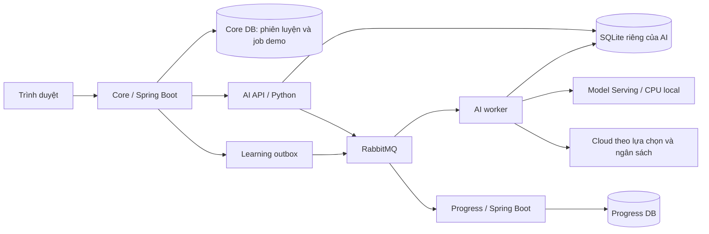

# Demo Qwen3.5-4B base và full07

Lane đánh giá riêng, dùng model hiện có; không huấn luyện lại hay thay đổi điều
kiện duyệt production. Đạt kiểm tra cấu trúc chưa chứng minh đầu ra đúng nghĩa.

Cập nhật 28/10: [R13](../../docs/model-demo-guided-r13.md) thêm glossary theo
mệnh đề/fact cho scene giao nhận, schema do server cấp và số từ trên UI. Đây
là thay đổi pipeline inference; chưa chạy generation CPU thật với bản mới.
Các kết quả CPU ở cuối tài liệu thuộc pipeline trước cập nhật này.



## Model và giới hạn

- Base `Qwen/Qwen3.5-4B`, revision `851bf6e806efd8d0a36b00ddf55e13ccb7b8cd0a`.
- Adapter full07 SHA-256: `1670910dcad7f1e8f66d1dd74e6297fe914c2067d0c26240b72b25fd36c922bf`.
- Server kiểm tra hash trọng số, cấu hình base/adapter và tokenizer. Runtime
  có sẵn: `data/fine-tuning/.venv-cpu`; phiên bản ghim trong `server.py`.
  Không tự tải model hay cài runtime.
- CPU FP32, greedy, tắt thinking; một lượt inference tại một thời điểm.
  Base dùng cùng trọng số với LoRA tắt (`baseMode=adapter-disabled`).
- Cần ít nhất **20 GiB RAM trống** trước khi nạp. Đây là điều kiện bảo vệ máy,
  chưa phải số đo RAM đỉnh hoặc cấu hình tối ưu đã nghiệm thu.
- Chỉ bind `127.0.0.1:8093`; dùng service token. Không public cổng này.
  Live không nạp model; ready trả 503 cho đến khi nạp xong.
- Base/full07 chạy lần lượt, cùng prompt/context. Mỗi nhánh sinh nội dung rồi
  dịch. Prompt được ghim bằng version/hash trong code.

## Khởi động local

Đối với runtime microservice đã tách credentials, dùng launcher riêng từ gốc repo:

```powershell
python scripts/run-service.py model --env-file data/microservices/model.env
python scripts/run-service.py ai --env-file data/microservices/ai.env
python scripts/run-service.py worker --env-file data/microservices/ai.env
python scripts/run-service.py core --env-file data/microservices/core.env
```

Build lại JAR Core sau khi đổi prompt pin; API/worker cùng dùng artifact mới.
Các file env trên là dữ liệu riêng bị Git bỏ qua; quy trình tạo và quyền truy cập
ở `docs/ai-provider-database.md`. Launcher dưới đây là luồng legacy dùng `.env`
chung, giữ cho rollback; không dùng để chứng minh cách ly credentials.

Chạy từ gốc repository bằng PowerShell 7. PostgreSQL, Redis và RabbitMQ cần
hoạt động theo cách khởi động hiện có. Progress có README riêng.

1. Cấu hình `.env` riêng (Git đã bỏ qua):
   - `DICTALAB_MODEL_DEMO_ENABLED=true` để Core hiện panel.
   - `DICTALAB_AI_MODEL_DEMO_ENABLED=true`, `DICTALAB_AI_JOBS_ENABLED=true`.
   - `DICTALAB_AI_CONVERSATION_ENABLED=false` nếu chỉ chạy lane demo này.
   - `DICTALAB_AI_SERVICE_TOKEN`: token ASCII ngẫu nhiên 32–256 ký tự, dùng
     chung cho Core, AI API và worker.
   - `DICTALAB_MODEL_SERVICE_TOKEN`: token ngẫu nhiên khác, 32–256 ký tự.
     Launcher dùng nó cho `DICTALAB_AI_MODEL_SERVING_TOKEN` nếu biến sau trống;
     nếu cấu hình cả hai, giá trị phải khớp.
   - `DICTALAB_AI_RABBITMQ_URL`: broker riêng; credentials mã hóa URL.
   - `DICTALAB_AI_JOBS_DATABASE`: cùng file SQLite bền vững cho API/worker.
     Launcher mặc định dùng `data/ai-jobs.sqlite3` ở gốc repository.
   - `DICTALAB_AI_JOB_RETENTION_SECONDS=86400`. Core lưu bản kết quả sau khi
     nhận; Core ngừng quá retention có thể bỏ lỡ kết quả.
   - `AI_BUDGET_ENABLED=true` để dùng kế toán quota/ngân sách hiện có ở Core.
2. Xác minh file mà chưa nạp trọng số:

   ```powershell
   ./scripts/run-model-demo.ps1 -Component Verify
   ```

3. Mở ba terminal. API/worker dùng Python đã cài dependencies trong
   `services/ai-generation/requirements.lock`; truyền interpreter qua `-Python`
   nếu cần. Giữ token trong môi trường hoặc `.env`, không truyền qua đối số.

   ```powershell
   ./scripts/run-model-demo.ps1 -Component Model
   ./scripts/run-model-demo.ps1 -Component Api
   ./scripts/run-model-demo.ps1 -Component Worker
   ```

4. Khởi động lại Core bằng launcher hiện có, đăng nhập và mở hội thoại.
   Panel **Thử model base và fine-tune full07** cho phép so sánh theo tình
   huống/mức bài, tạo câu tiếp theo sau khi hoàn thành câu hiện tại, xem trạng
   thái nền và mở lại 20 job gần đây. Kết quả ghi rõ provider/model thực tế.
   Áp dụng bài vẫn cần kiểm tra nghĩa; transcript/đáp án vẫn ẩn.

AI API/worker chạy native cùng máy với Model Serving. Container Docker không
truy cập được loopback host; cấu hình hiện tại không cho Model Serving từ xa.
Không đổi URL sang mạng public để khắc phục.

Kiểm tra nghĩa và tạo audio khi áp dụng vẫn dùng provider/quota hiện có của
Core, tách với ngân sách sinh bài demo. Với reviewer Ollama, phải đo bộ nhớ
khi cả reviewer và model 4B cùng hoạt động. Không tự dừng ứng dụng khác lấy RAM.

## Cloud và fallback

- `DICTALAB_AI_DEMO_DAILY_BUDGET_MICROUSD`,
  `DICTALAB_AI_DEMO_CALL_RESERVATION_MICROUSD`,
  `DICTALAB_AI_DEMO_DAILY_CLOUD_CALLS` mặc định 0: tắt sinh bài cloud demo.
- AI giữ trước ngân sách hai lượt gọi theo tổng hệ thống và scope người dùng
  trong SQLite. Đơn vị là phần triệu USD; reservation không phải hóa đơn.
  Cần chọn mức bảo thủ theo giới hạn token/giá provider trước khi bật gọi có phí.
- Người dùng phải chọn cloud hoặc bật fallback. Chỉ lỗi local xác định được
  hoặc đầu ra không đạt kiểm tra mới cho phép fallback; timeout chưa rõ kết
  quả và sai provenance không tự chuyển. Không gọi lại cloud đã giữ tiền.
- So sánh luôn tắt fallback. Kết quả lỗi vẫn lưu để đánh giá.
- CPU dùng chung worker hiện có và có thể trì hoãn job khác. Lane này dành cho
  demo một người; cần đo hàng đợi trước khi mở cho nhiều người.

## Kiểm tra và nghiệm thu

```powershell
python -X utf8 -m pytest -q services/ai-generation/tests services/model-serving/test_server.py
mvn --batch-mode --no-transfer-progress '-Dtest=ModelDemoIntegrationTest,ConversationIntegrationTest,AiUsageBudgetIntegrationTest' test
python -X utf8 tools/ai-eval/jobs_smoke.py
./scripts/test-run-local-env.ps1 -LauncherName run-model-demo.ps1
```

Smoke dựng và dọn broker dùng riêng nếu không có `AI_TEST_RABBITMQ_URL`.
Provider giả kiểm tra giao tiếp/phục hồi, không đánh giá chất lượng model.
Không trỏ phép thử vào broker production.

Ngày 28/10/2026: đã chạy inference thật qua server mới sau khi đóng ứng dụng
không liên quan theo yêu cầu chủ máy, với khoảng 20.38 GiB RAM trống ban đầu.
Base và full07 đều trả `Wednesday` cho cùng câu hỏi ngắn; latency lần lượt
62,953 ms (gồm cold load) và 4,953 ms (đã nạp). Đây chưa phải benchmark tốc độ.

Mẫu so sánh hội thoại A1 tại quán cà phê thất bại ở cả hai nhánh với
`INVALID_MODEL_SCHEMA`: thừa slot/fact và sai/thiếu trường. Bộ kiểm tra đã chặn
đầu ra; chưa chạy dịch hoặc duyệt nghĩa. Không dùng mẫu này để tuyên bố model
đạt chất lượng hội thoại. Toàn lượt kiểm tra mất 633.8 giây; RAM hệ thống trống
thấp nhất khoảng 3.96 GiB. Sampler RSS đo nhầm tiến trình launcher, nên chưa có
số đo RAM đỉnh hợp lệ. Chưa deploy VPS. Bằng chứng và phần còn lại được ghi tại
`docs/microservices-implementation.md`.
